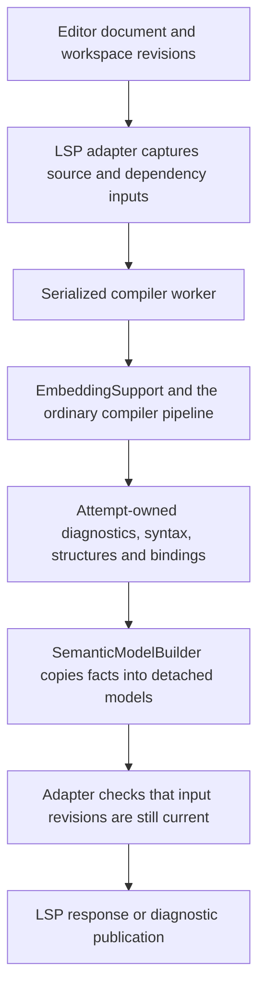

# Compiler support for the language server

The compiler-backed language server uses the Ecstasy compiler to answer questions about source
code: which declaration a name refers to, which overload a call selects, what types are visible
at a cursor, and whether an edit preserves those relationships. This document explains the
changes to `javatools` that make those answers available, why each change is needed, and where
the language server consumes it.

The central change is to make compilation an operation that a host can own and inspect. A host
supplies a consistent source snapshot, dependencies, a diagnostic destination and a cancellation
policy. The compiler returns the structures and facts that the operation actually established.
An unsuccessful compilation can expose useful syntax and partial progress without claiming that
it produced an executable module.

These mechanisms are general Java embedding APIs. `javatools` does not depend on LSP4J, LSP4IJ,
IntelliJ, VS Code, TextMate or tree-sitter. Protocol messages, document versions, scheduling,
editor presentation and refactoring edits remain in `lang/lsp-server`.

This guide describes the combined implementation, including supporting changes that can be
reviewed or merged independently. The [diagnostic design and migration guide](#diagnostics-cancellation-and-reporting-scopes)
below includes the error-listener rationale and API examples. Java source links are relative to
this directory and can be followed from a rendered Markdown document.

## Contents

- [Why the previous compiler interface was insufficient](#why-the-previous-compiler-interface-was-insufficient)
- [One editor request through the compiler](#one-editor-request-through-the-compiler)
- [Source snapshots and compilation outcomes](#source-snapshots-and-compilation-outcomes)
- [Diagnostics, cancellation and reporting scopes](#diagnostics-cancellation-and-reporting-scopes)
- [Why explicit probes and a final propagated listener](#why-explicit-probes-and-a-final-propagated-listener)
- [Preserving semantic facts from successful validation](#preserving-semantic-facts-from-successful-validation)
- [Declaration analysis and unfinished source](#declaration-analysis-and-unfinished-source)
- [AST traversal, copying and the partial-analysis package](#ast-traversal-copying-and-the-partial-analysis-package)
- [Constant pools, caches and dependency inputs](#constant-pools-caches-and-dependency-inputs)
- [Why ordinary AST and runtime files also changed](#why-ordinary-ast-and-runtime-files-also-changed)
- [Compatibility and limits](#compatibility-and-limits)
- [Tests and reproduction](#tests-and-reproduction)
- [Appendix: file-by-file compiler changes](#appendix-file-by-file-compiler-changes)

## Why the previous compiler interface was insufficient

A batch compiler can report errors, abandon its intermediate state and return failure. An editor
must continue helping while that failure is the normal state of the buffer. It must also avoid
publishing an answer from an older version after the user has typed something else.

| Previous limitation | Concrete editor failure | Compiler mechanism added or corrected |
| --- | --- | --- |
| A failed embedding compilation returned no module and lost access to its intermediate state. | An erroneous method body could leave the host with no way to inspect the declarations or source tree that had already been built. | `Compilation` retains available syntax, file structure, pool and validated binding facts independently of executable success. |
| Disk discovery and source reading were coupled to the CLI's module loading. | A saved module root and an unsaved member file could be analyzed as different revisions; virtual or newly created members were difficult to represent. | `ModuleInfo` exposes source-text and membership hooks while preserving normal package/resource assembly. |
| Listener substitution, null-to-discard conventions and implicit stop behavior obscured who owned diagnostics. | Reports could disappear during a probe or cached lookup; a host could be stopped by a budget it had not chosen. | Explicit reporting ownership, branches, suppression reasons, stateful collectors and abort queries. |
| Useful bindings were temporary validation decisions, or were rewritten away. | Name matching could select the wrong overload; constant folding could make a reference disappear from rename. | Attempt-owned call collectors, initializer provenance and source-binding accessors. |
| A valid parse and completed validation were prerequisites for many semantic queries. | Completion after a member-access dot or inside an unfinished argument could not use the real lexical scope. | Explicit cursor analysis, bounded recovery nodes and compiler-fitted candidate facts. |
| Compiler structures and working context were mutable and sometimes retained operation state. | Repeated editor requests could retain old listeners or accidentally inspect constants under the wrong working pool. | Scoped reporting/validation state, explicit pool scopes and detached adapter snapshots. |

Parsing command-line output cannot recover selected overloads, local-register identity or facts
discarded by a rewrite. A separate editor type checker would have to reproduce Ecstasy's access,
generic inference, composition and overload rules. Instead, the compiler exports decisions where
it already makes them, and partial queries reuse its existing validation and fitting operations.

## One editor request through the compiler



The ownership transition happens when **SemanticModelBuilder copies facts into detached models**.
An immutable collection of AST references is still a collection of compiler-owned objects. The host
must finish inspecting and copying them while it exclusively owns the attempt; it cannot hand the
AST or constant pool to arbitrary request threads.

The production path is visible in these files:

| Responsibility | Implementation |
| --- | --- |
| Capture module text, membership, URI aliases and resources; create fresh compilation inputs. | [XdkSources.kt](../lang/lsp-server/src/main/kotlin/org/xvm/lsp/adapter/xdk/XdkSources.kt) |
| Schedule and serialize work, cancel obsolete attempts, and gate publication against current inputs. | [XdkAdapter.kt](../lang/lsp-server/src/main/kotlin/org/xvm/lsp/adapter/xdk/XdkAdapter.kt) |
| Call and time the embedding APIs for ordinary, dependency and refactoring compilations. | [CompilerCalls.kt](../lang/lsp-server/src/main/kotlin/org/xvm/lsp/adapter/xdk/CompilerCalls.kt) |
| Drive parsing, linking, resolution, validation and emission, or stop at the requested analysis goal. | [EmbeddingSupport.java](src/main/java/org/xvm/api/EmbeddingSupport.java), [tool/Compiler.java](src/main/java/org/xvm/tool/Compiler.java), [compiler/Compiler.java](src/main/java/org/xvm/compiler/Compiler.java) |
| Convert compiler objects and source positions to independently owned semantic data. | [SemanticModelBuilder.kt](../lang/lsp-server/src/main/kotlin/org/xvm/lsp/adapter/xdk/SemanticModelBuilder.kt), [SemanticModel.kt](../lang/lsp-server/src/main/kotlin/org/xvm/lsp/adapter/xdk/SemanticModel.kt), [PartialSemanticModel.kt](../lang/lsp-server/src/main/kotlin/org/xvm/lsp/adapter/xdk/PartialSemanticModel.kt) |

The compiler does not know a document's LSP version or decide whether a response is stale. The
adapter supplies cancellation and rejects superseded results. Compiler cancellation checkpoints
make that policy effective during compilation rather than only after it finishes.

## Source snapshots and compilation outcomes

### Configure compiler libraries without starting an interpreter

`EmbeddingSupport.configure` accepts the core repository used by compilation. The `XDK_HOME`
fallback includes both `lib/` and `javatools/`: the compiler needs the bootstrap turtle module
(`mack.xtclang.org`) and native bridge (`_native.xtclang.org`), not just the ordinary libraries.
Missing a bootstrap module prevents compilation before the user's source can be analyzed.

The language server instead supplies its bundled compiler libraries through
[XdkLibraries.kt](../lang/lsp-server/src/main/kotlin/org/xvm/lsp/adapter/xdk/XdkLibraries.kt). Library
setup, compiler attempts and runtime/interpreter initialization are separate responsibilities;
loading the compiler's required modules does not mean executing the user's program.

### Reuse normal module assembly with host-provided inputs

[ModuleInfo.java](src/main/java/org/xvm/tool/ModuleInfo.java) still implements module discovery,
member/package assembly and resource association. Its host hooks let the adapter replace the
inputs to that machinery:

- `readSource(File)` supplies the captured characters for a source file.
- `sourceEntries(File)` supplies a directory's captured source membership, including added or
  removed members, instead of rediscovering membership during the attempt.
- The protected `(File sourceFile, String moduleName)` constructor establishes a source identity
  without requiring the source root to exist on disk. Subclasses provide the corresponding source
  tree and resource behavior.
- `getSourceTree(errors, parser)` allows a selected member to use cursor-aware parsing while the
  other members use ordinary parsing and the same assembly path.
- `getParsedSources()` exposes the available per-source trees, including syntax retained when an
  error prevents construction of a usable assembled root.

The LSP implementation overrides these hooks in `XdkSources`. Open buffers take precedence over
disk text. Source URIs, source membership and captured resource inputs belong to the same analysis
request. Refactoring proofs can replay captured inputs with proposed text or path changes without
first writing those changes to the user's files.

**Use a fresh `ModuleInfo` for each attempt.** It caches assembled compiler trees. The adapter
therefore retains immutable input values and creates a fresh `XdkSources` when replaying them,
rather than treating a previously parsed `ModuleInfo` as a reusable immutable snapshot.

### Return progress without calling failure success

The `compileModule(Source, ...)` and `compileModule(ModuleInfo, ...)` overloads return
`EmbeddingSupport.Compilation`. Its fields have deliberately different meanings:

| Result member | What the host can rely on |
| --- | --- |
| `module()` / `succeeded()` | An executable module was produced successfully. A failed attempt has no successful module. |
| `file()` / `pool()` | Registration got far enough to construct a file structure and its constant pool. Their existence alone does not establish successful validation. |
| `ast()` / `parsed()` | The assembled source root is available after loading/parsing succeeded. Semantic validation may still have failed. |
| `sourceTrees()` | Available per-source syntax, including recovered trees when parsing failed. Positions belong to each tree's own `Source`; recovered trees may not yet have parent links. |
| Binding maps | Facts established by the relevant successful validations and retained by the collector. Their presence does not turn the whole compilation into a successful one. |

`EmbeddingSupport` creates a fresh embedded compiler for the attempt and drives the normal tool
compiler pipeline. It retains state as each phase reaches it, instead of converting every failure
into a single null. Expected compiler aborts remain distinct from unexpected exceptions and
assertions, which are reported as internal failures even if an earlier source diagnostic exists.

The existing convenience APIs in [ModuleCompiler.java](src/main/java/org/xvm/api/ModuleCompiler.java)
and `EmbeddingSupport` keep their module/null or boolean result shapes. Hosts that need intermediate
state use `compileModule` explicitly.

For example, with `embedding` already configured and `dependencies` supplied by the host:

```java
var reports = new ErrorList();
var obsolete = new AtomicBoolean();
var errors = ErrorListener.cancellable(reports, obsolete::get);
var result = embedding.compileModule(new Source(text, documentName), dependencies, errors);

if (result.succeeded()) {
    ModuleStructure module = result.module();
    // The executable result is available.
}
if (result.pool() != null) {
    try (var scope = ConstantPool.withPool(result.pool())) {
        // Inspect available compiler facts and copy the values needed by the host.
        // This is still the compiler worker, not an arbitrary LSP request thread.
    }
}
// The host still checks its input revision before publishing reports or copied facts.
```

The host can set `obsolete` from its request lifecycle. Cancellation need not produce a source
error, so the absence of diagnostics is not a substitute for checking whether an attempt is current.

## Diagnostics, cancellation and reporting scopes

### Why the old reporting model had to change

The old error-listener API did not provide a reliable contract for embedding the compiler.
Accepting a listener at the entry point was not enough: deeper calls could substitute `BLACKHOLE`,
accept null as an implicit request to discard reports, or find a different listener through a
shared structure. The caller could receive only part of an attempt's diagnostics without knowing
anything had been lost. Suppression, ownership and stopping policy were spread across unrelated
call sites, so adding a callback at the outer API could not repair what happened underneath it.

This caused observable failures. The default branch for a host listener imposed a one-error
budget the host had never requested: the lexer stopped at the first recoverable error and never
reported the next one. A previously created branch could also ignore its parent's later abort
request. Two regression tests reproduce those failures on the old compiler with exactly the same
test source that passes on the repaired implementation.

Reporting also had inconsistent control-flow effects. `log` returned an abort decision, but the
fallback `RuntimeErrorListener` instead threw an exception for ERROR and FATAL. Selecting a
diagnostic destination could therefore change how the operation failed. An editor must be able to
collect an ordinary source error as data, distinguish it from an internal compiler failure, and
let the compiler stop at an appropriate checkpoint. The destination receiving a report should not
introduce a different failure path merely because that report has a particular severity.

### Changes and enhancements

* **Separate reporting from stopping.** `log(ErrorInfo)` delivers a diagnostic;
  `isAbortDesired()` answers whether work should stop. The lexer and parser retain explicit stop
  checkpoints, and forwarding listeners preserve the owner's policy.
* **Make host callbacks usable by the compiler.** `collecting` forwards structured diagnostics
  while remembering severity and error codes. A bare callback receives reports but does not
  implement those state queries automatically.
* **Make branching consistent.** A host's default branch buffers without an arbitrary one-error
  limit. `ErrorList` branches retain their configured budget, and both observe their parent's
  current abort request.
* **Make suppression explicit.** Named reasons distinguish probes, cascade suppression and
  intentional discards. A derived silence discards messages while retaining the owner's stop
  policy.
* **Require a reporting destination at active compilation boundaries.** An omitted listener is
  rejected before compilation starts; intentional silence is supplied as an explicit listener.
* **Keep ownership stable.** Constructor-owned listeners remain attached to their operation.
  Temporary suppression derives a local listener instead of overwriting the original destination.
* **Preserve diagnostic structure.** `Site` describes source spans, structures or unpositioned
  reports. Severity helpers take message arguments as trailing varargs; `tee` forwards reports to
  two destinations while combining their state.

### Removed behavior and its replacement

* **The boolean return from `log`** is replaced by a reporting call followed by an explicit policy
  query where the caller needs to stop. There is one continuation query for wrappers to preserve.
* **`BLACKHOLE` and `BlackholeErrorListener`** are replaced by named suppression factories.
  Removing the old symbols makes unmigrated call sites fail to compile, requiring each caller to
  identify its reason for silence and whether a parent's abort policy must survive.
* **Null-to-discard fallback at compilation boundaries** is replaced by a required listener.
  Passing `silent(DISCARD)` still supports a caller that deliberately wants no reports; accidentally
  omitting the destination no longer looks like a successful choice of silence.
* **The silent default in `ResolutionCollector.getErrorListener()`** is removed. Implementations
  must provide their destination, and `SimpleCollector` retains the listener it was given.
* **Reassigning a TypeInfo build's listener to `BLACKHOLE`** is replaced by local cascade
  suppression. The original listener continues to identify the operation and its stop policy.
* **Severity-triggered exceptions in the fallback runtime listener** are replaced by recorded
  abort state. The compiler or runtime caller decides how to end its operation. This does not
  remove the command-line launcher's deliberate fatal-error and exit handling.
* **The listener parameter on `Expression.testFitAsType`** is removed because that operation is
  a probe. Its staging and fit checks use explicit probe silence; selected validation can still
  retain and merge its diagnostics.

The legacy positional reporting overloads remain available after recompilation, but are
deprecated in favor of `Site` and trailing arguments. Their source re-anchoring behavior is tested.

### Why explicit probes and a final propagated listener

A probe asks a question whose answer can legitimately be “no.” For example, overload resolution
can test whether a written argument fits an `Int` parameter, reject that candidate and then
select a `String` overload. Reporting the rejected fit as a source error would diagnose a valid
program. Completion performs similar trials on proposed arguments. Silent probing is therefore
necessary; the redesign makes its policy explicit instead of removing it.

The old representations combined several different decisions:

| Previous pattern | What a reviewer or embedding host could not determine reliably | Explicit replacement |
| --- | --- | --- |
| Pass `null` and let a deeper helper choose a sink. | Was silence deliberate, was the caller missing a listener, and which helpers would discard, substitute or dereference it? | Require a listener at the active boundary; pass an explicit silence when that is the intended policy. |
| Pass `BLACKHOLE` for every kind of suppression. | Was this an alternative fit, a cascade after an existing error, or a deliberately unused destination? Should the current attempt's abort request still apply? | Name the suppression reason and choose standalone silence versus a wrapper derived from the current owner. |
| Reassign the operation's listener to a discard sink. | Which later validations or callbacks still reach the original owner, and can they still see cancellation or its error budget? | Keep the owner stable and derive a local listener for only the affected calls. |
| Store a listener on a shared structure and find it implicitly. | Which request owns a later cached lookup, particularly after the structure outlives the request? | Pass the current attempt's listener through compiler operations; retain diagnostics as replayable data rather than retaining their previous destination. |

The operation-owned references in `Compiler`, `StageMgr`, `Launcher` and resolution collectors
are final where their lifetime has one owner. This prevents accidental reassignment to a sink or
another request's destination. The compiler passes that owner, or a deliberately derived child,
through the calls that perform the work. It is one **logical reporting owner**, not a requirement
that every nested operation receive the exact same listener object.

A branch, tee, cancellation wrapper or derived silence can legitimately be a different object.
What matters is preserving the required relationship to the owner. Diagnostic retention and
error counters can change while the reference remains final. Final references do not make the
listener, parser or compiler thread-safe, nor do they make an AST immutable.

In particular, suppressing a message and suppressing a stop request are different decisions:

| Operation | Appropriate listener | Reports and stopping |
| --- | --- | --- |
| Validate the selected source construct. | The operation's listener. | Real diagnostics reach their owner; its state and stop policy remain available. |
| Ask an alternative-fit question within an active attempt. | `errors.silence(PROBE)`. | Trial messages are discarded, but the current parent abort/cancellation request remains visible. |
| Perform a deliberately independent silent query with no parent policy. | `silent(PROBE)`. | No reports, retained errors or abort request; this is the standalone behavior formerly supplied by a blackhole. |
| Try work whose diagnostics may be needed if it is accepted. | `errors.branch(node)`. | Reports are buffered; merge accepted reports once. The branch also observes parent abort and its own configured policy. |
| Suppress follow-on errors from already incomplete information. | `errors.silence(CASCADE)`. | Avoids flooding the owner with consequences while retaining its stop request. |

This distinction is why replacing every old `BLACKHOLE` with the real reporting listener would
also be wrong: rejected alternatives would become user errors. Conversely, replacing everything
with standalone `silent(PROBE)` would not preserve host cancellation. Existing standalone probe
sites remain standalone where that is their deliberate contract; they do not acquire cancellation
propagation merely because the factory has a clearer name. Work that must observe the active
attempt's policy needs a derived listener and a checkpoint that queries it.

For instance, related trials within one operation can share a derived probe:

```java
final ErrorListener probe = errors.silence(ErrorListener.Silence.PROBE);
var firstFit = first.testFit(context, candidateType, false, probe);
var secondFit = second.testFit(context, candidateType, false, probe);
// The fit results answer the trial questions; selected validation still receives errors.
```

The wrapper reads the parent's current abort state; it does not snapshot that state when created.
Creating it before two branches therefore does not lose a later cancellation request. It must
still belong to that operation, not be cached globally or reused for a different compilation.
The standalone `silent(PROBE)` factory already returns a shared stateless sink, so repeated calls
do not allocate a fresh listener. A local variable is useful when it makes a group of trials
clearer, not as a required allocation optimization. Buffers and branches are different: they
retain diagnostics and must not be shared between unrelated trials just to shorten the code.

`PROBE`, `CASCADE` and `DISCARD` are explanatory reasons, not levels or compiler modes. Changing
the enum value does not change how messages are discarded. The substantive improvement is explicit
ownership, appropriate retention and stop propagation. Keeping a deprecated `BLACKHOLE` alias was
technically possible; removing it forces old call sites to be reviewed instead of silently keeping
an unexplained policy. A caller that deliberately wants the old independent discard behavior can
still choose it explicitly.

Non-null active listeners also eliminate two meanings for the same value: an intentionally silent
operation and an accidentally omitted destination. Boundary checks reject the latter early;
annotations describe that contract to Java/Kotlin callers and IDEs. This does not forbid meaningful
absence elsewhere, such as an inactive resolver having no current reporting scope.

Some temporary destination changes remain necessary for parser speculation and parameterless
resolution callbacks. They are enclosed in `Reporting.Scope`, with restoration on nested, normal
and exceptional exits, rather than arbitrary reassignment of the operation's owner. The scoped
mechanism below is the deliberate exception to permanent ownership, not a return to ambient
listener swapping.

### Why this is a prerequisite for the compiler-backed LSP

**Reliable diagnostic ownership and abort propagation are required for the compiler-backed LSP.**
The adapter must associate reports with the requested compilation, reject unusable semantic
results, and stop obsolete work at compiler checkpoints. It cannot reconstruct diagnostics that
the compiler discarded or obtain errors from work that an unintended one-error budget prevented.
Leaving those failures in place blocks a reliable compiler-backed adapter, regardless of how much
code is added around the public entry point. These changes establish the reporting foundation;
the result, source-snapshot and cached-diagnostic APIs described in this guide complete the host-facing path.
The exact helper names and the decision to remove a legacy alias are API design choices. The
delivery, state and stopping guarantees they implement are the essential requirements.

### Compatibility with ordinary compilation

Normal command-line compilation continues to use the existing compiler pipeline, console and
exit policy. Users do not need new flags or changes to their Ecstasy source. The CLI supplies an
explicit discard listener only for its external delegate; its console still reports diagnostics.
`ErrorList` retains its configured serious-error budget, fatal reports still request an abort,
and the lexer/parser still stop when the applicable policy requires it. The changes repair
diagnostic delivery and listener ownership without introducing an IDE dependency into the compiler.

There is strong regression evidence for that continuity: the full Java suite for this listener
migration executed 418 tests successfully, and all 24 rebuilt XDK modules matched a freshly built
master baseline after normalizing only module creation timestamps. The [focused checks](#historical-listener-regression-evidence) add
direct coverage of reporting, aborts, boundary validation and launcher behavior. These historical results
support confidence in ordinary compilation; they are evidence for the tested paths, not an
exhaustive guarantee for every source program or external integration.

**The Java embedding API deliberately changes at the planned 0.5.0 boundary.** Existing Java
callers and listener implementations must migrate and recompile. Changed return types, removed
symbols, rejected nulls and the runtime listener's new exception behavior prevent a claim of
100% source or binary compatibility, even for a non-LSP Java consumer. The migration steps below
identify those changes explicitly so ordinary consumers can preserve their intended behavior.

### Code tour and practical usage

#### 1. Give each compilation its own diagnostic owner

Start at [ModuleCompiler](src/main/java/org/xvm/api/ModuleCompiler.java) or
[EmbeddingSupport](src/main/java/org/xvm/api/EmbeddingSupport.java). Supply the attempt's listener
at the entry point and keep it available until the result and diagnostics have been consumed.
For example, with a configured core repository and source text:

```java
final var errors = new ErrorList(100);
var compiler = new ModuleCompiler(coreRepository);
var module = compiler.compile(sourceText, null, errors);
var diagnostics = List.copyOf(errors.getErrors());

if (module == null || errors.hasSeriousErrors()) {
    // Publish the diagnostics and do not treat this as a successful compilation.
    return;
}
// The caller can now use the successfully compiled module.
```

The null argument here is the optional dependency repository, not the listener. The required
listener also reaches launcher construction and dispatch, the compiler, lexer/parser,
[StageMgr](src/main/java/org/xvm/compiler/ast/StageMgr.java), anonymous-class construction and
[Component.SimpleCollector](src/main/java/org/xvm/asm/Component.java).
[ResolutionCollector](src/main/java/org/xvm/asm/ComponentResolver.java) implementations must
return their selected destination. AST reporting and validation helpers no longer silently
accept a missing listener.

Use a fresh collector for an independent attempt. An `ErrorList` is mutable; even `clear()` keeps
its previously seen diagnostic UIDs. A new operation should not inherit that deduplication history.
Hosts must serialize compiler access and listener callbacks. Final references and non-null
parameters do not make compiler objects or their accumulated state thread-safe.

#### 2. Report data, then make the control-flow decision

[ErrorListener](src/main/java/org/xvm/asm/ErrorListener.java) remains the central interface.
Its nested `ErrorInfo` carries severity, code, message arguments and location. `Site.In`, `Site.At`
and `Site.None` describe the location independently of the message:

```java
errors.error(code, ErrorListener.in(source, start, end), arguments);
if (errors.isAbortDesired()) {
    return;
}
```

Use `in(source, start, end)` for source text, `at(structure)` for an assembled structure, and
`NOWHERE` for a report without either location. Source positions are the encoded values returned
by `Source.getPosition()`, not raw byte offsets or LSP positions. The `error`, `warn`, `info` and
`fatal` helpers select severity and delegate to `log`; they do not transfer control themselves.

`isAbortDesired()` and `hasSeriousErrors()` answer different questions. An operation can have
errors while remaining within its budget, and a host may request a stop without reporting an
error. Callers use the first query at stop checkpoints and the second when deciding whether a
result is usable. `hasError(code)` checks whether a particular diagnostic was recorded.

`RuntimeErrorListener` now prints diagnostics and records an abort request for ERROR/FATAL
instead of deliberately throwing from `log`. Its abort flag remains set for that instance's
lifetime; the shared `RUNTIME` sink is not a fresh per-attempt collector. A reporting callback
can still throw its own exception, which forwarding helpers propagate. The redesign removes the
fallback sink's severity-driven exception policy, not Java exception handling in general.

#### 3. Choose retention, callback delivery or both

[ErrorList](src/main/java/org/xvm/asm/ErrorList.java) retains the first report for each diagnostic
UID in insertion order. ERROR/FATAL reports spend its count budget; warnings do not. Its
no-argument constructor uses the shared `ErrorListener.DEFAULT_MAX_ERRORS` (512), `FIRST_ERROR`
selects one, and `UNLIMITED` disables the count limit. A retained FATAL requests an abort with
any budget. Pass an explicit limit to `ErrorList(int)` when an operation needs a different policy.

When a host wants every report delivered to a callback, use:

```java
ErrorListener errors = ErrorListener.collecting(hostDiagnostics::add);
```

`collecting` forwards every report, including duplicates, and tracks severity and codes before
calling the consumer. It has no count budget and requests an abort on FATAL. A bare lambda
implements only `log` and inherits state queries that return false, so it is not a substitute
when the compiler relies on those queries.

`tee(first, second)` delivers to both destinations in order and observes either destination's
abort, serious-error and code state. This supports reporting to a host while recording diagnostics
for later replay. `ErrorList.logTo(destination)` replays retained reports without clearing them;
deduplication belongs to the destination. If the first destination throws, the second is not called.

#### 4. Buffer speculative diagnostics until a result is accepted

`branch(node)` creates an `ErrorList.BranchedErrorListener`. Pass it to speculative work and merge
it once if that work's diagnostics should be retained:

```java
var trial = errors.branch(node);
// Run the candidate validation with trial as its listener.
if (keepDiagnostics) {
    trial.merge();
}
```

Unmerged diagnostics remain local to the branch. A default host branch has an unlimited count
budget, while an `ErrorList` branch copies its parent's configured limit. Both observe the
parent's current abort request, and a local FATAL still stops the branch. A node-associated
branch re-anchors structure reports to that node's source span; explicit source spans remain intact.

Merging an unbranched listener returns that listener. Merging a branch forwards its reports and
returns the parent without clearing the buffer. Do not repeatedly merge an accepted branch:
an `ErrorList` parent can deduplicate replay, but an arbitrary callback need not.

#### 5. Suppress reports without losing the operation's owner

`Silence` and `SilentErrorListener`, nested in `ErrorListener`, make suppression explicit.
`PROBE`, `CASCADE` and `DISCARD` are **reasons, not severity levels**. They have identical discard
behavior; compiler algorithms must not depend on which name is selected.

| Reason | Use it when |
|---|---|
| `PROBE` | Testing an alternative, such as whether an expression fits a candidate type. Failure is the answer to that query, not necessarily a problem in the selected program. |
| `CASCADE` | Examining already incomplete information whose follow-on errors would obscure the original failure. |
| `DISCARD` | Deliberately ignoring this destination, such as the CLI's external delegate when its console already reports diagnostics. |

The important behavioral distinction is between a standalone sink and a derived silence:

```java
// No parent listener or stop policy: an independent, deliberately silent probe.
ErrorListener independent = ErrorListener.silent(ErrorListener.Silence.PROBE);

// Suppress follow-on reports but continue to honor this operation's abort request.
ErrorListener quiet = errors.silence(ErrorListener.Silence.CASCADE);
```

`independent` never requests an abort. `quiet.isAbortDesired()` observes `errors`, even when
no diagnostic caused that stop request. Neither retains discarded messages; use a branch when
diagnostics might later be needed. `suppressed()` exposes a derived silence's parent, not a buffer
of hidden diagnostics. Re-silencing an existing silence returns the same instance and reason.

For a separately constructed standalone sink, `new SilentErrorListener(reason)` needs no
explicit null parent. The two-argument constructor retains an optional parent for callers that
need its stop policy. Required factory arguments and results use `@NotNull`; intentional absence
uses `@Nullable`, including `suppressed()` on a standalone sink. Public construction boundaries
still reject invalid null arguments immediately; annotations also expose the contract to IDEs
and Kotlin callers.

The names make intent searchable and reviewable. `BLACKHOLE` did not distinguish those purposes,
and substituting it for an active listener also removed access to that listener's stop policy.
Removing the old constant and class makes missed migrations visible to the Java compiler. A
deprecated alias was possible, but would allow unexplained suppression to survive the migration.
Callers that want exactly the old standalone discard behavior can use `silent(DISCARD)`.

Stable ownership is equally important. In
[TypeConstant](src/main/java/org/xvm/asm/constants/TypeConstant.java), `cascade(incomplete, errors)`
derives suppression at affected calls instead of assigning a sink to the `errors` parameter.
The original destination remains available throughout the build. Constructor-owned references,
such as those in `StageMgr`, `SimpleCollector` and `Launcher`, are final so they cannot drift to
another destination during the operation. Their listeners' counters can still change.

Non-null means that an active reporting boundary has an explicit owner or an explicit discard
policy. It does not mean that every listener field everywhere must be permanently non-null or
final: nested parser/resolver work needs temporary destinations and scoped restoration. That
ownership work is described separately below.

#### 6. Migrate Java callers and implementations

The planned release boundary is **0.5.0**. Recompile Java clients and listener implementations
after applying these changes; Java cannot retain compatibility overloads that differ only by
the return type of `log`.

| Previous use | Replacement and consequence |
|---|---|
| `if (errors.log(...))` | Report first, then query `errors.isAbortDesired()` and perform the same return/throw at that checkpoint. Update custom implementations to `void log(ErrorInfo)`. |
| `BLACKHOLE` or `BlackholeErrorListener` | Choose a named standalone silence or derive one from the current owner when its abort policy must survive. |
| Null at a compilation/launcher boundary | Pass the operation's listener or explicit `silent(DISCARD)`. Missing listeners now fail at the boundary. |
| A `ResolutionCollector` relying on the default sink | Implement `getErrorListener()` and retain the intended destination. |
| `testFitAsType(..., errors)` | Remove the listener argument; the operation owns its probe policy. |
| Depending on `RUNTIME.log` to throw on severity | Check `isAbortDesired()` and explicitly choose the operation's failure handling. |
| Legacy positional reporting overloads | They remain callable after recompilation but are deprecated; migrate to `Site` and trailing message arguments. |

### Give temporary reporting state a bounded lifetime

`Parser.attempt()` replaces `Parser.SafeLookAhead`: use `Attempt.keep()` in place of
`keepResults()`. A kept attempt merges its buffered diagnostics, including warnings; a discarded
attempt restores its tokens and recovery state. Nested attempts observe their parent's abort
request. This removes a public nested parser class and requires source migration/recompilation at
the same breaking release boundary described above.

Parser and resolver destinations use `Reporting` scopes, closed in reverse order with
try-with-resources. `NameResolver.getErrorListener()` is null outside `resolve`; callbacks borrow
the caller's non-null listener only during that call. These scopes restore destinations on every
exit. They do not make a parser, resolver, AST or listener safe for concurrent use. Lexical
reports also follow the active attempt, preserving lexical rollback from the parser correction.
Module-name-only scans can supply an explicit discard listener when reports are unwanted.

Loop and try/finally label variables retain their context/listener as one immutable
`ValidationScope` value. Each statement restores its previous value on normal, early and
exceptional exits, and `Statement.validate` likewise restores its common validation context.
The temporary references stay on the AST because label-variable and jump callbacks need the
currently validating statement. No shared mutable holder is added to cloned AST nodes.
`EvalCompiler` and `ModuleInfo.Node` own final diagnostic buffers from construction onward.

The unit regressions cover nested reporting, failed host/resolver callbacks, token rollback,
abort propagation and exceptional statement exits without requiring installed modules. Compile
and run the existing `manualTests/src/main/x/loop.x` and `exceptions.x` exercises with the built
XDK to check lazy label variables and try/finally behavior through code generation and execution.
The separate Gradle compiler-consumer test supplies its compiled modules through dependencies.

### Replay diagnostics from cached type information

Structures no longer discover the current listener through a mutable listener attached to a file
or constant pool. Explicit inspection supplies it, for example through
`TypeConstant.ensureTypeInfo(errors)` and `XvmStructure.log(errors, ...)`.

[TypeConstant.java](src/main/java/org/xvm/asm/constants/TypeConstant.java) retains diagnostics from
a successful TypeInfo build and replays them on later explicit lookups. This fixes the case where
a silent probe populated a cache before the selected source use: the real consumer must still
receive the warning. An `ErrorList` deduplicates repeated reports; a raw callback can observe each
replay. Invalidation replaces the cached facts and their retained reports.

The no-argument TypeInfo lookup remains an explicitly silent metadata query. Diagnostic-sensitive
code must choose the listener-taking operation. Some inspections build TypeInfo and can report new
diagnostics; they are compiler work, not harmless getters safe to invoke on any thread.

### Cancel obsolete work without manufacturing errors

`ErrorListener.cancellable` decorates the operation listener, preserving reporting, state,
branching and merging while polling the host predicate at abort checkpoints. A valid token stream
also polls; cancellation cannot depend on finding a source error. Module-member loading and phase
boundaries retain the same policy. This is cooperative cancellation, not arbitrary interruption:
the host must keep its predicate true once an attempt becomes obsolete. Other attempts have
separate policies, and the adapter still checks input revisions before publishing their results.

## Preserving semantic facts from successful validation

### Names, declarations and source identity

The source AST carries locations that assembled components alone cannot provide. Tooling accessors
expose written declaration-name tokens, documentation, local registers, resolved name targets,
import aliases and qualified-name components. Relevant changes are in:

- [NameExpression](src/main/java/org/xvm/compiler/ast/NameExpression.java) and
  [NamedTypeExpression](src/main/java/org/xvm/compiler/ast/NamedTypeExpression.java): resolved
  targets and per-token type-name bindings.
- [ImportStatement](src/main/java/org/xvm/compiler/ast/ImportStatement.java): written alias and
  qualified-name tokens, plus the imported identity.
- [Parameter](src/main/java/org/xvm/compiler/ast/Parameter.java),
  [VariableDeclarationStatement](src/main/java/org/xvm/compiler/ast/VariableDeclarationStatement.java),
  [MethodDeclarationStatement](src/main/java/org/xvm/compiler/ast/MethodDeclarationStatement.java),
  [PropertyDeclarationStatement](src/main/java/org/xvm/compiler/ast/PropertyDeclarationStatement.java)
  and [TypeCompositionStatement](src/main/java/org/xvm/compiler/ast/TypeCompositionStatement.java):
  written names and the compiler identities associated with declarations.

The adapter can consequently distinguish two same-spelled names in different scopes, a reference
to an import alias from a reference to its target, and a written declaration from a generated one.
These identities support navigation, references, rename and theme-based semantic highlighting.
They do not define colors in the compiler or introduce a public graphics/color library.

### Capture selected calls before rewrites obscure them

[InvocationBinding.java](src/main/java/org/xvm/compiler/InvocationBinding.java) records a selected
method identity, its instantiated signature and the association between written argument spans
and visible parameter indices. Named-argument labels retain their written ranges. Synthetic
default arguments are not presented as arguments the user wrote. If a rewrite prevents a reliable
association, the collector omits that tooling fact rather than guessing or changing compilation.

Method calls, function-valued calls and constructor calls remain distinct. A function-valued
invocation can have a validated signature without having a statically selected runtime method;
`FunctionCall` records the former without inventing the latter. Constructors are keyed by their
`NewExpression` nodes and carry the same kind of argument provenance.

The collector belongs to the compilation attempt. It is passed through
[Compiler](src/main/java/org/xvm/compiler/Compiler.java),
[StageMgr](src/main/java/org/xvm/compiler/ast/StageMgr.java), method/root contexts, deferred bodies
and nested compilation. [InvocationExpression](src/main/java/org/xvm/compiler/ast/InvocationExpression.java)
and [NewExpression](src/main/java/org/xvm/compiler/ast/NewExpression.java) record facts when real
validation succeeds. Retried validation invalidates earlier entries. Publication retains only
eligible nodes surviving in the final tree, excluding discarded speculative clones, and clears
the collector's scratch state.

Maps use AST identity, not structural equality. Their collection wrappers are immutable, but the
AST nodes and constants remain owned by the compiler worker. Ordinary compiler constructors use
`Collector.NONE`; normal compilation does not need to retain optional tooling call maps.

This gives signature help and parameter hints the compiler's actual argument mapping. It also
lets rename and call hierarchy distinguish overloads, instead of treating all calls with the same
spelling as references to one declaration.

### Keep references that constant folding would discard

Successful constant-initializer compilation can discard the temporary method used to validate an
initializer. [InitializerBinding.java](src/main/java/org/xvm/compiler/InitializerBinding.java)
captures source references, expression types and selected calls before that method disappears,
and anchors them to the surviving source property.

For example, if an initializer refers to another constant, replacing the initializer with its
computed value must not erase the original occurrence from references or rename. The retained
record stores source spans and compiler constants, not the temporary clone nodes, contexts,
registers or mutable tokens. The adapter then copies the needed identities into its detached model.

### Relate generated implementation details to written source

[LambdaBindings.java](src/main/java/org/xvm/compiler/ast/LambdaBindings.java) distinguishes written
lambda parameters from synthetic capture parameters and maps capture registers back to their
source registers. [AnonymousClassBindings.java](src/main/java/org/xvm/compiler/ast/AnonymousClassBindings.java)
provides the corresponding origin information for anonymous-class captures. A captured local
must still rename as the same source variable even when generated methods or properties access it.

For implementation and super navigation,
[MethodInfo.getSuperMethod](src/main/java/org/xvm/asm/constants/MethodInfo.java) exposes a written
super-dispatch target when one exists, without generating forwarding code.
[MethodBody.getIntoMethodInfo](src/main/java/org/xvm/asm/constants/MethodBody.java) exposes an
existing mixin constraint chain. Field, native and synthetic implementation details are not
misrepresented as source methods. The adapter's
[CompilerMethodRelations.kt](../lang/lsp-server/src/main/kotlin/org/xvm/lsp/adapter/xdk/CompilerMethodRelations.kt)
and [CompilerPropertyRelations.kt](../lang/lsp-server/src/main/kotlin/org/xvm/lsp/adapter/xdk/CompilerPropertyRelations.kt)
turn that metadata into navigation facts.

## Declaration analysis and unfinished source

These are separate operations with narrower guarantees than successful compilation:

| Operation | Work performed | Result guarantee |
| --- | --- | --- |
| `compileModule` | Ordinary parse, registration, linking/resolution, validation and emission. | Successful module only when compilation succeeds; available partial progress otherwise. |
| `analyzeDeclarations` | Ordinary parsing and declaration resolution, stopping before body validation/emission. | `Optional<DeclarationAnalysis>` containing a resolved declaration graph; no executable artifact. Syntax, linkage, declaration failure or cancellation prevents a successful result. |
| `analyzeIncomplete` | Explicitly selected partial parsing plus ordinary compiler inspection of supported intact syntax. | `PartialAnalysis` with available syntax and proved cursor facts; never a promise of an executable module or a selected incomplete call. |

### Recover syntax without validating damaged code as if it were complete

[Parser.java](src/main/java/org/xvm/compiler/Parser.java) can retain useful syntax after errors by
recovering at statement/declaration boundaries. The host still sees those errors. An ordinary
`compileModule` attempt does not proceed to semantic compilation merely because a recovered tree
exists. This preserves structural information for diagnostics and outlines without making an
invalid program valid.

Cursor-aware parsing is enabled explicitly with `Parser.forPartialAnalysis`, through
`EmbeddingSupport.analyzeIncomplete`. It retains the original source text and positions, including
declarations after the cursor. It does not truncate the document and rebase later locations, nor
does it replace every syntax error with invented valid code.

The overload without an explicit cursor is deliberately narrow: a trailing incomplete expression
statement at EOF. The explicit-cursor overloads support a broader set of editing contexts, including
one selected member file in a module snapshot. They must receive a position produced by
`Source.getPosition()` for the exact source being analyzed.

### Retain a bounded incomplete site and inspect its real context

The explicit-cursor path supports the following groups; the
[API Javadoc](src/main/java/org/xvm/api/EmbeddingSupport.java) defines the detailed boundaries:

| Editing context | Retained information |
| --- | --- |
| A member-access suffix, bare-name prefix or empty statement boundary. | Written prefix, receiver where available, visible variables/types and enclosing-instance access. |
| An unfinished call, including named and nested arguments. | Written argument positions and labels, candidate signatures, argument mappings and candidate value insertions. Assignment, initializer, return and compound-expression contexts remain attached to their real enclosing syntax. |
| Construction, including inner/virtual/annotated types. | Ordinary type preparation and constructor fitting, including available generic inference. Anonymous construction prepares the declaration and fits constructors without emitting forwarding constructors or running capture analysis. |
| A single-dimensional array size slot. | Fitting against the fixed-size constructor's size parameter. A following supplier is parsed for recovery but is not proved by this prefix analysis; multidimensional construction is unsupported. |
| Missing delimiters or a terminator around a supported site. | Bounded missing parentheses, brackets, angle/group closers and, at an EOF cursor, block braces. No invented operand, declaration name/type or literal contents. |
| Unfinished member/return/parameter types and declaration headers. | Visible types, qualified-name components and written formals with their shadowing constraints. Unfinished methods/properties do not register completed declarations or invented parameters. A root module header registers only its written namespace/core import. |

The embedding implementation requires one selected innermost incomplete site and rejects semantic
analysis if other serious syntax errors remain outside its recognized boundary. Recognized boundary
diagnostics still reach the host. Repeated delivery of the same boundary report is deduplicated;
other errors and unexpected failures remain visible.

The incomplete node inspects intact children in the actual compiler context and prevents the
incomplete operation from becoming an emitted method. A non-null pool only means semantic work
started. Child types are usable only when the child validated successfully with a fitting result;
placeholder types left by failed validation are not semantic proof.

### Export scope and candidate facts while the context exists

[CursorBinding.java](src/main/java/org/xvm/compiler/CursorBinding.java) captures narrowed local
types and readability, the enclosing receiver, visible type names, method/function candidates,
written argument mappings and compiler-fitted insertion proposals. Written formals can hide outer
names without being assigned fictitious completed declaration identities.

`callsInspected` distinguishes **no fitting candidates** from **the call was not inspected**.
That prevents an empty list from being interpreted as evidence that no overload is legal when
fitting never ran. A candidate whose written arguments fit is still a candidate: missing arguments
cannot establish that the complete operation will validate or select that method.

Candidate fitting uses ordinary compiler operations on disposable syntax. Variable/property reads,
literals, enclosing-instance expressions and supported source templates are checked in context;
they are not accepted solely by comparing type names in the LSP server. The adapter consumes the
copied results through [XdkCursorQueries.kt](../lang/lsp-server/src/main/kotlin/org/xvm/lsp/adapter/xdk/XdkCursorQueries.kt)
and its completion/signature-help code.

## AST traversal, copying and the partial-analysis package

### Give a source-tree copy a precise contract

[AstNode.copyTree](src/main/java/org/xvm/compiler/ast/AstNode.java) names the operation that the
older `clone()` API left implicit. It preserves the concrete node type, source positions and
compilation stage, recursively copies registered syntax children, and parents copied children
to their copied owners. Copying does not reparent the original tree. The copy's root initially
retains its original parent until the caller adopts it elsewhere.

This is **not a fresh parse or a deep copy of the compiler**. The default implementation still
starts with shallow cloning and reflectively copies registered child fields. Non-child bindings
and transient fields can remain shared unless an override handles them. A validated clone must
not be treated as an independent unvalidated program.

`Expression`, `Statement`, `TypeExpression` and specialized nodes use covariant `copyTree` return
types, so callers do not need to cast a copied expression back from `AstNode`. Constructor-based
partial-node copies adopt their children explicitly and preserve root metadata with
`copyTreeMetadataTo`. Legacy `clone()` delegates to the same implementation, avoiding two competing
copy contracts.

The related `childNodes()` API starts a fresh traversal for each iterator. `children()` retains
its existing one-shot mutable traversal semantics for compiler passes. Neither is a synchronized
snapshot; callers must own the tree and copy a list if they need a stable collection.

### Keep partial-analysis policy out of ordinary node implementations

The incomplete syntax and fitting helpers live under
[`org.xvm.compiler.ast.partial`](src/main/java/org/xvm/compiler/ast/partial):

| Classes | Responsibility |
| --- | --- |
| `IncompleteStatement`, `IncompleteExpression` | Retain a selected unfinished operation and its intact children in statement/expression contexts. |
| `IncompleteLocalDeclaration`, `IncompleteDeclarationStatement`, `IncompleteTypeCompositionStatement` | Preserve written declaration/header syntax without inventing successfully registered declarations. |
| `PartialSyntax` | Inspect retained sites and deferred anonymous source bodies without changing child ownership. |
| `PartialQueries`, `CursorScope` | Coordinate cursor inspection and capture the visible lexical scope. |
| `PartialCallResolver`, `PartialConstructionResolver` | Fit call/constructor candidates with the ordinary compiler's rules. |
| `PartialArgument`, `ProposedLiteralToken` | Build disposable proposed arguments and retain appropriate source anchoring for trials. |

Java subpackages do not share package-private access. The single documented
[PartialAst.java](src/main/java/org/xvm/compiler/ast/PartialAst.java) bridge exposes the ordinary
parenting, validation, type inspection, scope and fitting operations needed by these helpers.
Existing AST operations keep their protected/package-private visibility. The five coordinating
helpers (`PartialQueries`, `CursorScope`, `PartialCallResolver`, `PartialConstructionResolver` and
`PartialArgument`) remain package private.

The bridge is public for Java package access, **not a supported embedding facade**. Its arguments
are live compiler nodes and contexts. Hosts use `EmbeddingSupport` results; the bridge neither
installs proposals in the source tree nor implements an alternative type checker. Parser hooks
and a few ordinary-node hooks remain necessary because only those components know the syntactic
or validation context in which the incomplete site occurs.

## Constant pools, caches and dependency inputs

### Make the working context explicit

[ConstantPool.withPool](src/main/java/org/xvm/asm/ConstantPool.java) scopes the working pool and
restores its predecessor on close. A constant's owning pool is not automatically the working pool:
cross-pool resolution can deliberately register or resolve into another pool. Inspection after
compilation therefore establishes the appropriate scope explicitly. Scopes are opened and closed
on the same thread; asynchronous work must establish its own context.

The adapter serializes access to compiler state and shared repositories. Its detached models do
not contain compiler objects; snapshot-local symbol/type identities are separate from live
registers and constants. Some worker-only projections deliberately build TypeInfo using the
attempt's listener, while ordinary snapshot extraction avoids resuming validation. Those two
operations have different cost and reporting contracts.

`EmbeddingSupport.footprint(compilation)` inspects the supplied attempt's pool without starting an
interpreter. `ensureRuntimePool()` explicitly initializes runtime state when needed; the deprecated
`getConstantPool()` retains that runtime-initializing behavior. Neither should be confused with
the pool belonging to an unsuccessful compilation. The footprint's heap count is JVM-wide used
heap, not a measurement of memory owned exclusively by that compilation.

The supporting [TransientThreadLocal](../javatools_utils/src/main/java/org/xvm/util/TransientThreadLocal.java)
correction treats null as absence instead of storing a null-valued entry that still retains its
key in the per-thread map. Setting or computing null removes the entry. This matters for repeated
compiler use, including deferred TypeInfo state, but is a utility lifecycle fix rather than an
editor feature or a new claim of compiler thread safety.

### Preserve tolerant repositories and validate explicit dependency inputs

[FileRepository](src/main/java/org/xvm/asm/FileRepository.java) and
[DirRepository](src/main/java/org/xvm/asm/DirRepository.java) retain their best-effort behavior:
an unreadable candidate is unavailable, and another candidate or repository may still satisfy
the request. A damaged unrelated file does not prove why a requested module is absent.

The corrections keep unchanged failed reads in the existing metadata-based cache policy. A
changed file becomes eligible for retry; after a prior payload failure, a valid header alone is
not enough to establish a successful replacement. Directory cache rebuilding also avoids marking
an interrupted rebuild as current. [LinkedRepository](src/main/java/org/xvm/asm/LinkedRepository.java)
handles a repository with no available version tree instead of dereferencing null.

**This does not add a repository error callback or progress API.** For explicit dependency inputs,
the LSP validates owned bytes through `FileStructure` before accepting them into
[XdkDependency](../lang/lsp-server/src/main/kotlin/org/xvm/lsp/adapter/xdk/XdkDependency.kt). It can then
retain immutable bytes and reopen compiler-owned structures for an attempt. This keeps useful
dependency diagnostics separate from tolerant repository scans and avoids sharing a mutable
`FileStructure` across requests. Compiler queue/progress presentation belongs to the adapter.

## Why ordinary AST and runtime files also changed

The number of touched AST files is larger than the number of new concepts. Several contracts must
be carried through existing compiler operations rather than implemented only at an entry point:

| Change group | Why existing files participate |
| --- | --- |
| Listener migration across expressions, constants, structures and tools. | Every reporting/probing call must select an owner or an explicit silence and preserve the appropriate abort policy. Most such edits do not change an expression's language semantics. |
| Collector propagation through stages, root contexts, method bodies and nested construction. | The same attempt must see successful bindings established inside deferred or nested validation. An outer wrapper cannot reconstruct these decisions afterward. |
| Name/source accessors and capture provenance. | The relevant written token or resolved register is owned by the node that parsed or validated it. Exposing that fact avoids re-resolving the name in the adapter. |
| Copy and child-traversal overrides. | Each node must honor syntax-child ownership; specialized state cannot be made safe by changing only the base class. |
| Partial-syntax hooks in expressions and declarations. | The parser and enclosing node must retain the unfinished site in its real context while preventing normal emission of the unfinished operation. |
| Tool/runtime embedding call sites. | `Launcher`, tool drivers, `InterpreterControl`, `EvalCompiler`, `xRTCompiler` and `xRTType` must use the revised reporting/API contracts too. They do not gain an LSP dependency. |

Compiler correctness fixes discovered while exercising the new consumers apply to ordinary
compilation as well:

- Bound callable references must retain their callable type, including generic method references.
  Function fitting must not return a usable type after an argument-count or argument-type failure
  merely because the required return types match. The
  [function-typing regressions](../lang/lsp-server/src/test/kotlin/org/xvm/lsp/adapter/CompilerFunctionTypingTest.kt)
  check the fitting contract, rejected calls, and successful execution after serialization.
- A constant Boolean result does not imply that evaluating its operands has no effects.
  `probe() && False` must still evaluate `probe()` once, as must `probe() || True`. The
  [conditional-effects regression](../manualTests/src/main/x/conditionalEffects.x) checks assignment,
  conditional, negated and argument contexts as well as the corresponding nonconstant cases.

Emitted programs and tooling probes must use one consistent set of rules. These are not alternate
semantics enabled by an editor flag; some supporting corrections are already present independently
of the remaining tooling changes.

The source AST discussed here is distinct from the removed binary AST implementation. Tooling
does not restore that implementation or serialize its binding/cursor records into `.xtc` files.
The separate binary-format change requires older affected `.xtc` artifacts to be rebuilt; it
should not be mistaken for an LSP wire-format requirement.

## Compatibility and limits

- **Ordinary Ecstasy compilation uses the same pipeline and validation rules.** Optional binding
  collectors default to `NONE` in ordinary compiler construction. Cursor analysis is explicitly
  requested; recovered syntax does not authorize emission of an invalid program.
- **The Java embedding API is intentionally not universally source/binary compatible.** The
  planned breaking release boundary covers changed listener signatures, removed `BLACKHOLE` and
  `SafeLookAhead` APIs, required listeners and changed fallback runtime-listener behavior. Existing
  Java consumers must migrate and recompile; see the [migration guide](#6-migrate-java-callers-and-implementations).
- **Partial facts have narrower guarantees than complete results.** An available syntax tree,
  resolved declaration graph, fitted candidate and emitted module answer different questions.
  Unsupported source damage yields diagnostics or absent facts, not invented semantic certainty.
- **Compiler objects remain mutable and confined to their worker.** Immutable binding-map wrappers,
  final listeners and `copyTree()` do not make a compilation safe for concurrent access.
- **Cancellation is cooperative.** Polling and phase checks stop obsolete work where supported;
  the adapter must still check revisions before publication.
- **This is not a fully incremental compiler API.** The adapter captures/reuses input and detached
  result data, schedules work and avoids unnecessary requests. Fresh attempts still run compiler
  phases for their module snapshot rather than incrementally mutating an AST shared with the IDE.
- **Editor policy stays outside the compiler.** LSP message handling, themes, text edits, URI/version
  management, client workarounds and UI progress remain in `lang`. Syntax-only fallback behavior
  and compiler-derived semantic answers remain distinct sources of information.

### Java result records and nullable progress

Retained convenience constructors do not preserve a record's old deconstruction shape.
`CursorBinding` has fourteen components; Java clients using record patterns must adapt to the
current shape even where an older constructor descriptor remains available. Prefer accessors
when the consumer does not need deconstruction.

`PartialAnalysis` accepts and returns a nullable `ConstantPool`, like `Compilation`: null means
semantic analysis did not start. Its retained three- through six-argument constructors take that
pool directly, not an `Optional` parameter. Consumers of an earlier development API must recompile,
pass the pool or null and replace `pool().orElse(...)` with a null check. Optional return values
elsewhere remain appropriate where their API declares them.

Collection snapshots retain compiler-owned values. Constructor compatibility and immutable
collection wrappers do not extend those values' lifetime or permit concurrent AST/pool access.

## Tests and reproduction

The useful evidence is at three levels: contracts tested directly in `javatools`, Java embedding
consumers exercised with compiled XDK modules, and packaged-server/editor acceptance tests. A
passing parser unit test alone does not demonstrate that the distributed LSP preserves a fact
through its transport and editor integration.

| Contract | Representative tests |
| --- | --- |
| Callback delivery, budgets, branches, suppression and cancellation. | [ErrorListenerHostRegressionTest](src/test/java/org/xvm/asm/ErrorListenerHostRegressionTest.java), [ErrorListenerBranchTest](src/test/java/org/xvm/asm/ErrorListenerBranchTest.java), [ErrorListenerSilenceTest](src/test/java/org/xvm/asm/ErrorListenerSilenceTest.java), [ErrorListenerCancellationTest](src/test/java/org/xvm/asm/ErrorListenerCancellationTest.java), [CompilerCancellationTest](src/test/java/org/xvm/compiler/CompilerCancellationTest.java). |
| Reporting restoration and parser speculation. | [ReportingTest](src/test/java/org/xvm/asm/ReportingTest.java), [ParserAttemptTest](src/test/java/org/xvm/compiler/ParserAttemptTest.java), [NameResolverReportingTest](src/test/java/org/xvm/compiler/ast/NameResolverReportingTest.java), [ValidationScopeTest](src/test/java/org/xvm/compiler/ast/ValidationScopeTest.java). |
| Tree copying, traversal and source provenance. | [AstTreeCopyTest](src/test/java/org/xvm/compiler/ast/AstTreeCopyTest.java), [OrdinaryAstTreeCopyTest](src/test/java/org/xvm/compiler/ast/OrdinaryAstTreeCopyTest.java), [AstChildTraversalTest](src/test/java/org/xvm/compiler/ast/AstChildTraversalTest.java), [DeclarationProvenanceTest](src/test/java/org/xvm/compiler/ast/DeclarationProvenanceTest.java), [RegisteredChildFieldsTest](src/test/java/org/xvm/compiler/ast/partial/RegisteredChildFieldsTest.java). |
| Snapshot inputs, outcomes and cached diagnostics through the embedding boundary. | [EmbeddingSourceSnapshotTest](../lang/lsp-server/src/test/kotlin/org/xvm/lsp/adapter/EmbeddingSourceSnapshotTest.kt), [EmbeddingDiagnosticsTest](../lang/lsp-server/src/test/kotlin/org/xvm/lsp/adapter/EmbeddingDiagnosticsTest.kt), [TypeInfoDiagnosticsTest](../lang/lsp-server/src/test/kotlin/org/xvm/lsp/adapter/TypeInfoDiagnosticsTest.kt), [TypeInfoFinalCompositionTest](../lang/lsp-server/src/test/kotlin/org/xvm/lsp/adapter/TypeInfoFinalCompositionTest.kt). |
| Selected calls, functions, constructors and folded initializers. | [CompilerBindingFactsTest](../lang/lsp-server/src/test/kotlin/org/xvm/lsp/adapter/CompilerBindingFactsTest.kt), [BindingIdentitySnapshotTest](src/test/java/org/xvm/api/BindingIdentitySnapshotTest.java). |
| Declaration analysis, cursor candidates and recovery. | [CompilerDeclarationAnalysisTest](../lang/lsp-server/src/test/kotlin/org/xvm/lsp/adapter/CompilerDeclarationAnalysisTest.kt), [CompilerPartialFactsTest](../lang/lsp-server/src/test/kotlin/org/xvm/lsp/adapter/CompilerPartialFactsTest.kt), [ParserRecoveryTest](src/test/java/org/xvm/compiler/ParserRecoveryTest.java), [XdkPartialAnalysisTest](../lang/lsp-server/src/test/kotlin/org/xvm/lsp/adapter/XdkPartialAnalysisTest.kt), [XdkDeclarationHeaderTest](../lang/lsp-server/src/test/kotlin/org/xvm/lsp/adapter/XdkDeclarationHeaderTest.kt). |
| Tolerant lookup, failed-read caching and repaired inputs. | [DirRepositoryFailureTest](src/test/java/org/xvm/asm/DirRepositoryFailureTest.java), [FileRepositoryFailureTest](src/test/java/org/xvm/asm/FileRepositoryFailureTest.java). |
| Packaged compiler server and editor behavior. | [XdkStdioTest](../lang/lsp-server/src/test/kotlin/org/xvm/lsp/server/XdkStdioTest.kt) and the [manual/automated editor playbook](../lang/doc/manual-test-plan.md). |

### Historical listener regression evidence

The strongest evidence is the pair of
[host regression tests](src/test/java/org/xvm/asm/ErrorListenerHostRegressionTest.java).
Their source uses API shapes available on both sides of the reporting change. On the previous
implementation at `1d9352b6f`, both compile and fail for the expected behavioral reason. On the
repaired implementation, the same source passes both cases:

* `hostBranchLetsLexerReportBothErrors` sends two bad string escapes through the real lexer.
  Previously it threw after the first error because the default branch had a one-error budget.
  It now completes the scan and publishes both reports when the branch is merged.
* `parentAbortReachesTheLexerThroughAnExistingBranch` aborts the parent after creating its branch.
  Previously the lexer continued because the branch considered only its local state. It now
  honors the parent at its reporting checkpoint.

[ErrorListenerMigrationTest](src/test/java/org/xvm/asm/ErrorListenerMigrationTest.java) also proves
that derived silence preserves a host stop request without publishing an error. Its parser/lexer
budget tests and source-reanchoring test guard existing behavior. The branch, site, silence and
abort suites cover collection, forwarding, replay and suppression.
[ErrorListenerBoundaryTest](src/test/java/org/xvm/api/ErrorListenerBoundaryTest.java) checks required
listeners and destination retention; these assertions enforce the chosen API contract rather than
claiming that every API change reproduces an old bug.

The 2026-10-09 focused run on this implementation passed **60 tests with zero failures, errors
or skips**. Earlier full-suite verification of the same production listener migration passed
418 executed Java tests, with 42 skips recorded separately. A forced XDK rebuild produced
24 modules matching the master baseline after normalizing creation timestamps. The separate
integration checkout combining the reporting changes with the embedding foundations also passed
the real compiler-consumer test with no skips. These checks cover different scopes; the 60 focused
tests are not presented as a substitute for compilation and integration validation.

Run the focused tests from the repository root:

```bash
./gradlew :javatools:test \
  --tests 'org.xvm.asm.ErrorListener*Test' \
  --tests org.xvm.api.ErrorListenerBoundaryTest \
  --tests org.xvm.tool.LauncherErrorHandlingTest \
  --rerun-tasks --no-build-cache
```

These focused cases do not require installed XDK modules. The numerical receipts above
describe the listener migration at that time, not a fresh run of the complete implementation.
The broader commands below cover compiled-module consumers and packaged-server integration;
neither historical counts nor a green task substitute for checking current failures and skips.

### Run the compiler and embedding consumers

Run commands from the repository root. Build the XDK outputs first when exercising tests that
require installed modules:

```bash
./gradlew :xdk:installDist
./gradlew :javatools:test --rerun-tasks --no-build-cache
```

A focused embedding-consumer run exercises the new API boundaries without launching an IDE:

```bash
./gradlew :lang:lsp-server:test \
  -PincludeBuildLang=true -PincludeBuildAttachLang=true -Plsp.adapter=compiler \
  --tests 'org.xvm.lsp.adapter.Embedding*Test' \
  --tests org.xvm.lsp.adapter.TypeInfoDiagnosticsTest \
  --tests org.xvm.lsp.adapter.TypeInfoFinalCompositionTest \
  --tests org.xvm.lsp.adapter.CompilerBindingFactsTest \
  --tests org.xvm.lsp.adapter.CompilerDeclarationAnalysisTest \
  --tests org.xvm.lsp.adapter.CompilerPartialFactsTest \
  --rerun-tasks --no-build-cache
```

Exercise the packaged artifact separately:

```bash
./gradlew :lang:lsp-server:compilerStdioTest \
  -PincludeBuildLang=true -PincludeBuildAttachLang=true -Plsp.adapter=compiler \
  --rerun-tasks --no-build-cache
```

Check the JUnit XML under `javatools/build/test-results/test` and
`lang/lsp-server/build/test-results/{test,compilerStdioTest}` for failures **and skips**. Some Java
tests conditionally skip when compiled modules are absent; a green task alone does not establish
that they ran. The test links and commands here describe coverage and reproduction, not a claim
that every suite has just been rerun. Current CI results and their artifacts provide that receipt.

## Appendix: file-by-file compiler changes

This inventory records the `javatools` portion of the full implementation review when this guide
was added: **147 files (97 modified and 50 added)**, including this document. It
describes what changed in each file and why, rather than restating everything that file does.
Supporting changes already in the review's base and changes outside `javatools` are discussed
in the main guide but are not counted again here.

The files are grouped by responsibility. **Modified** means an existing file changed; **Added**
means a new file in this review. A small listener migration is not a new language feature, and
a test file is not an additional production mechanism. Every file link opens the corresponding
source or document in this checkout.

### Documentation and embedding entry points

| File | Change | What changed and why |
| --- | --- | --- |
| [README.md](README.md) | Modified | Keeps a short architecture overview and links to this guide for the consolidated diagnostic design, listener migration and compiler contracts. |
| [LSP-COMPILER.md](LSP-COMPILER.md) | Added | Explains the compiler-to-LSP data flow, API guarantees, partial-analysis limits, compatibility implications and test coverage; this appendix maps those mechanisms to their files. |
| [src/main/java/org/xvm/api/EmbeddingSupport.java](src/main/java/org/xvm/api/EmbeddingSupport.java) | Modified | Returns compilation outcomes, retained source trees and identity-based semantic facts; adds declaration/cursor analysis over source snapshots, explicit bootstrap configuration and footprint inspection without starting the runtime. |
| [src/main/java/org/xvm/api/ModuleCompiler.java](src/main/java/org/xvm/api/ModuleCompiler.java) | Modified | Requires an explicit listener and reports compilation, input and output failures through it. Retains the simpler module/boolean result APIs and documents repository sharing constraints. |
| [src/main/java/org/xvm/api/InterpreterControl.java](src/main/java/org/xvm/api/InterpreterControl.java) | Modified | Routes an unhandled interpreted exception through the guaranteed listener with the module as its diagnostic site, removing the nullable-listener discard path. |

### Diagnostics, structures and repositories

| File | Change | What changed and why |
| --- | --- | --- |
| [Annotation.java](src/main/java/org/xvm/asm/Annotation.java) | Modified | Separates diagnostic emission from the abort query when rejecting a non-annotation type; logging no longer returns the stop decision. |
| [ClassStructure.java](src/main/java/org/xvm/asm/ClassStructure.java) | Modified | Uses an explicitly silent probe when looking up a Service member, replacing the global blackhole sentinel. |
| [Component.java](src/main/java/org/xvm/asm/Component.java) | Modified | Requires a destination for resolution collectors and reports cyclical contributions through the typed fatal/site API. |
| [ComponentResolver.java](src/main/java/org/xvm/asm/ComponentResolver.java) | Modified | Removes the default discard listener from the resolution-collector interface. Implementations must choose where resolution diagnostics go. |
| [ConstantPool.java](src/main/java/org/xvm/asm/ConstantPool.java) | Modified | Exposes implicit-import names without loading or resolving their components, allowing cursor scope queries to enumerate names using the language's own import table. |
| [DirRepository.java](src/main/java/org/xvm/asm/DirRepository.java) | Modified | Preserves tolerant lookup while caching unchanged failed payload reads, retrying changed candidates and invalidating a directory scan before rebuilding its cache. Adds no reporting callback API. |
| [ErrorList.java](src/main/java/org/xvm/asm/ErrorList.java) | Modified | Makes retained diagnostics, deduplication, shared default budgets, parent-aware branches and replay explicit. Branch delivery and abort policy remain distinct operations. |
| [ErrorListener.java](src/main/java/org/xvm/asm/ErrorListener.java) | Modified | Defines diagnostic sites, severity helpers, collection/forwarding/cancellation wrappers, branches and named silence reasons. Separates reporting from abort queries and replaces the blackhole/null conventions. |
| [FileRepository.java](src/main/java/org/xvm/asm/FileRepository.java) | Modified | Caches failed reads under the existing metadata policy, retries changed files and requires a full payload read after a prior failure. Lookup stays best-effort; write failures still propagate. |
| [FileStructure.java](src/main/java/org/xvm/asm/FileStructure.java) | Modified | Removes storage and inheritance of an ambient error listener, so a reused module structure cannot carry one host's diagnostic destination into another operation. |
| [LinkedRepository.java](src/main/java/org/xvm/asm/LinkedRepository.java) | Modified | Handles an underlying repository with no available version tree instead of dereferencing null during combined version lookup. |
| [MethodStructure.java](src/main/java/org/xvm/asm/MethodStructure.java) | Modified | Uses a shared probe listener for speculative common-type inference and the explicit diagnostic-site API for unsupported dynamic type parameters. |
| [Reporting.java](src/main/java/org/xvm/asm/Reporting.java) | Added | Adds a scoped diagnostic destination for callbacks that cannot take a listener parameter. Closing a scope restores the previous destination, including after nested calls or exceptions. |
| [XvmStructure.java](src/main/java/org/xvm/asm/XvmStructure.java) | Modified | Makes structural reporting use the listener supplied by the caller; removes ambient lookup and the boolean return from the logging helper. |

### Type information and inherited method metadata

| File | Change | What changed and why |
| --- | --- | --- |
| [ImmutableTypeConstant.java](src/main/java/org/xvm/asm/constants/ImmutableTypeConstant.java) | Modified | Reports redundant immutability and queries abort separately, preserving the validation decision under the revised listener contract. |
| [MethodBody.java](src/main/java/org/xvm/asm/constants/MethodBody.java) | Modified | Exposes the existing FromInto mixin constraint metadata for inspection without generating a forwarding implementation. |
| [MethodInfo.java](src/main/java/org/xvm/asm/constants/MethodInfo.java) | Modified | Adds a source-method query for super dispatch using the compiler's existing chain selection; synthetic, native, field and other non-source targets remain absent. |
| [PropertyInfo.java](src/main/java/org/xvm/asm/constants/PropertyInfo.java) | Modified | Anchors ignored duplicate/super annotation warnings to the contributing property's identity, so the reported structure matches the annotation being ignored. |
| [TypeCollector.java](src/main/java/org/xvm/asm/constants/TypeCollector.java) | Modified | Replaces blackhole use in speculative common-type inference with explicit probes, sharing one within a local sequence where appropriate. |
| [TypeConstant.java](src/main/java/org/xvm/asm/constants/TypeConstant.java) | Modified | Uses explicit reporting for TypeInfo construction, retains and replays cached diagnostics to later callers, and distinguishes speculative/cascade suppression from real validation. Cache invalidation also clears retained diagnostic state. |
| [TypeInfoReal.java](src/main/java/org/xvm/asm/constants/TypeInfoReal.java) | Modified | Marks the parent-newability check as a silent probe while retaining the caller's listener for the surrounding TypeInfo computation. |
| [UnresolvedTypeConstant.java](src/main/java/org/xvm/asm/constants/UnresolvedTypeConstant.java) | Modified | Reports an unresolved type through the error/site API, retaining the constant as the diagnostic location. |

### Compiler phases, parsing and exported facts

| File | Change | What changed and why |
| --- | --- | --- |
| [Compiler.java](src/main/java/org/xvm/compiler/Compiler.java) | Modified | Owns a final listener and optional invocation/cursor collectors and passes them through compiler stages. Registration recognizes host cancellation without inventing an error or retaining a listener on the file structure. |
| [CursorBinding.java](src/main/java/org/xvm/compiler/CursorBinding.java) | Added | Defines immutable collections of scope, type, candidate-call and argument-proposal facts for an explicit cursor query. Its collector publishes inspected source sites without presenting candidates as selected executable calls. |
| [EvalCompiler.java](src/main/java/org/xvm/compiler/EvalCompiler.java) | Modified | Creates its diagnostic buffer at construction so hosts can inspect errors before lambda compilation, with an explicit first-error policy. |
| [InitializerBinding.java](src/main/java/org/xvm/compiler/InitializerBinding.java) | Added | Captures source references, types and call facts before successful constant folding discards an initializer's temporary method; excludes validation contexts and disposable AST identities from the published provenance. |
| [InvocationBinding.java](src/main/java/org/xvm/compiler/InvocationBinding.java) | Added | Records selected methods, function types, constructors and source-to-parameter argument associations. Attempt-owned collectors discard stale/trial facts and publish maps keyed by source-node identity. |
| [Lexer.java](src/main/java/org/xvm/compiler/Lexer.java) | Modified | Uses explicit sites/listeners and checks cancellation even while reading valid tokens. Unterminated string handling stops at EOF instead of repeatedly reporting when no error budget stops it. |
| [Parser.java](src/main/java/org/xvm/compiler/Parser.java) | Modified | Replaces implicit lookahead listener swapping with scoped attempts; adds bounded syntax recovery and opt-in cursor/header parsing while preserving written positions and later declarations. Unrelated parse errors still block semantic compilation. |
| [Token.java](src/main/java/org/xvm/compiler/Token.java) | Modified | Migrates token diagnostics to explicit source-span or no-location sites with trailing message arguments; the helper no longer returns an abort decision. |

### AST ownership, contexts and semantic provenance

| File | Change | What changed and why |
| --- | --- | --- |
| [AnonInnerClass.java](src/main/java/org/xvm/compiler/ast/AnonInnerClass.java) | Modified | Enforces the non-null listener contract at construction even when assertions are disabled; this particular edit does not add a new anonymous-class algorithm. |
| [AnonymousClassBindings.java](src/main/java/org/xvm/compiler/ast/AnonymousClassBindings.java) | Added | Associates anonymous-class captures and generated properties with their enclosing source registers, so navigation and rename can follow the original declaration. |
| [AstNode.java](src/main/java/org/xvm/compiler/ast/AstNode.java) | Modified | Adds repeatable child traversal and the documented copyTree contract, preserves the legacy clone entry point, supports inherited registered child fields and carries fact collectors into child staging. Reporting requires an explicit destination. |
| [CompositionNode.java](src/main/java/org/xvm/compiler/ast/CompositionNode.java) | Modified | Makes source lookup safe for unparented parsed compositions and implicit compositions with no type child, supporting inspection before normal tree adoption. |
| [Context.java](src/main/java/org/xvm/compiler/ast/Context.java) | Modified | Propagates the attempt's call/cursor collectors through lexical contexts and makes diagnostic/probe ownership explicit during name and this resolution. |
| [Expression.java](src/main/java/org/xvm/compiler/ast/Expression.java) | Modified | Adds the covariant copyTree result and uses it for exhaustive fit trials. Makes type-fitting probes explicitly silent instead of depending on whether a caller happened to pass null or a reporting listener. |
| [ForEachStatement.java](src/main/java/org/xvm/compiler/ast/ForEachStatement.java) | Modified | Holds the context/listener pair for lazy loop variables in ValidationScope and restores it on every validation exit; speculative fitting uses explicit probes. |
| [ForStatement.java](src/main/java/org/xvm/compiler/ast/ForStatement.java) | Modified | Replaces separate nullable callback fields with ValidationScope and restores the previous scope after normal, early and exceptional validation exits. |
| [ImportStatement.java](src/main/java/org/xvm/compiler/ast/ImportStatement.java) | Modified | Exposes the written alias, qualified-name tokens and already-resolved import identity without restarting name resolution, giving tooling exact import provenance. |
| [InvocationExpression.java](src/main/java/org/xvm/compiler/ast/InvocationExpression.java) | Modified | Publishes validated method/function/super call facts and written argument mappings, exposes the invoked expression/selected method and uses explicit probes. Keeps failed argument fitting from being overwritten by successful return-type matching. |
| [LambdaBindings.java](src/main/java/org/xvm/compiler/ast/LambdaBindings.java) | Added | Maps written lambda parameters and generated capture parameters back to their source registers, distinguishing source declarations from synthetic compiler parameters. |
| [LambdaExpression.java](src/main/java/org/xvm/compiler/ast/LambdaExpression.java) | Modified | Exposes the arrow token and retained source bindings, carries collectors into generated-method validation and supplies a typed tree copy; diagnostic probes and sites use the explicit listener API. |
| [MethodDeclarationStatement.java](src/main/java/org/xvm/compiler/ast/MethodDeclarationStatement.java) | Modified | Exposes declaration names and documentation, retains formal-parameter identities and carries collectors through annotation/default/body validation and generated method compilation. |
| [NameExpression.java](src/main/java/org/xvm/compiler/ast/NameExpression.java) | Modified | Exposes the resolved constant or register and supplies a typed tree copy. Also preserves the callable type and hidden generic bindings of bound method references; speculative resolution selects an explicit probe. |
| [NameResolver.java](src/main/java/org/xvm/compiler/ast/NameResolver.java) | Modified | Scopes the caller's listener across collector callbacks and releases it on all exits. Retains successfully resolved qualified-name segments without restarting lookup when tooling inspects them. |
| [NamedTypeExpression.java](src/main/java/org/xvm/compiler/ast/NamedTypeExpression.java) | Modified | Exposes tokens and resolved identities for individual qualified-name segments. Migrates specialized copying, including the non-child dynamic expression, to copyTree and uses an explicit default-type probe. |
| [NewExpression.java](src/main/java/org/xvm/compiler/ast/NewExpression.java) | Modified | Shares construction preparation with partial queries, records selected constructors and capture origins, exposes written arguments/deferred bodies and propagates collectors. Cursor-containing bodies avoid publishing disposable capture-analysis clones or emitting an unfinished construction. |
| [Parameter.java](src/main/java/org/xvm/compiler/ast/Parameter.java) | Modified | Retains a parameter's resolved register, constructor-property identity or formal type constant for source consumers, with a typed copy that keeps the binding slot independent when a copy is rebound. |
| [PartialAst.java](src/main/java/org/xvm/compiler/ast/PartialAst.java) | Added | Provides one documented internal bridge from ast.partial to ordinary parenting, validation, scope, call-fitting and construction operations. Keeps those operations out of the embedding API and avoids widening existing AST members individually. |
| [PropertyDeclarationStatement.java](src/main/java/org/xvm/compiler/ast/PropertyDeclarationStatement.java) | Modified | Exposes the property name token, records initializer provenance before folding and carries collectors into real initializer methods. A cursor initializer is inspected through source-owned nodes rather than disposable folding clones. |
| [StageMgr.java](src/main/java/org/xvm/compiler/ast/StageMgr.java) | Modified | Retains a final non-null listener and the attempt's call/cursor collectors across stage processing. Existing constructors select disabled collectors for ordinary compilation. |
| [Statement.java](src/main/java/org/xvm/compiler/ast/Statement.java) | Modified | Adds the covariant copyTree result and restores the validation context in finally, including when partial validation supplies an explicit value-context callback. |
| [StatementBlock.java](src/main/java/org/xvm/compiler/ast/StatementBlock.java) | Modified | Threads collectors through method/root contexts, records parameter and capture associations, and adds a typed tree copy. TypeInfo queries during contextual lookup use the current listener. |
| [TryStatement.java](src/main/java/org/xvm/compiler/ast/TryStatement.java) | Modified | Keeps the finally-validation context and listener together and restores them after nested validation or failure, avoiding stale callback state on a retained tree. |
| [TypeCompositionStatement.java](src/main/java/org/xvm/compiler/ast/TypeCompositionStatement.java) | Modified | Exposes declaration/formal/constructor-parameter provenance and supports syntax-only incomplete subclasses. Rejects conflicting unconditional type declarations before an invalid composite cast, respects deferred children and propagates collectors into constructors. |
| [TypeExpression.java](src/main/java/org/xvm/compiler/ast/TypeExpression.java) | Modified | Adds a covariant copyTree result and replaces null-listener type queries with explicit probes while keeping reporting queries tied to their supplied listener. |
| [TypedefStatement.java](src/main/java/org/xvm/compiler/ast/TypedefStatement.java) | Modified | Exposes the written alias token, allowing navigation and rename to use its exact declaration range. |
| [ValidationScope.java](src/main/java/org/xvm/compiler/ast/ValidationScope.java) | Added | Represents a live context/listener pair for lazy validation callbacks. Null at the owning statement means no active scope; an active scope cannot contain a missing context or listener. |
| [VariableDeclarationStatement.java](src/main/java/org/xvm/compiler/ast/VariableDeclarationStatement.java) | Modified | Exposes the existing declaration register and documents matching narrowed uses through original-register identity, rather than matching local names by spelling. |
| [WhileStatement.java](src/main/java/org/xvm/compiler/ast/WhileStatement.java) | Modified | Uses ValidationScope for lazy loop variables and restores the previous scope after validation, including exceptions, rather than leaving context/listener fields attached to the statement. |

### Expression call-site migration

| File | Change | What changed and why |
| --- | --- | --- |
| [AnnotationExpression.java](src/main/java/org/xvm/compiler/ast/AnnotationExpression.java) | Modified | Uses a named probe when resolving an annotation argument as a method reference; real annotation validation keeps its reporting listener. |
| [ArrayAccessExpression.java](src/main/java/org/xvm/compiler/ast/ArrayAccessExpression.java) | Modified | Replaces null/blackhole listeners in index, slice, tuple, matrix and operator-fit queries with explicit probes, sharing a local probe across related candidate checks. |
| [AsExpression.java](src/main/java/org/xvm/compiler/ast/AsExpression.java) | Modified | Uses explicit probes for implicit cast-type lookup and operand-fit checks. |
| [AssignmentStatement.java](src/main/java/org/xvm/compiler/ast/AssignmentStatement.java) | Modified | Uses one local probe for speculative right-hand-side, tuple-unpacking and future-value fitting before the chosen assignment is validated. |
| [CaseManager.java](src/main/java/org/xvm/compiler/ast/CaseManager.java) | Modified | Uses a shared probe for case-value versus range fitting, leaving selected case validation responsible for diagnostics. |
| [CmpChainExpression.java](src/main/java/org/xvm/compiler/ast/CmpChainExpression.java) | Modified | Supplies an explicit probe when testing operands against a common comparison type. |
| [CmpExpression.java](src/main/java/org/xvm/compiler/ast/CmpExpression.java) | Modified | Uses an explicit probe when selecting a common operand type. |
| [ElseExpression.java](src/main/java/org/xvm/compiler/ast/ElseExpression.java) | Modified | Marks the alternative expression's multi-value fitting as a probe instead of passing a null listener. |
| [ElvisExpression.java](src/main/java/org/xvm/compiler/ast/ElvisExpression.java) | Modified | Uses explicit probes for alternative/conditional fitting and always branches the supplied listener where diagnostics must be retained for a chosen interpretation. |
| [ListExpression.java](src/main/java/org/xvm/compiler/ast/ListExpression.java) | Modified | Uses a probe for implicit lookup of the list's explicitly written type. |
| [MapExpression.java](src/main/java/org/xvm/compiler/ast/MapExpression.java) | Modified | Uses a probe for implicit lookup of the map's explicitly written type. |
| [NonBindingExpression.java](src/main/java/org/xvm/compiler/ast/NonBindingExpression.java) | Modified | Uses a probe to inspect the type of an unbound argument placeholder. |
| [NotNullExpression.java](src/main/java/org/xvm/compiler/ast/NotNullExpression.java) | Modified | Uses probes for type/value interpretations and conditional multi-value fitting, keeping speculative failures out of ordinary diagnostics. |
| [ParenthesizedExpression.java](src/main/java/org/xvm/compiler/ast/ParenthesizedExpression.java) | Modified | Shares an explicit probe between tuple and single-value interpretations before selecting the validation path. |
| [RelOpExpression.java](src/main/java/org/xvm/compiler/ast/RelOpExpression.java) | Modified | Uses explicit probes for operator and operand fitting and calls the revised type-fitting helper, whose silence policy is internal to that helper. |
| [ReturnStatement.java](src/main/java/org/xvm/compiler/ast/ReturnStatement.java) | Modified | Uses one probe for competing multi-value, conditional, future and tuple interpretations before validating the chosen return form. |
| [SequentialAssignExpression.java](src/main/java/org/xvm/compiler/ast/SequentialAssignExpression.java) | Modified | Adds the probe static imports alongside the expression migration. There is no executable behavior change in this file's diff. |
| [StatementExpression.java](src/main/java/org/xvm/compiler/ast/StatementExpression.java) | Modified | Uses probes when inspecting temporary statement bodies and an explicit source site when reporting a missing return. |
| [TemplateExpression.java](src/main/java/org/xvm/compiler/ast/TemplateExpression.java) | Modified | Shares a probe while choosing String versus Object handling for interpolated values. |
| [TernaryExpression.java](src/main/java/org/xvm/compiler/ast/TernaryExpression.java) | Modified | Uses local probes for the competing arm types and conditional False forms, replacing nullable listeners without changing which chosen arms are subsequently validated. |
| [TraceExpression.java](src/main/java/org/xvm/compiler/ast/TraceExpression.java) | Modified | Explicitly suppresses reports when adopting the already-validated wrapped expression's types and constants. |
| [TupleExpression.java](src/main/java/org/xvm/compiler/ast/TupleExpression.java) | Modified | Uses an explicit probe to obtain a written tuple type during implicit-type inspection. |
| [UnaryComplementExpression.java](src/main/java/org/xvm/compiler/ast/UnaryComplementExpression.java) | Modified | Marks required-type fitting as a probe before selecting the complement operator. |
| [UnaryMinusExpression.java](src/main/java/org/xvm/compiler/ast/UnaryMinusExpression.java) | Modified | Marks required-type fitting as a probe before selecting the negation operator. |

### Partial syntax and compiler-backed cursor queries

| File | Change | What changed and why |
| --- | --- | --- |
| [CursorScope.java](src/main/java/org/xvm/compiler/ast/partial/CursorScope.java) | Added | Captures visible variables, enclosing-instance information and type-name candidates through ordinary contextual lookup, retaining real accessibility and narrowing rules. |
| [IncompleteDeclarationStatement.java](src/main/java/org/xvm/compiler/ast/partial/IncompleteDeclarationStatement.java) | Added | Retains an unfinished declaration header and selected type prefix as syntax without registering an invented method/property component, parameter list or body context. |
| [IncompleteExpression.java](src/main/java/org/xvm/compiler/ast/partial/IncompleteExpression.java) | Added | Keeps an incomplete operation inside its real assignment, return or other value context. It inspects the intact prefix but never supplies a valid value or permits emission. |
| [IncompleteLocalDeclaration.java](src/main/java/org/xvm/compiler/ast/partial/IncompleteLocalDeclaration.java) | Added | Retains the written type/initializer when a local name is missing, without inventing a local register or inferred declaration identity. |
| [IncompleteStatement.java](src/main/java/org/xvm/compiler/ast/partial/IncompleteStatement.java) | Added | Owns the selected bare name, member or call prefix, including arguments and cursor metadata. Validation publishes prefix facts and then fails deliberately so the unfinished operation cannot emit code. |
| [IncompleteTypeCompositionStatement.java](src/main/java/org/xvm/compiler/ast/partial/IncompleteTypeCompositionStatement.java) | Added | Retains unfinished type headers and bodies without contributing inheritance/member facts. A root module can register its written namespace/core import solely to establish the query scope. |
| [PartialArgument.java](src/main/java/org/xvm/compiler/ast/partial/PartialArgument.java) | Added | Builds disposable argument trials with the correct lexical parentage, preserving labels and other written arguments without replacing retained source syntax. |
| [PartialCallResolver.java](src/main/java/org/xvm/compiler/ast/partial/PartialCallResolver.java) | Added | Uses normal lookup and argument fitting to inspect possible method/function calls at the cursor. Candidate signatures remain possibilities rather than a selected executable call. |
| [PartialConstructionResolver.java](src/main/java/org/xvm/compiler/ast/partial/PartialConstructionResolver.java) | Added | Reuses ordinary construction preparation and fitting for incomplete constructors, stopping before synthesis and emission instead of maintaining a second constructor type checker. |
| [PartialQueries.java](src/main/java/org/xvm/compiler/ast/partial/PartialQueries.java) | Added | Coordinates semantic inspection for incomplete nodes through PartialAst, collecting facts while their real compiler context is live and keeping compiler internals out of the host API. |
| [PartialSyntax.java](src/main/java/org/xvm/compiler/ast/partial/PartialSyntax.java) | Added | Provides read-only containment, cursor and argument-slot queries, including deferred anonymous bodies. Respects boundaries where a nested call or lambda owns a different argument context. |
| [ProposedLiteralToken.java](src/main/java/org/xvm/compiler/ast/partial/ProposedLiteralToken.java) | Added | Carries the spelling of a disposable zero-width literal proposal so normal literal conversion can inspect it; it is never installed in the source tree or published as a source binding. |

### Tool drivers, runtime consumers and diagnostic text

| File | Change | What changed and why |
| --- | --- | --- |
| [java/org/xvm/runtime/template/_native/lang/src/xRTCompiler.java](src/main/java/org/xvm/runtime/template/_native/lang/src/xRTCompiler.java) | Modified | Adapts the runtime compiler's diagnostics to explicit no-location sites and trailing varargs, preserving its existing result completion path. |
| [java/org/xvm/runtime/template/_native/reflect/xRTType.java](src/main/java/org/xvm/runtime/template/_native/reflect/xRTType.java) | Modified | Uses named probes for reflective newability queries instead of the removed blackhole sentinel; no editor dependency is introduced. |
| [java/org/xvm/tool/Bundler.java](src/main/java/org/xvm/tool/Bundler.java) | Modified | Aligns its constructor naming/documentation with the required listener passed to Launcher; bundling behavior is unchanged by this edit. |
| [java/org/xvm/tool/Compiler.java](src/main/java/org/xvm/tool/Compiler.java) | Modified | Extracts the ordinary declaration phases so embedding can stop before body validation/emission, while full compilation still runs them. Uses explicit diagnostics and abort queries without sentinel comparisons. |
| [java/org/xvm/tool/Disassembler.java](src/main/java/org/xvm/tool/Disassembler.java) | Modified | Aligns its constructor with Launcher's explicit listener contract; this is integration and documentation rather than a disassembly redesign. |
| [java/org/xvm/tool/Initializer.java](src/main/java/org/xvm/tool/Initializer.java) | Modified | Documents and forwards the explicit listener required by Launcher, retaining the initializer's existing work. |
| [java/org/xvm/tool/Launcher.java](src/main/java/org/xvm/tool/Launcher.java) | Modified | Requires a final diagnostic destination, chooses explicit discard for CLI-only dispatch and forwards a fatal diagnostic to the host before console handling can abort. |
| [java/org/xvm/tool/ModuleInfo.java](src/main/java/org/xvm/tool/ModuleInfo.java) | Modified | Adds snapshot-backed source identity, text and directory-entry hooks; accepts a parser strategy and exposes retained per-file syntax after loading failure. Node buffers are final and parsing observes host cancellation. |
| [java/org/xvm/tool/Runner.java](src/main/java/org/xvm/tool/Runner.java) | Modified | Aligns constructor naming/documentation with the explicit Launcher listener, retaining the execution path. |
| [java/org/xvm/tool/TestRunner.java](src/main/java/org/xvm/tool/TestRunner.java) | Modified | Forwards the listener through the revised Runner constructor and aligns its parameter naming; it adds no LSP-specific test-running behavior. |
| [resources/errors.properties](src/main/resources/errors.properties) | Modified | Adds the incomplete-expression diagnostic used by retained partial syntax, keeping the diagnostic code/message available through normal compiler reporting. |

### Embedding and diagnostic contract tests

| File | Change | What changed and why |
| --- | --- | --- |
| [api/BindingIdentitySnapshotTest.java](src/test/java/org/xvm/api/BindingIdentitySnapshotTest.java) | Added | Checks identity-based method/function/constructor maps at publication boundaries, detached immutable cursor maps and rejection of null entries. |
| [api/EmbeddingFootprintTest.java](src/test/java/org/xvm/api/EmbeddingFootprintTest.java) | Added | Checks that footprint inspection measures the supplied attempt and does not bootstrap the runtime. |
| [api/ErrorListenerBoundaryTest.java](src/test/java/org/xvm/api/ErrorListenerBoundaryTest.java) | Added | Checks rejection of missing listeners before compilation/file access and verifies that collectors, stage managers and AST reporting retain an explicitly chosen destination. |
| [asm/DirRepositoryFailureTest.java](src/test/java/org/xvm/asm/DirRepositoryFailureTest.java) | Added | Exercises corrupt/incompatible candidates, fallback to usable modules, shared failed-read caching, changed-file repair and candidate removal. |
| [asm/ErrorListenerAbortTest.java](src/test/java/org/xvm/asm/ErrorListenerAbortTest.java) | Added | Checks the shared default budget, unlimited mode, fatal abort policy and the fallback listener's reporting behavior. |
| [asm/ErrorListenerBranchTest.java](src/test/java/org/xvm/asm/ErrorListenerBranchTest.java) | Added | Checks host and ErrorList branches, full merge delivery, harmless merge on an unbranched listener and the distinction between a bare callback and a stateful collector. |
| [asm/ErrorListenerCancellationTest.java](src/test/java/org/xvm/asm/ErrorListenerCancellationTest.java) | Added | Checks cancellation through pre-existing branches and merges without replacing the wrapped budget or affecting a separate attempt. |
| [asm/ErrorListenerHostRegressionTest.java](src/test/java/org/xvm/asm/ErrorListenerHostRegressionTest.java) | Added | Exercises real lexer failures through a host branch, proving that two errors survive and that a later parent abort reaches an already-created branch. |
| [asm/ErrorListenerMigrationTest.java](src/test/java/org/xvm/asm/ErrorListenerMigrationTest.java) | Added | Checks duplicate delivery versus buffering, parent budget/abort propagation, retained branch source sites and parser/lexer stopping after the configured budget is spent. |
| [asm/ErrorListenerSilenceTest.java](src/test/java/org/xvm/asm/ErrorListenerSilenceTest.java) | Added | Checks silence reasons, standalone versus parent-derived silence, idempotent suppression and observation of later parent abort requests. |
| [asm/ErrorListenerSiteTest.java](src/test/java/org/xvm/asm/ErrorListenerSiteTest.java) | Added | Checks trailing varargs, severity helpers, exhaustive diagnostic sites, tee delivery/abort behavior and replay of retained diagnostics. |
| [asm/FileRepositoryFailureTest.java](src/test/java/org/xvm/asm/FileRepositoryFailureTest.java) | Added | Exercises invalid headers, truncated payloads, unchanged failed-read caching, repair/removal and propagation of write failures. |
| [asm/FileStructureErrorListenerTest.java](src/test/java/org/xvm/asm/FileStructureErrorListenerTest.java) | Modified | Replaces ambient-listener expectations with explicit delivery and verifies that reusing a structure does not reuse the previous request's listener. |
| [asm/ReportingTest.java](src/test/java/org/xvm/asm/ReportingTest.java) | Added | Checks nested destination restoration after exceptions, restoration of an inactive state and rejection of a null active destination. |
| [asm/RepositoryFailureTestSupport.java](src/test/java/org/xvm/asm/RepositoryFailureTestSupport.java) | Added | Captures and restores process-wide console output under isolated test execution, allowing repository tests to inspect existing reports without adding a production reporting API. |

### Parser, AST and partial-analysis tests

| File | Change | What changed and why |
| --- | --- | --- |
| [compiler/CompilerCancellationTest.java](src/test/java/org/xvm/compiler/CompilerCancellationTest.java) | Added | Checks that cancelled structure registration stops without throwing or fabricating a source error. |
| [compiler/CursorBindingTest.java](src/test/java/org/xvm/compiler/CursorBindingTest.java) | Added | Checks grouped cursor-fact construction, immutable snapshots and independent updates that preserve unrelated call, argument and enclosing-instance facts. |
| [compiler/EvalCompilerTest.java](src/test/java/org/xvm/compiler/EvalCompilerTest.java) | Added | Checks that diagnostics can be queried before compilation starts. |
| [compiler/ParserAttemptTest.java](src/test/java/org/xvm/compiler/ParserAttemptTest.java) | Added | Checks kept/discarded and nested attempts, token rewind, recovery restoration, lexer reports, callback exceptions, caller abort and module-name scanning. |
| [compiler/ParserDeclarationNameTest.java](src/test/java/org/xvm/compiler/ParserDeclarationNameTest.java) | Added | Checks unfinished declaration-name slots, retained written types/initializers, independent children and following declarations; rejects slots outside supported contexts and honors stopping policies. |
| [compiler/ParserRecoveryTest.java](src/test/java/org/xvm/compiler/ParserRecoveryTest.java) | Added | Exercises ordinary recovery and explicit cursor parsing across expressions, calls, delimiters, declaration/type headers and EOF. Checks positions, following declarations, ownership, speculation and cancellation/budgets. |
| [compiler/ParserTest.java](src/test/java/org/xvm/compiler/ParserTest.java) | Modified | Migrates the existing discarded-lookahead regression to Parser.Attempt and updates the explanation of speculative diagnostic suppression. |
| [compiler/ast/AstChildTraversalTest.java](src/test/java/org/xvm/compiler/ast/AstChildTraversalTest.java) | Added | Checks repeated/interleaved traversal, live views versus snapshots, exhaustion and preservation of the legacy mutable replacement/removal cursor. |
| [compiler/ast/AstTreeCopyTest.java](src/test/java/org/xvm/compiler/ast/AstTreeCopyTest.java) | Added | Checks recovery-node metadata, independent owned children, retained cursor tokens and immutable header lists when partial syntax is copied inside ordinary trees. |
| [compiler/ast/CompositionSourceTest.java](src/test/java/org/xvm/compiler/ast/CompositionSourceTest.java) | Added | Checks source lookup for a default composition before adoption, when no parent or explicit type supplies a source. |
| [compiler/ast/DeclarationProvenanceTest.java](src/test/java/org/xvm/compiler/ast/DeclarationProvenanceTest.java) | Added | Checks qualified-name prefixes across deferred/failed resolution and retries, resolver ownership after copying and independent rebinding of copied parameters. |
| [compiler/ast/NameResolverReportingTest.java](src/test/java/org/xvm/compiler/ast/NameResolverReportingTest.java) | Added | Checks that direct resolution and callbacks use the same caller, release the listener afterward and restore outer reporting through nested, deferred and exceptional calls. |
| [compiler/ast/OrdinaryAstTreeCopyTest.java](src/test/java/org/xvm/compiler/ast/OrdinaryAstTreeCopyTest.java) | Added | Checks typed and legacy copies of ordinary nodes for metadata preservation and independent child ownership. |
| [compiler/ast/ValidationScopeTest.java](src/test/java/org/xvm/compiler/ast/ValidationScopeTest.java) | Added | Exercises callback behavior after nested failures, finally-scope restoration and early loop exits; also checks that active scopes cannot contain missing state. |
| [compiler/ast/partial/PartialSyntaxTest.java](src/test/java/org/xvm/compiler/ast/partial/PartialSyntaxTest.java) | Added | Checks deferred anonymous syntax, exact cursor containment, argument ownership across labels/groups/nested calls, copying and disposable substitutions without changing written syntax. |
| [compiler/ast/partial/RegisteredChildFieldsTest.java](src/test/java/org/xvm/compiler/ast/partial/RegisteredChildFieldsTest.java) | Added | Checks inherited and declared child fields in traversal, dumping, copying, replacement and removal, including independent mutable child lists. |

### Existing tool test integration

| File | Change | What changed and why |
| --- | --- | --- |
| [BundlerTest.java](src/test/java/org/xvm/tool/BundlerTest.java) | Modified | Passes explicit discard listeners through existing launcher/bundler tests, preserving their CLI and artifact assertions under the new contract. |
| [LauncherErrorHandlingTest.java](src/test/java/org/xvm/tool/LauncherErrorHandlingTest.java) | Modified | Migrates callbacks and explicit listener choices and adds a regression proving that the host receives a fatal diagnostic before console handling throws. |
| [LauncherVersionTest.java](src/test/java/org/xvm/tool/LauncherVersionTest.java) | Modified | Uses explicit discard listeners for version commands, preserving the existing output-format checks. |
| [ModuleInfoTest.java](src/test/java/org/xvm/tool/ModuleInfoTest.java) | Modified | Adds a snapshot-source case that parses before its directory exists and checks one owned diagnostic buffer from node construction; migrates existing diagnostic assertions to the new API. |
