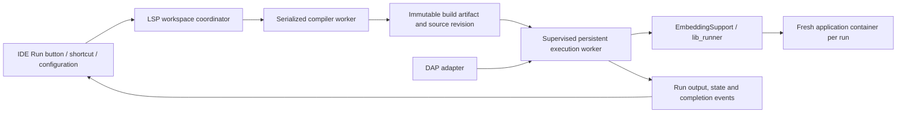

# Embedded compilation, Run and debugging

Status: accepted architecture and delivery plan, 2026-09-28. A first delivery of embedded build and
Run in both IDEs landed on `lagergren/errs` on 2026-10-15 ([below](#first-delivery-2026-10-15)); it
covers parts of R1–R5, which are now done. R6, debug sessions backed by real runs, followed on
2026-10-22, and R7, the runtime debugger, was completed on 2026-10-26, both in VS Code and
IntelliJ. The release gate (R8) was completed on 2026-10-27, without a Windows soak, which is not
planned, and parts of R9, and R10, are done. The audit in
the next section describes the code before the first delivery.

## First delivery (2026-10-15)

Embedded mode is the IDE counterpart of building and running with Gradle, like IntelliJ's *Build and
run using* choice. Each IDE chooses per folder or project: automatic (Gradle exactly when the root
has a Gradle build, embedded otherwise), embedded, or Gradle. Decisions taken for this delivery:

| Question | Decision |
|----------|----------|
| Default mode | Embedded, also with a Gradle build, whose own settings embedded builds and runs say do not apply (2026-10-16; previously automatic, which remains selectable) |
| Unsaved buffers | Builds and runs compile the editor's text, saved or not, and neither client saves files (R2, 2026-10-19; until then both saved first). VS Code saves before the task as `task.saveBeforeRun` says, and IntelliJ before a run, not a build |
| Run host | Execution worker JVMs started by the language server, one per running program and up to four at once; one idle worker is kept for the next run (2026-10-16; previously one worker running one program at a time) |
| Debugging | Not now. VS Code debug launches run without the debugger; IntelliJ keeps DAP disabled. This held until 2026-10-22; since then, R6/R7 debug sessions in both editors |
| Compiler queue | Builds reuse the server's serialized compile queue, not a second compiler |

| Area | Delivered |
|------|-----------|
| Protocol | `xtc/build`, `xtc/run`, `xtc/stopRun`, `xtc/runnableTargets`; `xtc/runOutput` and `xtc/runExited` notifications for a client-chosen run ID ([server README](../../lsp-server/README.md#embedded-build-and-run)) |
| Build | [XdkBuild](../../lsp-server/src/main/kotlin/org/xvm/lsp/adapter/xdk/XdkBuild.kt) compiles the module's dependency order into `build/xtc/embedded/`, with per-module outcomes, skipped consumers of failed dependencies and attributable diagnostics |
| Runnable targets | Found on the compiler worker from the module's type, including methods its annotations contribute, or, for a module that does not compile, from the `run` it declares: a `run` method with at most one required parameter. Run lenses appear only on such modules; no user code runs |
| Execution | [RunWorkerProcess](../../lsp-server/src/main/kotlin/org/xvm/lsp/run/RunWorkerProcess.kt) starts [RunWorker](../../lsp-server/src/main/kotlin/org/xvm/lsp/run/RunWorker.kt) lazily over JSON-lines stdio, reuses it and replaces it after death; stray worker output becomes events, never protocol frames; a worker must report the server's protocol and XDK before it receives anything, its output is batched and bounded, and it reports its heap and threads after each run |
| Embedding API | `EmbeddingSupport.runMethod` selects an entry method with the CLI runner's rule and passes exact arguments; [InterpreterControl](../../../javatools/src/main/java/org/xvm/api/InterpreterControl.java) no longer starts the runner's HTTP host; [runner.x](../../../lib_runner/src/main/x/runner.x) tasks take a method and arguments |
| VS Code | `xtc.build.mode`; Build/Rebuild (`Cmd`/`Ctrl+F9`), Run lens, editor title Run, `Ctrl+Shift+R`/`Ctrl+Shift+F10`, tasks and `F5` follow it; runs stream into a task terminal and closing it stops the run ([README](../../vscode-extension/README.md#building-and-running)) |
| IntelliJ | Build, Execution, Deployment › Ecstasy; a project task runner for Build/Rebuild with Build tool window reports; run configurations with *Run with*; a process handler giving native console, Stop and Rerun; an action for the Run lens command ([README](../../intellij-plugin/README.md#running-your-application)) |

Known limits: up to four programs at a time per server (a fifth run reports that four programs
are already running); IntelliJ Build Module builds
every module; older
IntelliJ configurations store a module name from a `\w+` regex, so qualified module names need the
new *Module source* field. The commits and validation are recorded in the
[integration plan](../../../docs/errs-integration-plan.md#embedded-build-and-run-r2r5-2026-10-15).

## What the code already does

| Area | Evidence | Consequence |
|---|---|---|
| Compiler Run lens | [XdkAdapter](../../lsp-server/src/main/kotlin/org/xvm/lsp/adapter/xdk/XdkAdapter.kt) creates `xtc.runModule` for module symbols | A module declaration alone currently qualifies; this is not proof of a runnable entry point or a successful build |
| IntelliJ Run | [producer](../../intellij-plugin/src/main/kotlin/org/xtclang/idea/run/XtcRunConfigurationProducer.kt) uses a module-name regex; [configuration](../../intellij-plugin/src/main/kotlin/org/xtclang/idea/run/XtcRunConfiguration.kt) launches Gradle or `xtc` | Run shortcuts/configurations bypass the compiler session and unsaved artifact snapshot; the regex does not preserve qualified module names |
| VS Code Run | [command](../../vscode-extension/src/commands.ts) ignores the supplied source URI; [task provider](../../vscode-extension/src/task-provider.ts) builds shell command strings | Both clients need a common launch request, including source/workspace identity and argument arrays |
| Embedding execution | [EmbeddingSupport](../../../javatools/src/main/java/org/xvm/api/EmbeddingSupport.java) caches a connector and returns a `Control` per run | Reusable VM hosting is already the intended foundation; configuration is singleton and cannot be changed after startup |
| Interpreter control | [InterpreterControl](../../../javatools/src/main/java/org/xvm/api/InterpreterControl.java) loads the runner once, copies an artifact into its native container and invokes task registration/start | Compiler ASTs need not be retained for execution; startup currently also invokes runner `run`, starting its HTTP service |
| Runner | [runner.x](../../../lib_runner/src/main/x/runner.x) maintains task IDs and creates a fresh lightweight child container per task | Reuse the runtime/runner, while giving each normal rerun fresh application state. The Java embedding path should call task methods directly without starting HTTP |
| Current execution limits | Runner invokes `container.invoke("run", ())`; custom injections are rejected; the [external console](../../../javatools/src/main/java/org/xvm/runtime/template/_native/io/xExternalConsole.java) reads host-supplied input since 2026-10-16 | Entry-point arguments, input, output channels, asynchronous completion/stop and bounded shutdown need an explicit host API |
| Repeat-run regressions | [EmbeddingSupportTest](../../../javatools/src/test/java/org/xvm/api/EmbeddingSupportTest.java) runs modules with a console, by name more than once, with a supplied root directory and with a failure, and closes a suspended run, each within a time limit; it also runs changed modules and dependencies, closes runs as they finish, twice and from two threads at once, and bounds what repeated runs add to the runtime's constant pools (R1) | These checks came from the removed main-based `LspTest` and now run with `:javatools:test`; its run timings and native pool sizes were only printed, and are now [measured and asserted](#additive-delivery-and-acceptance) |
| JIT execution | [JitControl](../../../javatools/src/main/java/org/xvm/api/JitControl.java) is unsupported; embedding selects the interpreter | First delivery targets interpreter execution; do not advertise JIT parity |
| DAP | [XtcDebugServer](../../dap-server/src/main/kotlin/org/xvm/debug/XtcDebugServer.kt) is a placeholder: breakpoints are reported unverified with the reason, launch and attach fail with it, and there are no threads | A transport stub is not debugging. Breakpoints stay unverified until a runtime bridge confirms them |
| Interpreter debugger | [Debugger](../../../javatools/src/main/java/org/xvm/runtime/Debugger.java) has frame/PC hooks; [ServiceContext](../../../javatools/src/main/java/org/xvm/runtime/ServiceContext.java) returns the global `DebugConsole.INSTANCE` | A real DAP bridge needs session-scoped debugger ownership and suspension/control APIs; parsing console output is not a suitable integration |

## Recommended ownership and process model

Use one compilation service contract and one execution service contract, shared by both IDEs and
the DAP adapter. The service contract is independent of the transport and IDE UI.

Prefer a separate, lazily started execution-worker JVM per workspace/XDK configuration. Reuse it
across runs; do not launch a JVM, CLI or Gradle task for each ordinary editor Run. The coordinator
owns its process and connection. First implementation permits one active run per worker, with
explicit stop/restart behavior. Add concurrent sessions only after isolation and scheduling tests.

This is an architectural recommendation, not a claim that the existing runtime is unsafe in all
in-process hosts. An in-process prototype can prove the common API. For the shipped IDE, a separate
worker permits recovery from an unresponsive application, excessive native-pool growth or debugger
failure without losing compiler diagnostics. A lightweight child container is not an OS security
boundary. Existing compiler serialization remains intact; application execution never blocks the
compiler queue, JSON-RPC thread or IDE UI thread.

The worker uses the same pinned, full bundled XDK and version handshake as the compiler. A changed
XDK/injector/runtime configuration requires a new worker generation. Normal rerun creates a new
child container and uses the latest successful requested build. Running the exact previous artifact
is a separate explicit action. Hot reload into a live container is not implied by rerun.

Use a framed private control connection with separate application-output events. Do not let user
console output enter LSP/DAP framing. Stdio pipes are sufficient for an owned child; a local socket
for additional DAP clients needs scoped credentials and lifecycle ownership. No runner HTTP listener
is required for an IDE session. EOF, project close and parent death terminate owned work; cancellation
of one request must not accidentally abandon a process or terminate an unrelated run.

Keep the first coordinator implementation as a protocol-neutral Kotlin package in `lang`. A worker
entry point can be packaged with existing artifacts. Extract a small shared library only when the
LSP and DAP have actual shared code to consume; avoid creating several new Gradle modules now.
Java runtime/compiler contracts stay in javatools, without introducing Kotlin there.

## Build and launch contract

Names below describe proposed API roles, not existing public classes.

- `BuildRequest`: workspace/module identity, captured source versions, dependency/XDK revisions,
  compile options and cancellation. Run must compile the exact snapshot selected by the user,
  including unsaved buffers according to one documented policy in both clients.
- `BuildResult`: attributable diagnostics, success/failure/cancellation, source manifest and immutable
  emitted artifact/dependency closure. A last successful artifact is never silently substituted when
  the requested sources fail. A valid cache hit satisfies compile-before-run; a new compilation is
  not required when every relevant input is unchanged.
- `RunnableTarget`: compiler-proven module/entry-point identity, declaration location, accepted
  argument shape and build revision. XTC's default convention is `run`, not an assumed Java `main`.
  Align compiler inspection with the runtime's actual callable/default-argument rules. An arbitrary
  `.x` member file is not an independent program; resolve its owning module. Unsupported entry
  points produce a clear reason. Revalidate the target when launch begins.
- `RunRequest`: target/build handle, argument array, working-directory/resource policy, console/input
  channels, run mode and restart policy. Avoid nullable positional option lists and comma/shell parsing.
- `RunSession`: immutable ID and worker generation, observable state, asynchronous completion,
  result/exception, ordered output and stop/close operations. Distinguish queued, building, starting,
  running, stopping, exited, failed and cancelled. Publish exactly one terminal outcome. `Control`
  compatibility can be retained behind the richer asynchronous facade.

Use the existing [XdkDependency](../../lsp-server/src/main/kotlin/org/xvm/lsp/adapter/xdk/XdkDependency.kt)
artifact/revision/source-index ownership as the starting point. Extend it deliberately for an entire
build manifest and debugger source mapping. No compiler `ModuleStructure`, AST, TypeInfo, constant
pool or mutable repository crosses the worker boundary. Emit/copy bytes on the compiler worker;
open fresh runtime-owned structures in the execution worker. Runtime exceptions must be associated
with the launched artifact and source revision, not whatever buffer text happens to be current.

Incremental compilation is a future implementation behind `BuildRequest`, with explicit dependency
invalidation and cache keys. It does not require a different Run API. A current run pins its artifact
closure; editor changes affect the next build, not its running code or breakpoint source mapping.

Library/program entry-point distinctions should govern CodeLens, gutter buttons, context Run and
keyboard Run through the same target query. IntelliJ Run configurations retain user arguments and
working-directory choices; its Run console and Stop/Rerun actions wrap `RunSession`. Use Community
platform APIs and LSP4IJ only. VS Code uses the same requests and renders output through its task or
debug console. Neither client reconstructs the compiler invocation. Keep an explicitly selected
Gradle build/task path for generated inputs and user build automation; it is not the normal embedded
Run implementation. Build-model integration must supply those inputs before compilation.

First prove the service with embedded Run. A DAP `launch` (including no-debug launch) uses
the same BuildResult and RunSession, then attaches runtime controls. The IDE transport may eventually
route both Run and Debug through DAP; that should not change compilation or execution ownership.

## Debugging boundary

Introduce a runtime debugger implementation behind the existing `Debugger` interface with explicit
session/container ownership. Define how fibers/services map to DAP threads, where they suspend,
which runtime thread may inspect frames, and how immutable stack/variable snapshots are obtained.
Support source/PC maps bound to artifact revisions; send unverified breakpoint reasons when a
location cannot be installed. Breakpoints must be installed before an initially suspended launch
resumes. Invalidate variable/frame handles on resume, rerun and worker replacement.

Deliver launch, termination and output before stepping; then implement breakpoints, exception stops,
stack traces, scopes, variables and stepping. Evaluation may execute user code: define side effects,
cancellation and timeouts instead of treating it as ordinary hover. Runtime values, heap objects and
thread state stay separate from immutable LSP semantic snapshots. Debug inline values (L79) follow
this bridge; they cannot be inferred from compiler type hints.

## Implications for the current compiler branch

1. Preserve captured source/dependency revisions, compilation cancellation, structured diagnostics
   and emitted artifacts as independently consumable results. Rename and incremental build must
   invalidate target/build handles when module identity, source paths or dependencies change.
2. Keep compile-only operations independent of `ensureConnector()`/runtime initialization. Do not
   use the runtime constant pool as a compiler snapshot cache or share mutable structures with it.
3. Expose passive compiler entry-point/source facts only where needed. Runtime sessions, queues,
   resource providers and debugger objects do not belong in AST nodes.
4. Treat L73 server commands as a thin route to the service; do not build a second compiler in an
   execute-command handler. L75 source content/revisions and L81 cancellation/progress apply to Run
   and Debug as well as editor queries.
5. The current L62 work stays compiler-focused. Its constructor-call provenance is relevant later
   to source mapping, but adds no execution lifecycle or runtime initialization. Do not enlarge
   this PR to deliver the runner or DAP implementation without a separate decision.

## Additive delivery and acceptance

- [x] **R1 — Runtime API baseline and repeat-run tests.** Convert the standalone probe's useful
  assertions into bounded tests: same-name changed artifacts, different dependencies, success,
  exceptions, exit results, immediate stop, stop/finish races, close twice, repeated runs and pool
  growth. Separate unsupported injections/JIT/input from verified interpreter support. Measure cold
  and warm latency. Exercise no HTTP listener/port collision in the embedding path.
  *Partial (2026-10-15):* worker regressions cover success, exit codes, exceptions, named methods,
  missing methods, arguments with spaces and Unicode, stop then reuse, and no HTTP listener. Changed
  artifacts, races, double close, pool growth and latency remain.
  *Completed 2026-10-19:* `EmbeddingSupportTest` covers the rest. A module changed under the same
  name runs its new code, and an unchanged module runs with the current version of its dependency.
  Closing a run as it ends on its own, closing it twice and closing it from two threads at once end
  it once and leave no console registered. The tests found two bugs in `InterpreterControl.close()`.
  A close as the run ended on its own failed with the runner's "Task N has terminated": the run could
  end after the close saw it running and before the runner got the kill, which is what Stop does to a
  program waiting for input, and the worker logged the failure. And a second close returned at once
  while the run was still going, which RunWorker's Stop and its run thread could do. Now a kill that
  finds the task gone, which the runner's `taskStatus` confirms, is not a failure, and a second close
  returns when the first is done. Two constant pools outlive a run: the native container's, which
  every run shares, and the runner's. After a module's first run, running it again, changed under
  the same name, or running other modules whose type arguments are classes of their own adds nothing
  to either. A type argument from the core library adds the types made with it to the native pool
  once (14 constants for two such types), and the test allows at most 100. Additional injections and
  custom injectors are refused with `UnsupportedOperationException`. JIT runs are not supported
  (`useJit()` is false), and console input is verified (X287).
  Latency on the development Mac, not asserted since it depends on the machine: the first run takes
  about 1.7 s, most of it starting the interpreter and the runner, and a warm run of a trivial module
  about 0.15 s. Compiling one takes about 0.75 s the first time and 70–130 ms after that. Both rely
  on the configured XDK repository, which keeps the modules it has loaded. A caller that also
  passes a new XDK repository as input loads them again, and a warm run then takes about 0.8 s and
  a compile 0.5 s. The worker passes only its build output, and `EmbeddingSupportTest` now does
  too, which took the class from 46 s to 12 s.
- [x] **R2 — Build results and runnable targets.** Reuse workspace snapshots/artifacts; prove entry
  eligibility and module ownership, arguments/defaults, unsaved compile-before-run, compile failure,
  stale target rejection, renamed roots and correct source revisions. Do not execute user code in
  target discovery. These passive compiler APIs can be extracted before runtime UI integration.
  *Partial (2026-10-15):* builds report per-module outcomes and diagnostics and skip consumers of
  failed dependencies; runnable targets come from registered module structures without running
  code.
  *Snapshots and reuse (2026-10-16):* a build compiles the text captured at the request, through
  editor analysis's module-closure compile; modules whose sources and dependency revisions are
  unchanged reuse the earlier artifact (`reused`), including one the editor analysis compiled; every
  artifact has a SHA-256 revision; `manifest.json` records compiled source hashes and dependency
  revisions; a failed module's old artifact is removed. A run of a module that no longer declares the
  entry method is refused by the runner's entry check before user code runs. Still open: arguments
  and defaults proven against the entry method before the build, renamed-root handling beyond the
  current graph, and dedicated stale-target tests.
  *Unsaved editor text (2026-10-19):* neither client saves before a build or run any more; the build
  compiles the text the server holds. IntelliJ commits its documents and waits for LSP4IJ's pending
  changes before it sends the request, since a request can reach the server before an edit's
  `didChange` (LSP4IJ #1729), which a save never covered. The editors still save on their own:
  VS Code before a task as `task.saveBeforeRun` says (`always` by default), and IntelliJ's default
  runner before every run. Shared X281 and X289 check it in both editors, VS Code with
  `task.saveBeforeRun` set to `never`: the build fails on the unsaved broken library and leaves it
  unsaved, and the third run runs the unsaved edit.
  *Stale targets (2026-10-19):* a run of a method that its module no longer declares builds the
  module and is refused by the runner's entry check, and the earlier artifact's method does not run;
  a run of a module renamed in its source is refused before a build as an unknown source module
  (`EmbeddedExecutionTest`). The renamed module's earlier artifact stays in `build/xtc/embedded/lib`,
  but nothing runs it: a build writes or removes only the artifacts of the modules it builds.
  *Arguments and defaults (decided 2026-10-19):* they are proven on the module the run's build has
  just produced, by the runner's entry check before any user code runs, not before the build: only
  the built module is certain to be the one that runs, and an earlier check could use only editor
  analysis that may be older. The check applies the command-line runner's rule
  (`EmbeddingSupport.entryMethod` and `passesArguments`; `EmbeddingSupportTest` for entry selection,
  optional argument arrays and defaults, exact arguments and missing methods; `EmbeddedExecutionTest`
  for arguments, a named method, a missing method and a method the module no longer declares).
  *Renamed roots (2026-10-19):* discovery already followed a root file renamed or moved on disk, and
  builds find modules in the current graph, but a run target saved with the old root URI (a VS Code
  task or Rerun, an IntelliJ configuration's *Module source*) failed as an unknown source module,
  even with the module's name unchanged, since both clients sent only the URI. `xtc/run` now takes
  the name as `moduleName` beside the URI, and the server uses it when the URI no longer names a
  module; a module renamed in its source is still found by its URI. IntelliJ's Run lens also brings
  a reused configuration's name and source up to date. `EmbeddedExecutionTest` renames a discovered
  root on disk and runs it by the old URI with its name and by the new URI, and refuses the old URI
  alone; shared X291 runs a saved target again after the rename in both editors. Not covered:
  renaming a root whose editor is still open (that buffer stays a source under the old path, and
  builds report a duplicate module until it is closed); an IDE move of a discovered root into
  another directory, which the rename work refuses; and the fallbacks for the name and dependencies
  of a renamed root whose header does not parse, which are keyed by the old path. Closed 2026-10-19.
  *2026-10-21:* all three are fixed. Discovery drops an open buffer whose file is gone when a file on
  disk has the same text, so the old path no longer declares the module a second time (shared X301:
  X291's rename with the root's editor left open). A discovered root whose module uses no resources
  can be moved into another directory inside the discovery folders, with its companion folder and
  Undo/Redo (`XdkFileOperationsTest`, shared X302 in VS Code); a root that uses resources, or a
  destination outside those folders, is still refused. A renamed root whose header does not parse
  keeps the module name and imports of its last parse, because discovery records a file added with
  the exact text of a removed one (`XdkWorkspaceDiscoveryTest`).
- [x] **R3 — Asynchronous embedded execution.** Extend Java/lib_runner entry selection and argument
  passing, session completion, stop, output/input and resource ownership. Preserve caller-owned
  directories and dispose only session-owned temporary resources. Structured exception/exit events
  replace textual parsing. No per-run CLI or new VM.
  *Partial (2026-10-15):* entry selection, exact arguments, completion, stop and ordered output work
  through lib_runner tasks in one runtime, with structured exit events.
  *Console input (2026-10-16):* `Console.readLine()` reads lines both clients send with
  `xtc/runInput`; input typed during the build is held until the program starts, and the end of
  input or a stop gives a waiting `readLine` an empty line (X287). Every part listed above now
  works. The runtime part has its own `javatools` test, `EmbeddingSupportTest`, merged into master
  with #703 (`bdb674af5`, 2026-10-20); CI runs it since `ee022b504`. JIT runs remain unsupported.
  Closed 2026-10-19.
- [x] **R4 — Persistent worker supervision.** Add configuration/generation handshake, private IPC,
  startup/stop deadlines, bounded output/backpressure, memory measurement and safe idle recycling.
  Verify worker death during a run, restart after crash, parent death, IDE close, XDK change and
  no leaked task/console/process. Bound retained artifacts and native-pool growth independently.
  *Partial (2026-10-15):* a lazily started worker over private JSON-lines stdio, reused across runs,
  replaced after death and shut down with the server; it exits when the server's pipe closes.
  *2026-10-16:* one worker per running program, up to four at once, so programs run side by side;
  startup and stop deadlines (a worker not ready within 60 s, or a program still running 10 s after
  Stop, is ended and its run says why, without touching other runs); one idle worker is kept for the
  next run and exits after 10 minutes idle, any other when its run ends (`RunWorkerSupervisionTest`
  with a stand-in worker, and two real programs at once in `EmbeddedExecutionTest`).
  *2026-10-18:* a worker receives nothing until its `ready` reports the protocol version and the
  bundled XDK's fingerprint the server expects; one that reports another, or none (a first-protocol
  worker), is ended and its run says to restart the language server. The server's configuration is
  fixed for its lifetime, so a new generation is a new server; the check catches a worker started
  from replaced files. Output is batched (sent 20 ms after it is printed, or once 16,384 characters
  wait) and bounded (no more waits), and the server forwards it synchronously, so a program printing
  faster than the client reads waits in its print (`OutputBatchesTest`; 5,000 prints arrive whole
  and in order in far fewer events in `EmbeddedExecutionTest`); VS Code keeps the last million
  characters of a run's text. After each run the worker reports its heap in use after a collection
  and its threads; the server logs them and does not reuse a worker keeping more than 512 MB or 200
  threads (a real worker keeps about 137 MB and 21 threads after a run). Ending a worker no longer
  leaves its runs open when its closed output stream fails the server's read.
  *Completed 2026-10-18:* after each run the worker also reports the runtime's own pool threads and
  the consoles and runs it still holds for ended programs, counted before the run's exit so the next
  run is not among them. Each is bounded on its own: a worker that still holds a console or run,
  whose runtime pool grew, or whose heap after a run grew more than 128 MB since its first run (what
  runs retain, such as artifacts) is not used again, beside the 512 MB and 200-thread totals
  (`RunWorkerSupervisionTest`). Over 25 mixed runs (exit codes, arguments, an exception, console
  input, Stop) one real worker serves every run, holds no console or run afterwards, keeps its
  pool threads, and its heap after a run (about 137 MB) grows by less than 1 MB. A killed language server
  process takes its worker with it, and an editor closing the server's input ends its runs and
  workers (`EmbeddedExecutionTest`). Runner tasks are not counted on their own; a leak of them would
  show in that heap. The R8 soak extends this across platforms and debug sessions.
  *2026-10-19:* the worker's own output timer started on a program's first print, from one of the
  runtime's pool threads, and joined their thread group, which is what the worker counts as the pool.
  The first program that printed after a silent first run thus looked like pool growth and retired a
  healthy worker, so the next run waited about 2 s for a new one. The timer thread has a group of its
  own (`OutputBatchesTest`), and the pool count is the runtime's pool alone: one thread per core,
  started by the first run.
  *2026-10-26:* the worker no longer calls `System.gc()` before it reports its heap, and the 128 MB
  growth rule is gone (R8 below).
- [x] **R5 — Both IDE Run integrations.** Route lens/gutter/context/shortcut/configuration actions
  through the same target and session API. Test arguments with spaces/Unicode, unsaved sources,
  missing entry points, compile errors, output, Stop, Rerun and repeated runs in shared scenarios.
  Assert worker reuse and distinct child sessions. Verify IntelliJ without Ultimate functionality.
  *Partial (2026-10-15):* both IDEs route lens, context, shortcut, task/configuration and Build actions
  through the shared requests, with Stop and Rerun, using Community and LSP4IJ APIs only. IntelliJ
  unit tests cover mode resolution, configuration migration and the run lifecycle; the VS Code
  headless suite checks command registration and the build mode command. Shared native playbook
  cases X280–X285 cover Run lenses, builds, arguments/exit codes, Stop, Rerun, failed builds and
  debug launches in both editors; X288 switches between the embedded and Gradle modes beside a
  Gradle build (with a stub wrapper, so no Gradle build runs) and X289 runs a module again,
  unchanged and after an unsaved edit. A real Gradle build and repeated-run soak are not driven by
  shared cases.
  *Completed 2026-10-20:* shared X292 runs a module twice whose static service counts the calls made
  to it: each run prints `calls=1,2`, so no run goes on from the program state of the run before it.
  `EmbeddedExecutionTest` checks the same with one worker serving both runs; the editors cannot see
  which worker ran a program, and worker reuse over 25 mixed runs was already asserted there. Shared
  X293 runs, from a run target, a module without a `run` method and one whose `run` requires two
  parameters: both build, and each run is refused with the reason and exit code 1 before user code
  runs. The run shows the reason alone, `Missing method "run" in module RunLibrary`, as `xtc run`
  does: until 2026-10-20 the runtime reported it as a failure to create the application container
  and the worker added the error code. Shared X294 runs a module whose `run` has no parameters with
  an argument: the argument is dropped, the output shows the runtime's warning (EMB-6, as `xtc run`
  warns) before the program's own output, and the program runs. IntelliJ runs the shared cases in
  IntelliJ IDEA 2026.2.3 with Ultimate features disabled.
  Not covered then: `.x` files had no IntelliJ gutter Run icon, and X288 drives Gradle mode with a
  stub wrapper, not a real Gradle build.
  *2026-10-21:* IntelliJ shows a Run icon in the gutter of each Run lens line. `.x` files have no PSI
  for a run line marker, so the icons are document line highlighters placed from a new
  `xtc/runLenses` request; a click runs the module as the lens does (shared X280). Shared X303 makes
  a project the way New Project does (VS Code `xtc init`, the IntelliJ wizard's creator), chooses
  Gradle mode, and builds and runs it with its own Gradle build and the XTC plugin and XDK in
  mavenLocal; a saved type error then fails the build. Not covered: IntelliJ's Build Project in
  Gradle mode, which is the IDE's builder and needs a Gradle import; Debug or configuration actions
  on the gutter icon; repeated-run soak, which belongs to R8.
- [x] **R6 — Honest DAP lifecycle.** Remove synthetic verified breakpoints/threads, connect launch,
  no-debug execution, output, completion, disconnect and terminate to the same session service.
  Advertise only functioning requests. DAP facade shutdown must follow an explicit run ownership policy.
  The placeholder half is done: synthetic breakpoints and threads are gone, launch and attach fail with
  the reason, and only the configuration handshake is advertised (`XtcDebugServerTest`).
  *Completed 2026-10-22 (`6312fd242`, `ccc0695d5`, `44d121779`):* a debug session lives in the language
  server and travels over its connection: `xtc/debugStart` creates it, `xtc/debugMessage`
  notifications carry its DAP messages both ways, and `xtc/debugEnd` ends it. No socket, credentials
  or second process are needed, and the session uses the server's own build and workers; `dap-server`
  is now a library of the server, and VS Code no longer ships a `dap-server.jar`. `launch` builds and
  runs through the service `xtc/run` uses, and starts the program after `configurationDone` (or two
  seconds after its build when a client sends none); a `noDebug` launch takes the same path. Output
  arrives as `output` events and the exit as `exited` and `terminated`; a failed build reports its
  diagnostics as output and fails the launch. The session advertises only `configurationDone` and
  `terminate`, reports breakpoints unverified with the reason, has no threads, and refuses `pause`
  and `attach`. *Ownership:* the session owns the program it launched. `terminate`, `disconnect`,
  `xtc/debugEnd` and the server's shutdown stop it, also while it still builds, and its exit ends
  the session. `xtc/stopRun` now stops a run that is still building too: the program never starts,
  and its exit says `Stopped before the program started.` A line the client sends from its debug
  console while the program runs is the program's input. Embedded runs set the runtime's new
  `Debugger.NONE`, so `assert:debug` continues: until then the command-line debugger read its
  commands from the worker's standard input, which is the server's protocol pipe, and the run never
  ended. In VS Code, `F5`, `Ctrl+F5` and `launch.json` configurations start such a session in
  embedded mode, and Gradle mode still runs the Gradle task. Shared X285 checks it in VS Code
  (`run-ZuRYb6`): exit code 4, the breakpoint unverified with the reason, the session ending with
  the program, and a line sent as the Debug Console's `evaluate` request read by a second program.
  IntelliJ then kept DAP disabled and offered no Debug runner (X285); since R7's fourth step, its
  debug sessions are the same, through LSP4IJ's DAP client.
- [x] **R7 — Runtime debugger bridge.** Implement session-scoped hooks, initial suspension, real
  breakpoints/exception stops, fibers/threads, stacks/scopes/variables, stepping, pause, watches and
  hover on variables and paths (which run no code), and bounded evaluation. Test source revisions,
  stale handles, resume/stop races and multiple service contexts. The debugger features beyond
  these are R9–R13.
  *Breakpoints, stops and stacks (2026-10-22; `41cb8b60c`, `e73878550`, `bb016ce17`):* the first end-to-end case,
  set a breakpoint, stop there, see the call stack, continue, works in VS Code. It came in three
  steps, each its own commit and integration burst:
  1. *Runtime (`javatools`).* `SessionDebugger`, a second implementation of the interpreter's
     `Debugger` interface for hosts without a terminal. The host makes the program's modules known,
     sets breakpoints by file and 1-based line, gets each stop through a listener, reads immutable
     thread and stack snapshots, and resumes. A breakpoint on a line without code moves to the next
     line with code in its method; one in a file no known module came from, or on a line with no
     code to follow, is refused with the reason. A stop holds every fiber that reaches a line, and
     the program's clocks, as the console debugger does. Lines run at full speed until there are
     breakpoints, and fibers keep yielding to each other, since nothing steps. The runner's own
     code is never debugged (`setHost`), and closing a stopped run ends the program where it is
     (`terminate`) instead of letting it run on, which the first version did.
     `EmbeddingSupport.runMethod()` takes a run's debugger, set before the task starts and
     replaced by `Debugger.NONE` when the run ends.
  2. *Execution worker and server (`lang`).* A run started with breakpoints gets a
     `SessionDebugger` in the worker JVM, beside the program; the session in the language server
     only translates and never holds runtime objects. The worker protocol (version 3) gains
     breakpoints on `run`, `setBreakpoints`, `threads`, `stackTrace` and `continue`, and the
     `breakpoints`, `stopped` and `reply` events. The DAP session installs the breakpoints set
     before `configurationDone` before the program's first line, reports how each was installed
     with `breakpoint` events, forwards stops, and answers `threads`, `stackTrace`, `scopes` (empty
     until step 5) and `continue`.
  3. *VS Code.* No client code changed: the inline adapter carries the new messages. Shared X304
     sets a breakpoint, stops there, checks the stack VS Code asks for, and continues to the exit
     code; X285 keeps the run and console input. VS Code `run-iwSxfQ` passes both with the other
     execution cases.

  4. *IntelliJ (`69c2ff2f8`; chosen 2026-10-22: LSP4IJ's DAP client).* The Ecstasy Application
     configuration is an LSP4IJ DAP run configuration whose Debug, offered with the embedded
     compiler only, goes to LSP4IJ's runner; Run keeps its own paths. The adapter's "server" is a
     process handler without an operating-system process, which carries the session's framed DAP
     messages over the language server connection. Shared X304 passes natively in IntelliJ too
     (`run-6846671860304618586`), and X285 debugs DebugRun to its exit code. LSP4IJ's DAP API is
     experimental: Plugin Verifier reports it without failing the build.

  5. *Variables (`51cccbfbf` runtime, `05e3ff076` editors).* `SessionDebugger` reads a stopped
     frame's `this` and named variables, an object's fields and an array's elements on the waiting
     fiber's own thread, and answers off its lock; the worker (protocol 4) and the session answer
     `scopes` and `variables`. Shared X305 reads them in both editors (VS Code `run-SQPPVx`,
     IntelliJ `run-7310647732030191697`). A stop now sends the program's waiting output first.
  6. *Stepping (`769d6f34d` runtime, `a78d736f5` editors).* Steps over, into and out of calls, one
     fiber at a time, stopping with the reason `step`; a return continues a step over or out to the
     caller's next line, and a breakpoint ends a step. The worker (protocol 5) and the session
     answer `next`, `stepIn` and `stepOut`. Shared X306 steps in both editors (VS Code `run-DLPFYQ`,
     IntelliJ `run-6073636771825028984`).

  7. *Exception stops (`bf0b25af4` runtime, `9d2c2f738` editors).* `SessionDebugger` stops at
     every thrown exception, or at those no frame will catch, at the frame that throws, once; the
     exception is that frame's first variable. The session's filters, Uncaught Exceptions on by
     default and All Exceptions, reach it before the program's first line (worker protocol 6).
     Shared X307 stops at an uncaught exception in both editors with no setup.
  8. *Pause and stop on entry (`5a7bf8def` runtime, `48f00ef8c` editors).* Pause stops a running
     program at the next line a fiber reaches; `stopOnEntry` stops it at the first line of its own
     modules (worker protocol 7). Shared X308 pauses in VS Code, and X309 stops on entry there and,
     since `df6c1a873`, in IntelliJ, whose configuration has the option; IntelliJ's Pause waits on
     LSP4IJ (UP30).
     `5a64247bd` rewrote `SessionDebugger` plainly, with less mutable state, without changing it.
  9. *Watches and hover on paths (`2e4a81205` runtime, `c966674fc` editors).* `evaluate` in a
     stopped frame reads a path, a name and then fields and array elements such as `point.x` or
     `ints[1]`, without running code, on the waiting fiber's thread as variables are; what cannot
     be evaluated fails with the reason (worker protocol 8). Shared X310 evaluates watches in both
     editors, and VS Code's hover requests too.
  10. *Expressions with operators (`fda3dc3e8` runtime, `0540055e9` editors).* Bounded evaluation's tier 1
     ([design](plan-bounded-evaluation.md)): watches, hovers, the console, conditions and logpoint
     parts take expressions with Ecstasy's literals and operators, which the runtime computes with
     its own native operations, without running the program's code; an operation that would run
     code is refused, naming the method. Shared X313 in both editors, its logpoint in VS Code only
     (UP32).

  *Source revisions (2026-10-26, `f53883083`):* a debugged run keeps the text each file was built
  from, so once a file is edited a breakpoint is placed on the line it was built with, one on a
  changed line is unverified with the reason, and stack frames show on their lines now (shared
  X321). With bounded evaluation's tier 2 done before it, R7 is complete. The debugger is
  the runtime's, so it debugs every run of its `EmbeddingSupport`, which the worker's one program
  at a time satisfies. Integration bursts are listed in the
  [integration plan](../../../docs/errs-integration-plan.md#r6r7-integration-bursts-2026-10-22).
- [x] **R8 — Runtime release gate.** Repeated compile/run/stop/debug cycles and memory/process soak
  on supported platforms; client parity; logs correlating build ID, queue job, artifact revision,
  worker PID/generation and run ID; current playbook/capability docs and independent PR validation.
  *Runtime retention (2026-10-26, `474af84f08`):* a shut-down interpreter's runtime is no longer kept
  by a pending timer alarm, values its templates cached in statics, or `FullyBoundHandle.NO_OP`; the
  `javatools` test JVM holds one runtime at a time.
  *Soak (2026-10-26, `0d6e890bad`):* rounds of an edited build and run, a stopped run, and debug
  sessions continued or terminated from a breakpoint, on one worker, which keeps no run, console,
  debugger, console code, session or compiled sources, and whose runtime pool keeps its size. The
  worker counted a JDK thread that joined the pool's thread group as pool growth and was retired;
  it now reports the pool's own size. Memory is checked by counts, not by the heap after
  `System.gc()`.
  *No forced collection (2026-10-26, `2668896b26`):* the worker no longer calls `System.gc()` after a
  run. It reports the heap the JVM left after its own latest collections; the 512 MB limit applies to
  that, and the 128 MB growth rule of R4 is gone.
  *Correlated logs (2026-10-26, `a87b63d9d`):* the build, run, debug session and worker lines share
  `build=` (the compiler queue job's ID), `artifact=` (the module and its revision), `run=`,
  `workerRun=`, and `worker=` with `generation=`.
  *Focused test tasks (2026-10-26, `e91b5e58cb`, `30d9685ff3`):* `graphQueryTest`, `emissionTest`,
  `dependencyHostTest`, `sourceGraphHostTest`, `embeddingConsumerTest` and
  `:javatools:errorListenerTest` each run what a doc's command used to list with `--tests`.
  *Editor cycles (2026-10-26, `718ddd656e`):* shared X322 repeats runs, stopped runs and debug
  sessions of one module from both editors; each ends, and no run or debug session stays open.
  *Linux (2026-10-27, `6b8f5bbe03`):* in a Podman container (arm64, JDK 25, not root), `javatools`'
  tests and the soak at 50 rounds pass. The runs found that the tests of read-only files fail as
  root (they skip there now, `e4a8e6847e`), that a worker which exits stays a zombie under a PID 1
  that does not reap, and that the console test's lazy `toString()` exceeds the runtime's 1 s
  limit on a host under heavy load, and then leaves its program stopped on the class's shared
  worker. A worker whose input ends now stops its runs and exits within 5 s (`c474566892`).
  *Parity (2026-10-27, at `718ddd656e`):* VS Code passes all 34 run and debug cases; IntelliJ
  passes 21 of its 32 and the other 11 are partial, three because of the test driver and eight
  because of LSP4IJ 0.21.0 (UP32–UP42). X308 and X312 wait on unreleased LSP4IJ fixes.
  *Docs (2026-10-26, `3ac199f192`)* and *PRs (2026-10-27):* the run and debug docs are current,
  and #716, #717, #718, #724 (with #730's fix), #731 and #693 each pass CI on their own heads,
  rebased onto master `ddaa3d0a4`.
  Not planned (decided 2026-10-27): a soak on Windows, which CI's `lang` checks do not run on.
- [ ] **R9 — Breakpoint kinds.** Conditional breakpoints (the console debugger's `BC`), hit counts and
  logpoints, which print without stopping; function breakpoints, which stop when a method is
  entered; exception breakpoints by type (the console's `BE+ <exception>`), with `exceptionInfo`
  for the editors' exception views; and data breakpoints, which stop when a property or field
  changes. Conditions and logpoint messages are expressions, so they build on R7's evaluation.
  *First step (`5b2686a2e` runtime, `edeab8f5b` editors):* conditions, `Boolean` expressions since
  R7's step 10, hit counts and logpoints, whose `{...}` parts are evaluated;
  exception filters by class, with the classes that extend them; and `exceptionInfo`, with the
  exception's stack trace (worker protocol 9). Shared X311 and X312 pass in VS Code; IntelliJ checks
  X311's condition, and the rest waits on LSP4IJ (UP32-UP34). Still open in R9: function and data
  breakpoints.
- [x] **R10 — Values.** Value formats such as hexadecimal (the console's `V`) and identity codes that
  tell instances apart (`DI`); a value's `toString()` on demand (`DS`), which runs code and so uses
  R7's evaluation; computed properties as lazy variables, where only fields showed before; paging of
  large arrays and collections in place of the first 100 elements; changing a variable's value
  while stopped (`setVariable`); and completions in the Debug Console. *Complete (2026-10-26):*
  `toString()` on demand and computed properties, as lazy variables whose reads run their code for
  at most a second (`1d88e086d`, R10a, worker protocol 12, shared X316); and integers in
  hexadecimal, through DAP's `format` or the session's `xtc/valueFormat`, which VS Code's own menu
  item sets, with mutable objects' identity codes (`cb551d4c2`, R10b, protocol 13, shared X317); and
  large arrays read a page at a time, by a request's `filter`, `start` and `count` (`00dee9671`,
  R10c, protocol 14, shared X318); and Set Value, a variable given an expression's value without
  running code (`3a060bd39`, R10d, protocol 15, shared X319); and Debug Console completions, the
  frame's names or the members of the value before a dot, without running code (`8178cd03d`,
  R10e, protocol 16, shared X320). Other collections, such as a `Map`, show their fields, since
  their entries would take running their code.
- [ ] **R11 — Execution control.** Run to Cursor in both editors (the console's `SL`; VS Code's sets a
  temporary breakpoint, so it may already work and needs checking), choosing which call on a line
  to step into (`stepInTargets`), restarting a frame (the console's `T`), and continuing, stepping or
  pausing one fiber while the others stay stopped.
  *Run to Cursor (2026-10-27):* both editors add a temporary breakpoint and continue, which the
  server already handled; `EmbeddedExecutionTest` checks that sequence, and shared X323 passes in
  VS Code. In IntelliJ it is partial: LSP4IJ removes the temporary breakpoint once `continue` is
  answered, so a program that takes longer to reach the cursor runs past it (UP44).
  *Step into a call (2026-10-27):* `stepInTargets` lists the calls of a stopped frame's line, from its
  ops, and `stepIn` with a `targetId` stops in the chosen one, letting the line's other calls run, or
  at the next line if the line does not make it (worker protocol 19, shared X327).
- [ ] **R12 — Program structure and sources.** Every service and fiber in Threads, with their
  containers, also those that run or wait for a reply (the console's `VF`), not only those stopped
  at a line, and thread events as they start and end; frames whose source file is not on the
  machine, such as library code, served through the `source` request from the bundled XDK's
  sources; and the loaded modules (`modules`, `loadedSources`).
  *Library sources (2026-10-27):* a frame of a bundled XDK library's code is in the library's
  bundled source, the read-only copy that navigation opens, not through the `source` request: the
  editors' language features work there too. Frames carry their module and source path (worker
  protocol 17), and a frame of another module's code no longer joins the program's source directory
  to the class's path. Shared X324 passes in both editors.
  *Threads (2026-10-27):* a stop lists every fiber of the program's services, in its container and
  those nested in it, with what each does if it does not wait at a line, and the stack of one that
  waits otherwise, without variables (shared X325). Thread events are not sent: a fiber starts for
  every call to a service.
  *Loaded modules (2026-10-27):* `modules` and `loadedSources` answer the program's own modules and
  the libraries it uses, a library's sources in their bundled copies (worker protocol 18, shared
  X326). VS Code shows them in Loaded Scripts; IntelliJ has neither (UP45).
- [ ] **R13 — Debugging beyond embedded runs.** Debug for Gradle-mode and command-line runs, which
  are refused now; debugging tests; and attaching to a program that already runs.

Not planned, since Ecstasy's runtime has no counterpart or the editors already provide it: reverse
execution (`stepBack`, `reverseContinue`), disassembly, instruction breakpoints and memory access;
`runInTerminal`, since programs run in the execution worker; and the console debugger's own
terminal features (its views, command history, repeated steps and breakpoint list), which the
editors' views and breakpoint management replace.

R1 establishes the baseline; R2 can proceed alongside compiler hardening. R3 precedes R4/R5;
R6 shares the established service, followed by R7. R8 closes production acceptance. R9–R13 follow
R8, unless one of them is chosen to gate the release, which moves it in front of R8; parts of R9,
and R10, landed before R8. Compiler-only tests do not establish any of these runtime gates. The
playbook's execution and debug cases, among X280–X327, cover the editor side of R5–R8, R11 and R12; R8 also
needs the server's soak and release evidence.
