<!-- The screenshots in images/ come from the editor tours: each one's tour step names it and its crop (GuideImage in the IntelliJ
     tour's TourScript.kt, guide in the VS Code tour's script.ts), and lang/intellij-plugin/tour/guide.py rebuilds them from a tour run. -->
# Ecstasy Language Tooling: User Guide

This guide is for developers who are new to the Ecstasy (XTC) tools in IntelliJ IDEA and VS Code. It
starts with installation and a first five minutes, then walks through editing, navigating, refactoring,
building, running, testing and debugging Ecstasy code, and says which features each editor has.

Both editors use the same two servers, which ship with the plugin and the extension:

- The **language server** (LSP) analyzes your code with the Ecstasy compiler as you type. It powers
  errors, completion, navigation and refactoring. It can also build, run and test your modules with
  its own compiler, which is the *embedded* build mode.
- The **debug adapter** (DAP) runs inside the language server and lets you debug Ecstasy programs:
  breakpoints, stepping, variables, watches and evaluation.

So the features below behave the same in both editors. Where they differ, it is in the editor's own
interface, and this guide says where.

The screenshots come from the editors' scripted tours, which play the card game in
[`lang/test-fixtures/tour/cardGame`](../../test-fixtures/tour/cardGame) in a Linux container. The
shortcuts are the editors' default Windows keymaps, as the tours give them, and IntelliJ's Linux
keymap is the same. On macOS, most shortcuts use Cmd in place of Ctrl; each editor's keymap
reference lists the rest. The Ecstasy chord **Ctrl+Alt+X, then a letter** is **Control+Option+X,
then the letter** on macOS.

For the details behind each feature, see the reference documents:
[IntelliJ plugin](../../intellij-plugin/README.md), [VS Code extension](../../vscode-extension/README.md),
[language server](../../lsp-server/README.md), [configuration reference](../configuration.md) and the
[manual test plan](../manual-test-plan.md), whose numbered cases (X1, X2 and so on) are copyable examples
with their expected results.

## Contents

1. [What you get](#1-what-you-get)
2. [Getting started](#2-getting-started)
3. [Editing and navigation](#3-editing-and-navigation)
4. [Refactoring](#4-refactoring)
5. [Building and running](#5-building-and-running)
6. [Testing with xunit](#6-testing-with-xunit)
7. [The debugger](#7-the-debugger)
8. [Settings, troubleshooting and limitations](#8-settings-troubleshooting-and-limitations)

## 1. What you get

Each table lists what you can do and how you start it in each editor. "Yes" means the feature works
in that editor, with the editor's usual action for it.

### Editing

| Feature | IntelliJ | VS Code | Notes |
|---------|----------|---------|-------|
| Errors and warnings as you type | Yes | Yes | The compiler checks the editor's text, saved or not |
| Errors in files that aren't open | Project view and Problems window | Problems view | |
| Semantic highlighting | Yes | Yes | Colors from the compiler, on top of the grammar's |
| Completion | Yes | Yes | Members, names in scope and argument values, with types |
| Inline completion | Yes | Yes | A name in scope, suggested as you type |
| Quick documentation | Ctrl+Q, or hover | Hover, or Ctrl+K Ctrl+I | Also for the XDK's types |
| Parameter info | Ctrl+P | Ctrl+Shift+Space | |
| Inlay hints | Yes | Yes | Parameter names and inferred types |
| Reference counts above declarations | Yes | Yes | A click lists the references |
| Templates | Live templates, Ctrl+J | Snippets | |
| Formatting | Ctrl+Alt+L, on type, on save | Shift+Alt+F, on type, on save | Through the server's formatter |
| Comment out lines | Ctrl+/, Ctrl+Shift+/ | Ctrl+/ | |
| Folding, extend selection | Yes | Yes | |
| Linked editing | Settings \| Editor \| General \| Smart Keys | The `editor.linkedEditing` setting | A local's occurrences change together as you type |

### Navigation

| Feature | IntelliJ | VS Code |
|---------|----------|---------|
| Go to definition | Ctrl+B or Ctrl+click | F12 or Ctrl+click |
| Go to type definition | Ctrl+Shift+B | Go to Type Definition |
| Go to implementations | Ctrl+Alt+B | Ctrl+F12 |
| Find references | Alt+F7 | Shift+Alt+F12 |
| Highlight a name's uses in the file | Yes | Yes |
| Call hierarchy | Ctrl+Alt+H | Show Call Hierarchy |
| Type hierarchy | Ctrl+H | Show Type Hierarchy |
| Go to symbol, the XDK's included | Ctrl+Alt+Shift+N | Ctrl+T |
| File outline | Ctrl+F12, Structure window | Outline view, breadcrumbs |
| The XDK's sources, read-only | Yes | Yes |

### Refactoring

| Feature | IntelliJ | VS Code | Notes |
|---------|----------|---------|-------|
| Rename methods, properties, locals, parameters and types | Shift+F6 | F2 | Checked by recompiling everything it touches |
| Rename a class with its file | Yes | Yes | |
| Rename or move a file, move a type to another package | Yes | Yes, in the Explorer | Uses follow |
| Extract to a local or a private method | Alt+Enter | Ctrl+Shift+R | |
| Inline a local, a private method or a constant | Alt+Enter | Ctrl+. | |
| Safe delete of an unused member | Alt+Enter | Ctrl+. | |
| Quick fixes: create a method or class, add an import, remove what's unused | Alt+Enter | Ctrl+. | |
| Organize imports | Ctrl+Alt+O | Shift+Alt+O | |
| Generate a doc comment | Alt+Enter | Ctrl+. | |
| Undo a refactoring across files | Asks first, then one step | One step, without asking | |

### Build and run

| Feature | IntelliJ | VS Code | Notes |
|---------|----------|---------|-------|
| Embedded build mode | Yes, the default | Yes, the default | The language server's compiler; no Gradle |
| Gradle build mode | Yes | Yes | The project's own Gradle build |
| `xtc` command-line mode | Yes | No | |
| Choose the mode | Ctrl+Alt+X, then B | Ctrl+Alt+X, then B, or the status bar | |
| Build | Ctrl+F9, Build window | Ctrl+F9, terminal | |
| Run a module | Gutter Run icon, Run lens, run configurations | Run lens, editor Run button, Ctrl+Shift+F10, tasks | |
| Program input | Run window | Terminal | |
| Stop and rerun | Yes | Yes | |

### Tests

| Feature | IntelliJ | VS Code | Notes |
|---------|----------|---------|-------|
| Find xunit tests as you write them | Gutter icons | Testing view and gutter icons | No restart needed |
| Run or debug a test, class, package or module | Gutter icons | Testing view, gutter, Run Test at Cursor | |
| Results, messages and the failing line | Test runner | Testing view, Test Results | |
| Rerun failed tests | Yes | Yes | |
| Run every test module's tests | Run 'All Ecstasy Tests' | Run All Tests | IntelliJ's has no Debug yet; in Gradle mode, Rerun Failed needs the Gradle model |
| Tests with Gradle's `testXtc` | Yes | Yes | In Gradle mode |
| Tests with `xtc test` | Yes | No | In command-line mode |

### Debugging

| Feature | IntelliJ | VS Code | Notes |
|---------|----------|---------|-------|
| Debug a module, embedded or with Gradle | Yes | Yes | |
| Debug a command-line run | Yes | No | |
| Attach to a program run with `--debug` | Ecstasy Attach configuration | Attach configuration | |
| Line breakpoints with conditions | Yes | Yes | |
| Hit counts and logpoints | Yes | Yes | |
| Function, data and exception breakpoints | Yes | Yes | |
| Step over, into, out | F8, F7, Shift+F8 | F10, F11, Shift+F11 | |
| Step into a chosen call | Smart Step Into, Shift+F7 | Step Into Target | |
| Run to cursor, restart frame, pause | Yes | Yes | IntelliJ calls it Reset Frame |
| Variables, watches, hovers, inline values | Yes | Yes | |
| Hexadecimal display, Set Value | Yes | Yes | |
| Evaluate, and run code, in the paused frame | Evaluate Expression, Debug console | Debug Console | With completion of names |
| Loaded sources and modules | Yes | Loaded Scripts; no Modules view | |

## 2. Getting started

### Requirements

- **IntelliJ IDEA 2026.2 or later**, the free edition included. The plugin needs Red Hat's **LSP4IJ**
  plugin, which provides IntelliJ's language server and debug adapter client, and IntelliJ's bundled
  Gradle and TextMate plugins. The language server runs on IntelliJ's own Java runtime, so you don't
  need to install Java for it.
- **VS Code 1.140 or later.** The language server needs **Java 25 or later**. The extension looks for
  one (the `xtc.java.home` setting, `JAVA_HOME`, `PATH`, SDKMAN and other usual places), and when it
  finds none, it downloads one from Eclipse Adoptium once and keeps it.
- **An XDK, with `xtc` on your `PATH`**, only for some tasks: VS Code's **Ecstasy: Create New
  Project**, `xtc init` and `xtc run` in a terminal, and IntelliJ's command-line build mode. Editing,
  embedded builds, runs, tests and debugging use the XDK that comes with the plugin or extension.
  Snapshot XDKs are on the [XDK snapshot release](https://github.com/xtclang/xvm/releases/tag/xdk-snapshots).
- **Gradle mode** runs your project's own Gradle build through its wrapper, with the XTC Gradle plugin
  and the XDK that the build names.

### Install the IntelliJ plugin

1. Download the plugin ZIP from the
   [IntelliJ plugin snapshot release](https://github.com/xtclang/xvm/releases/tag/intellij-plugin-snapshots),
   or build it from this repository (see [Building from source](../../intellij-plugin/README.md#building-from-source)).
2. In IntelliJ, open **Settings | Plugins**, click the gear icon and choose **Install Plugin from
   Disk...**, then select the ZIP.
3. Restart IntelliJ when it asks. If it reports that LSP4IJ is missing, install **LSP4IJ** from the
   Marketplace first.

The [plugin README](../../intellij-plugin/README.md#installation) also covers the JetBrains Marketplace
and its release channels.

### Install the VS Code extension

1. Download `xtc-language-<version>.vsix` from the
   [VS Code extension snapshot release](https://github.com/xtclang/xvm/releases/tag/vscode-extension-snapshots),
   or build it (see [Building from source](../../vscode-extension/README.md#building-from-source)).
2. In the Extensions view, open the **...** menu and choose **Install from VSIX...**, or run
   `code --install-extension xtc-language-<version>.vsix`.
3. Reload VS Code when it asks.

VS Code's **Welcome** page then has a **Get Started with Ecstasy** walkthrough, which goes through
creating a project, building and running it, the build modes and the server's log.

The snapshots follow the `master` branch. To try changes that aren't there yet, build the plugin or
extension from your checkout.

### Open or create a project

An Ecstasy project is a folder of `.x` files. Open any folder that has them: the language server finds
the modules in it, and the modules they import, without any configuration. A project made by
`xtc init` also has a Gradle build, which Gradle mode uses.

To make a new one:

- **IntelliJ:** **File | New | Project**, then **Ecstasy**. Choose the project type (application,
  library or service) and whether it has several modules. The wizard makes the same project as
  `xtc init`, with the XTC Gradle plugin, and a run configuration for it. It doesn't need an XDK.
- **VS Code:** **Ecstasy: Create New Project** in the Command Palette (Ctrl+Shift+P) asks for a name,
  a type and a folder, and runs `xtc init` in a terminal.
- **A terminal:** `xtc init myApp --type application --dir ~/projects`.

<table><tr><td width="50%">

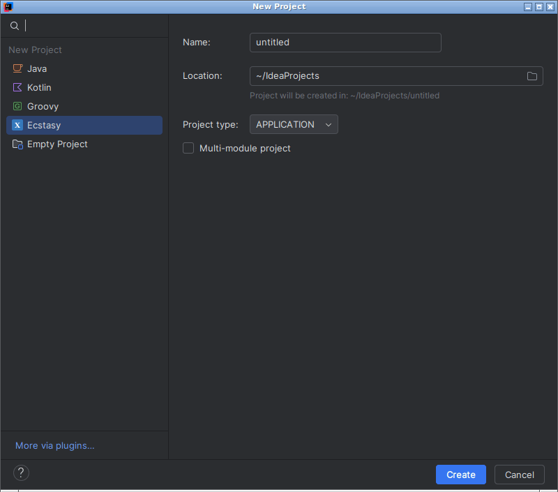
*IntelliJ: File | New | Project | Ecstasy makes the same project as `xtc init`.*

</td><td width="50%">

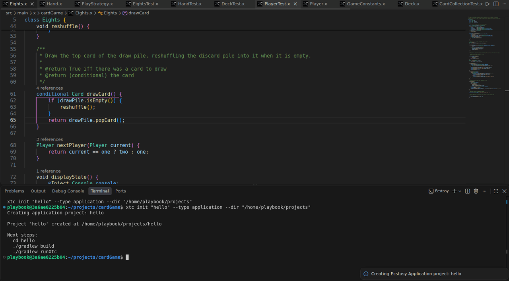
*VS Code: **Ecstasy: Create New Project** asks for a name, a kind and a folder, and runs `xtc init` in the terminal.*

</td></tr></table>

To follow the screenshots, use the card game that the tours use, a two-player game of Crazy Eights
with tests. It is a project that `xtc init` makes, with the card game's sources in place of its own:

```bash
xtc init cardGame --dir ~/projects
rm -rf ~/projects/cardGame/src
cp -R lang/test-fixtures/tour/cardGame/src ~/projects/cardGame/
```

Open `~/projects/cardGame` in either editor.

<table><tr><td width="50%">

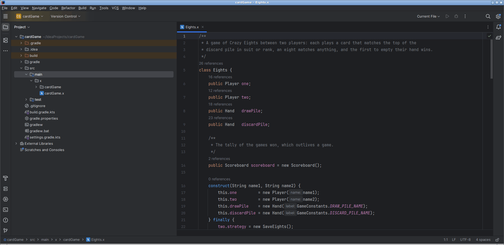
*IntelliJ with the card game open. The plugin starts its language server, with the XDK bundled.*

</td><td width="50%">

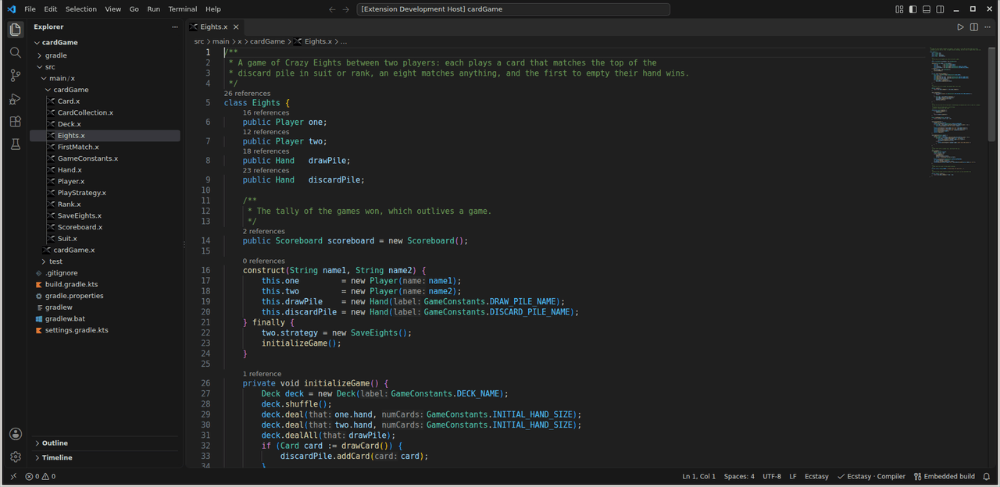
*VS Code with the card game open. The status bar shows `✓ Ecstasy · Compiler` once the server is ready, and the build mode, `Embedded build`.*

</td></tr></table>

### Your first five minutes

Open `src/main/x/cardGame/Eights.x`, then try these in order.

1. **See an error as you type.** Misspell a method name in a call. The compiler marks it at once,
   before you save; hover it, or press Ctrl+F1 in IntelliJ, to read the message. Undo the change.
2. **Complete a name.** Type a variable's name and a dot, such as `deck.`: completion lists the
   members of its type, with their types. Ctrl+Space opens the list anywhere.
3. **Read documentation.** Hover over a method name, or press Ctrl+Q (IntelliJ) or Ctrl+K Ctrl+I
   (VS Code), for its signature and doc comment.
4. **Go to a definition.** Ctrl+click a call, or press Ctrl+B (IntelliJ) or F12 (VS Code), to open
   the method it calls. It works for the XDK's types too, whose sources open read-only.
5. **Run the program.** Open `src/main/x/cardGame.x` and click the Run icon in the gutter (IntelliJ)
   or the **▶ Run** lens above `module cardGame` (VS Code). The game runs in the Run window or a
   terminal; press Enter to play each turn.
6. **Debug it.** Click in the gutter beside a line of `Deck.x` to set a breakpoint, then press
   Shift+F9 (IntelliJ) or F5 (VS Code). The program stops at the breakpoint, and the debugger shows
   its frames and variables. Step with F8 and F7 (IntelliJ) or F10 and F11 (VS Code), and continue
   with F9 (IntelliJ) or F5 (VS Code).
7. **Run a test.** Open `src/test/x/DeckTest.x`. Click the test icon in the gutter beside
   `module DeckTest` and choose Run (IntelliJ), or click its run icon (VS Code). Each test's result
   shows in the test runner or the Testing view.

## 3. Editing and navigation

### The language server

The plugin or extension starts the language server when you open an Ecstasy file. Its first analysis
of a project takes some seconds; after that, it rechecks what you change.

- **VS Code** shows the server's state in the status bar: a spinning `Ecstasy` while it starts,
  `✓ Ecstasy · Compiler` when it is ready, and a warning or error icon when it has failed, which you
  can click to restart it.
- **IntelliJ** shows it in LSP4IJ's **Language Servers** window, which also traces what the editor
  and the server say to each other.

The server's default *adapter* analyzes code with the compiler. The other adapter, Tree-sitter,
understands only syntax: it is a fallback for a project that the compiler has trouble with. Switch
with **Ctrl+Alt+X, then A**; see [Settings that matter](#settings-that-matter).

### Reading code

The compiler colors names by what they are: fields, parameters, locals, types and static members.
Inlay hints show the parameter names of a call whose arguments don't say what they are, and the
inferred types of locals. A line above each declaration counts its references in the project, tests
included, and a click lists them.

<table><tr><td width="50%">

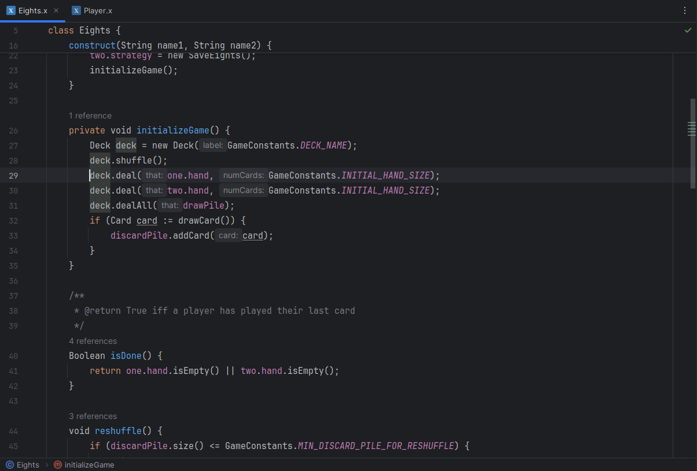
*IntelliJ: inlay hints name a call's parameters, such as `numCards:`, and the line above each declaration counts its references.*

</td><td width="50%">

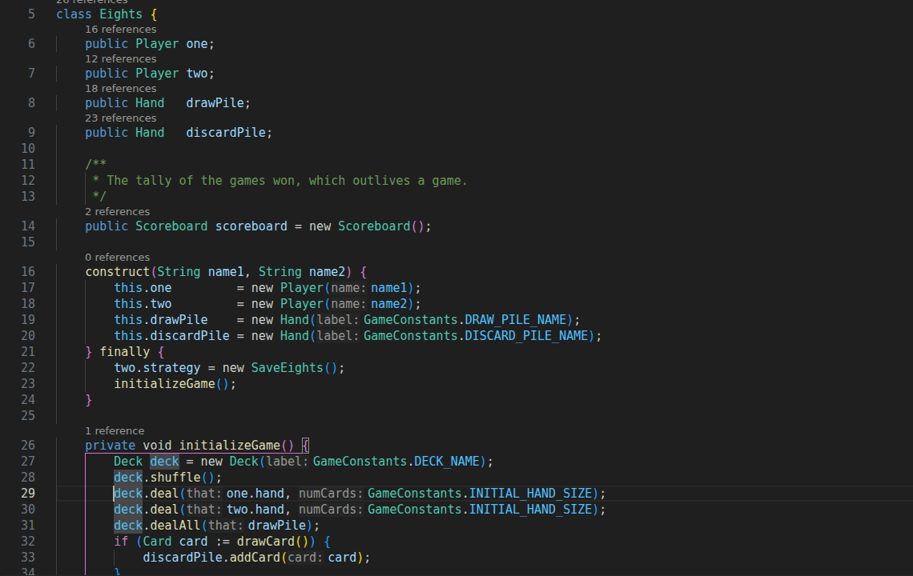
*VS Code: hints name `deal`'s parameters, `that` and `numCards`, and the line above each declaration counts its references.*

</td></tr></table>

Hover a name, or press Ctrl+Q (IntelliJ) or Ctrl+K Ctrl+I (VS Code), for its declaration and doc
comment, as the compiler sees it. This works for the XDK's own types too.

<table><tr><td width="50%">

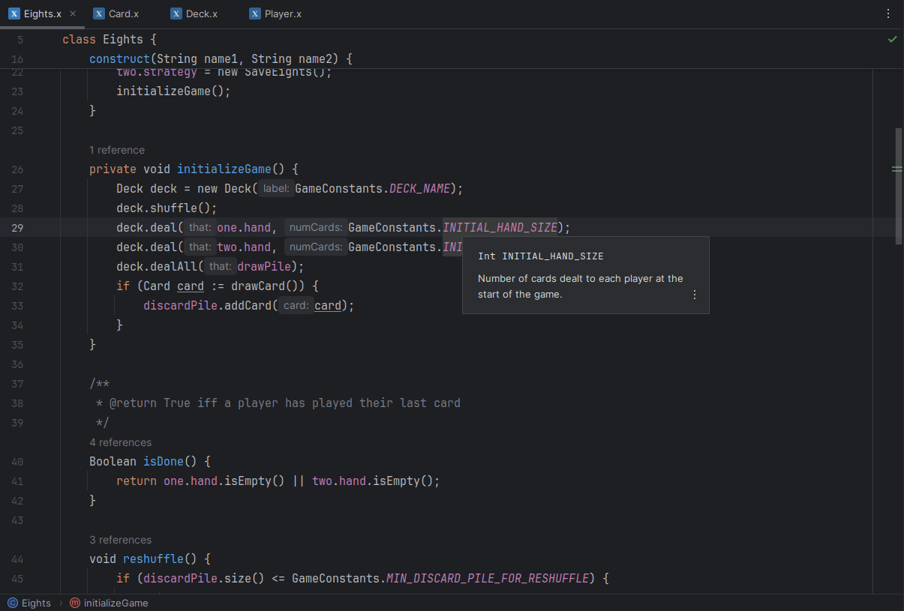
*IntelliJ: Ctrl+Q, or hovering, on `INITIAL_HAND_SIZE` shows its declaration and doc comment.*

</td><td width="50%">

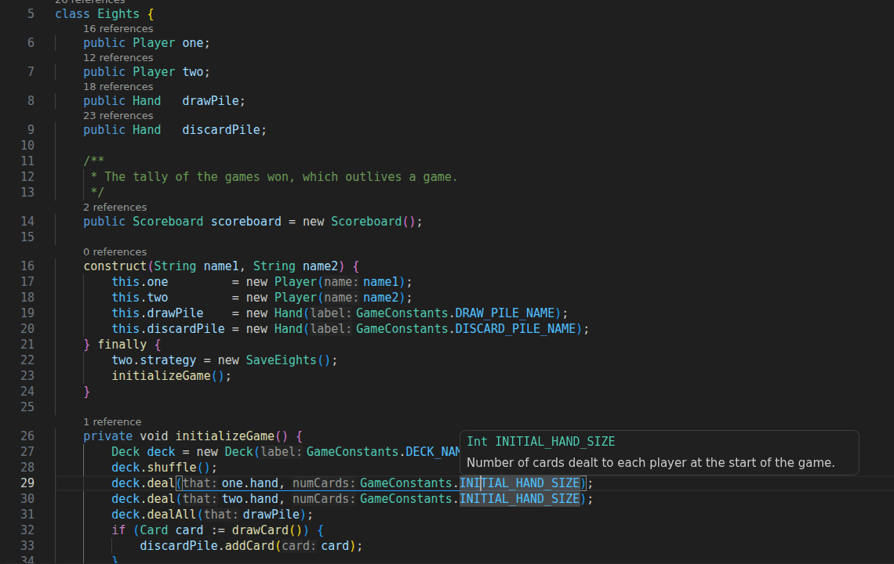
*VS Code: hovering `INITIAL_HAND_SIZE` shows its declaration and doc comment.*

</td></tr></table>

With the cursor on a name, its uses in the file are highlighted. Methods and doc comments fold.
Extend selection grows the selection by the syntax around it: Ctrl+W and Ctrl+Shift+W in IntelliJ,
Shift+Alt+Right and Shift+Alt+Left in VS Code.

The file's outline is IntelliJ's **File Structure** popup (Ctrl+F12) and **Structure** window, and
VS Code's **Outline** view and breadcrumbs.

### Writing code

After a dot, completion lists the members of the expression's type as the compiler resolves it,
with their types. As you type a name, it offers the types, variables and keywords in scope. In an
argument list it also offers the values in scope that fit the parameter. Choosing a type from another
module adds its import.

<table><tr><td width="50%">

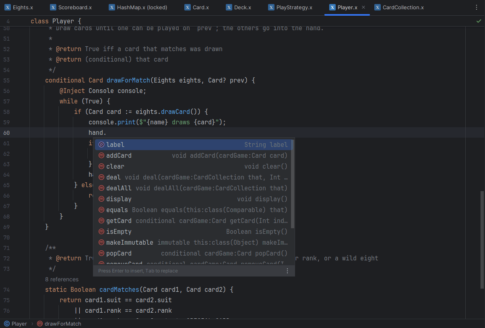
*IntelliJ: after `hand.`, completion lists the members of `Hand`, with their types.*

</td><td width="50%">

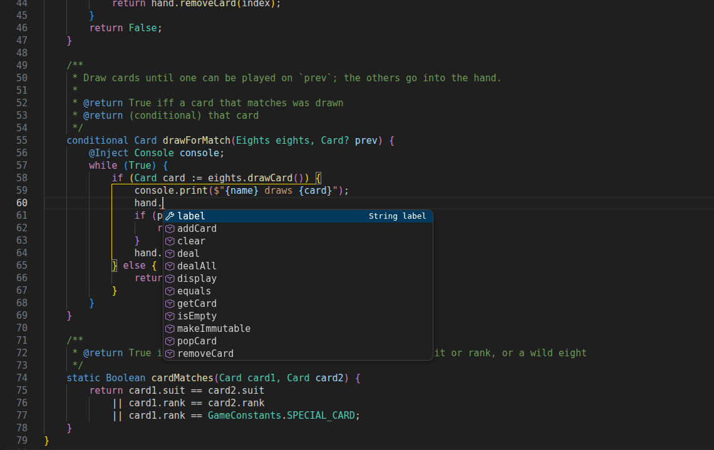
*VS Code: after `hand.`, completion lists the members of `Hand`.*

</td></tr></table>

Inside a call, Ctrl+P (IntelliJ) or Ctrl+Shift+Space (VS Code) shows the parameters of the method it
calls, with the one at the cursor in bold. It also opens by itself as you type the call's `(`.

<table><tr><td width="50%">

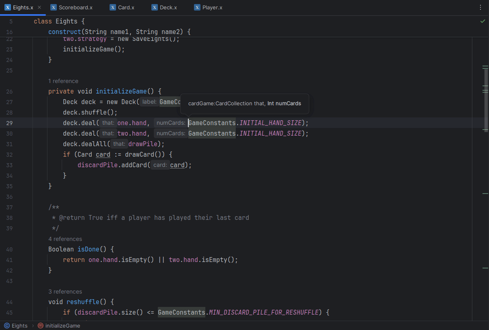
*IntelliJ: Ctrl+P inside a call of `deal` shows its parameters, with `numCards` in bold.*

</td><td width="50%">

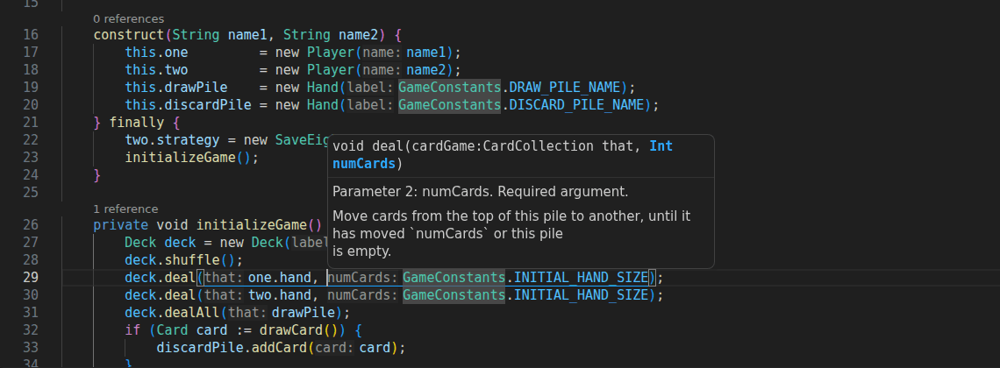
*VS Code: inside a call of `deal`, the parameter hints show its signature, with `numCards` in bold, and its doc comment.*

</td></tr></table>

Templates write common declarations. In IntelliJ, Ctrl+J lists the live templates, such as `cls`,
`meth`, `fori` and `sout`; in VS Code, the snippets complete with the other suggestions, such as
`meth` for a method. Tab moves through a template's placeholders.

**Formatting** goes through the language server's formatter, with your indentation settings
(IntelliJ's **Settings | Editor | Code Style | Ecstasy**, VS Code's `xtc.formatting.*` settings).
Reformat a file or a selection with Ctrl+Alt+L (IntelliJ) or Shift+Alt+F (VS Code). Enter and `}`
indent as you type, and typing `{` and Enter closes the block. To format on save, use IntelliJ's
**Actions on Save | Reformat code**, or VS Code's `editor.formatOnSave`.

Ctrl+/ comments out the selected lines with `//`; in IntelliJ, Ctrl+Shift+/ wraps a selection in
`/* */`.

### Errors and warnings

The compiler checks the editor's text as you type, not the saved file, so an error shows as soon as
you make it. Warnings show too, such as an assertion that can never fail.

<table><tr><td width="50%">

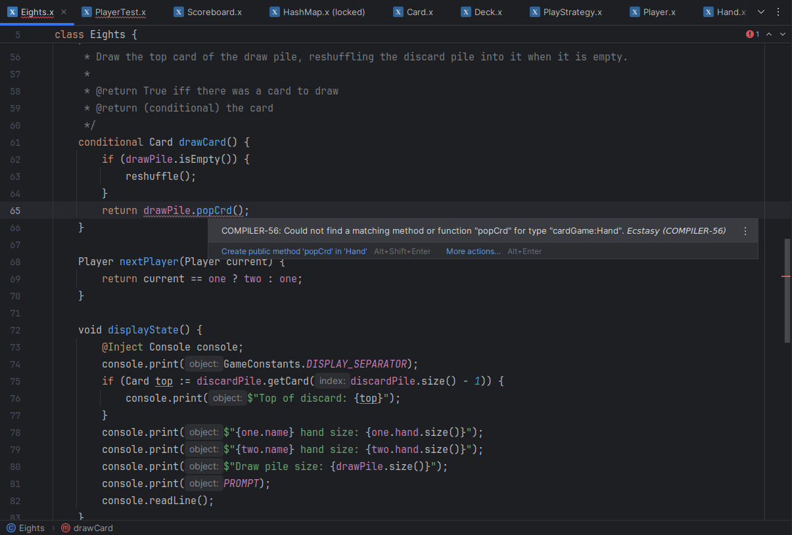
*IntelliJ: a misspelled `popCard` is an error as soon as it is typed; Ctrl+F1 shows the compiler's message, with a fix.*

</td><td width="50%">

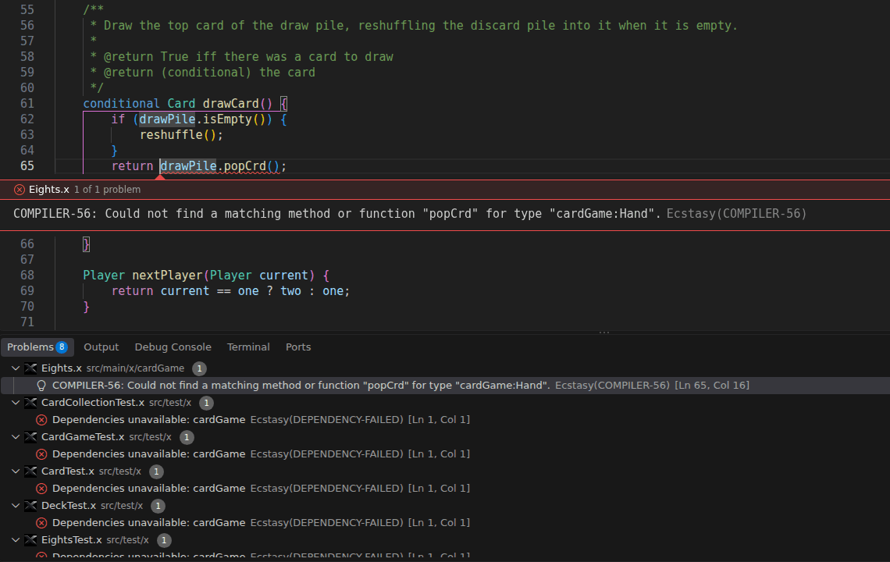
*VS Code: F8 shows the compiler's message, COMPILER-56, under the line.*

</td></tr></table>

Every problem of the project is in IntelliJ's **Problems** window and VS Code's **Problems** view
(Ctrl+Shift+M), each a click away from its code. That includes files you haven't opened: change a
method's signature, and its callers in other files and in the test modules are listed as errors
until you fix them. IntelliJ also draws such files red in the Project view.

<table><tr><td width="50%">

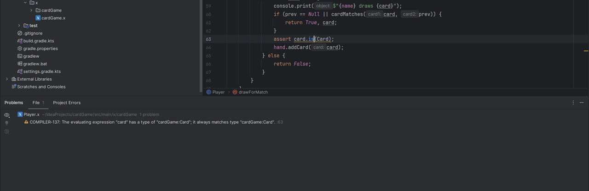
*IntelliJ: the Problems window lists the file's errors and warnings, and Project Errors the rest of the project's.*

</td><td width="50%">

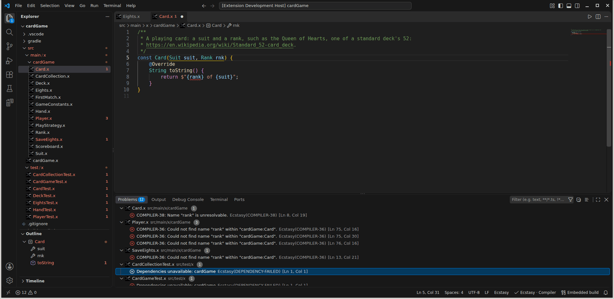
*VS Code: renaming `Card.rank` without saving breaks its uses in files that aren't open, and the test modules that depend on them; the Problems view lists them all.*

</td></tr></table>

### Navigating

| To | IntelliJ | VS Code |
|----|----------|---------|
| Open the declaration of what's under the cursor | Ctrl+B or Ctrl+click | F12 or Ctrl+click |
| Open the declaration of its type | Ctrl+Shift+B | **Go to Type Definition** |
| List the implementations of an interface method | Ctrl+Alt+B | Ctrl+F12 |
| Find every use, in all modules | Alt+F7 | Shift+Alt+F12 |
| See who calls a method | Ctrl+Alt+H | **Show Call Hierarchy** |
| See a class's supertypes and subtypes | Ctrl+H | **Show Type Hierarchy** |
| Find a class, method or property by name | Ctrl+Alt+Shift+N | Ctrl+T |

<table><tr><td width="50%">

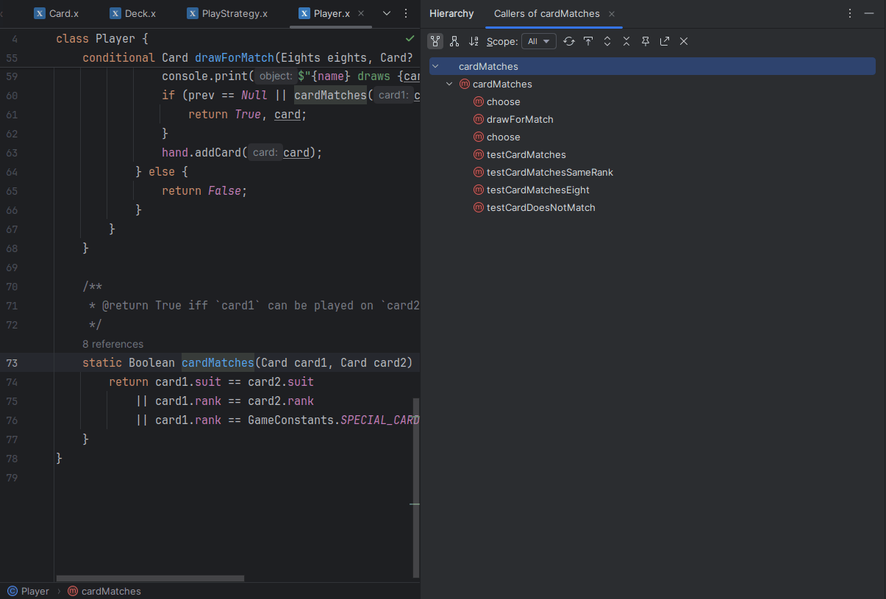
*IntelliJ: Ctrl+Alt+H on `cardMatches` lists its callers: the player, both strategies' `choose` and the tests.*

</td><td width="50%">

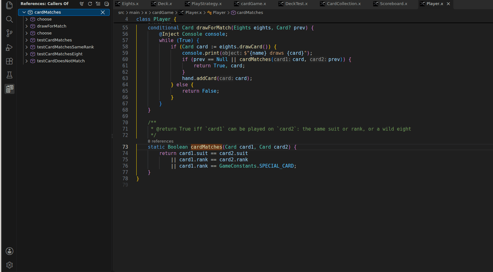
*VS Code: **Show Call Hierarchy** on `cardMatches` lists its callers in the side bar: the player, both strategies and the tests.*

</td></tr></table>

<table><tr><td width="50%">

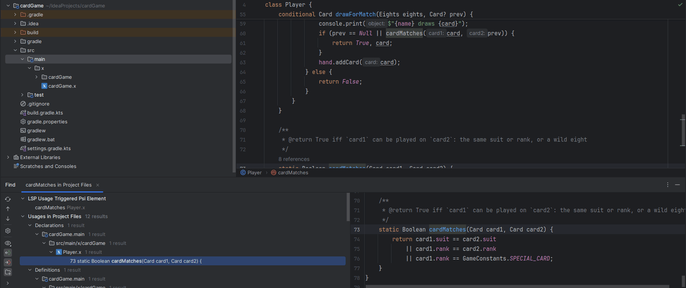
*IntelliJ: Alt+F7 on `cardMatches` finds its uses, the tests' included, in the Find window.*

</td><td width="50%">

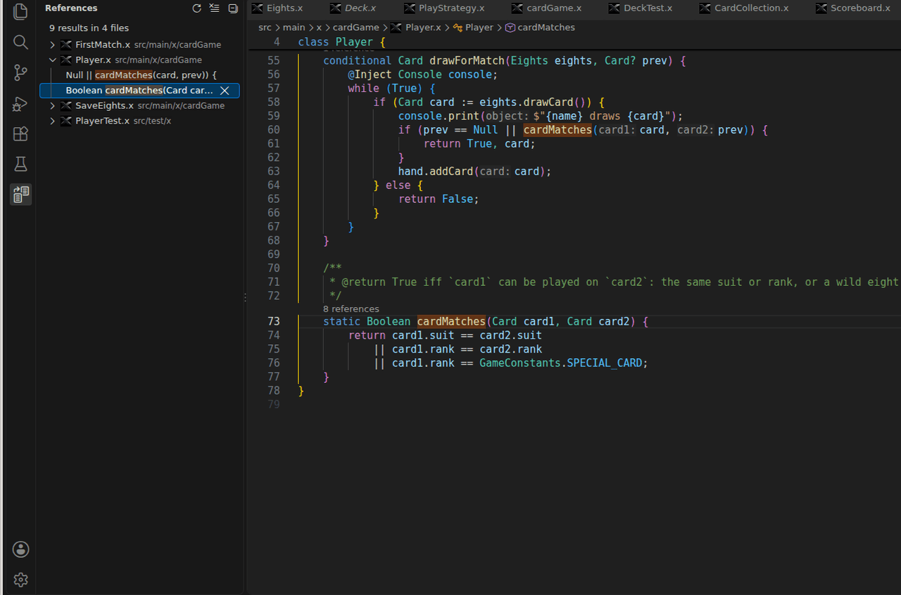
*VS Code: Find All References on `cardMatches` finds 9 uses in 4 files, the tests' included.*

</td></tr></table>

Navigation reaches into the XDK as well: going to `HashMap`'s declaration opens the `ecstasy`
module's source, read-only. Its names are links too, as the language server compiles the library's
sources when the first one opens ([X350](../manual-test-plan.md#navigation-inside-an-xdk-librarys-source-x350)).

<table><tr><td width="50%">

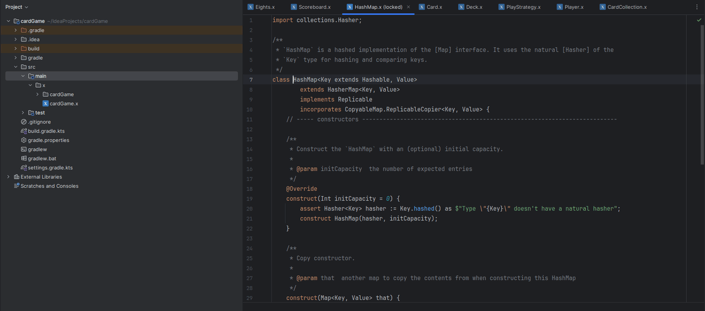
*IntelliJ: Go to Declaration on `HashMap` opens the XDK's source, read-only.*

</td><td width="50%">

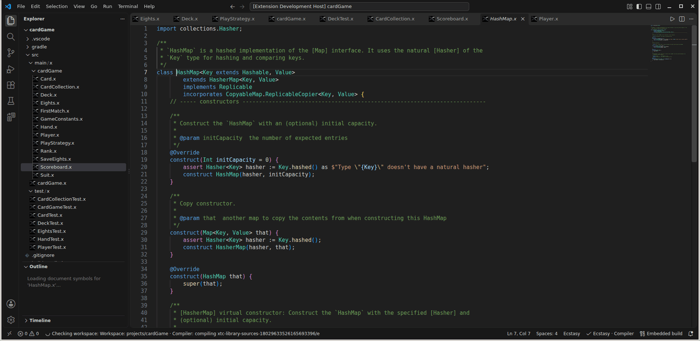
*VS Code: Go to Definition on `HashMap` opens the XDK's source, read-only; the status bar shows the server compiling the library's sources.*

</td></tr></table>

## 4. Refactoring

Every refactoring is checked before anything changes: the language server recompiles everything the
change touches and compares what each name refers to before and after. When it can't prove that the
program still means the same, it doesn't offer the change, or refuses it with the reason, rather than
leave your code broken.

### Rename

Press Shift+F6 (IntelliJ) or F2 (VS Code) on a method, property, local, parameter or type, and type the
new name. The rename changes the declaration and every use, in every module of the project, tests
included.

<table><tr><td width="50%">

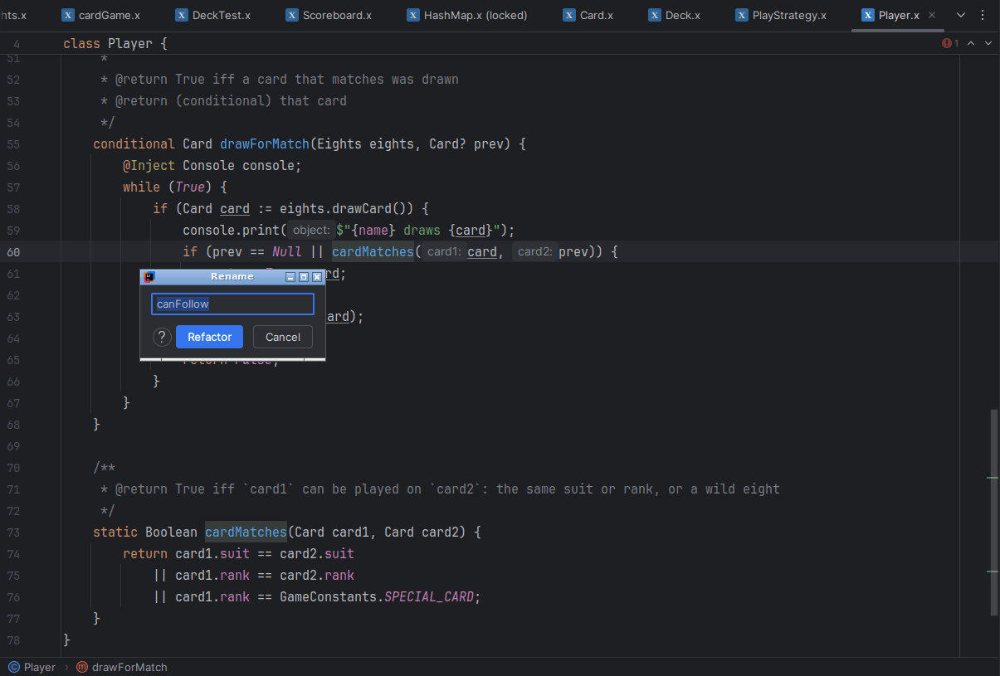
*IntelliJ: Shift+F6 on `cardMatches` renames it, here to `canFollow`.*

</td><td width="50%">

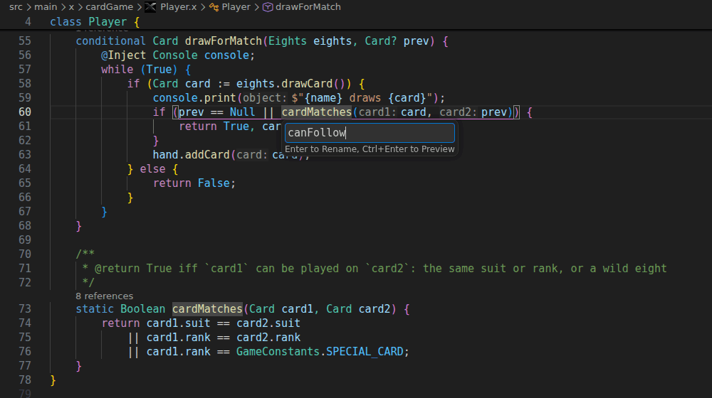
*VS Code: F2 on `cardMatches` renames it, here to `canFollow`; the server checks the new name before anything changes.*

</td></tr></table>

Renaming a class renames its file, since Ecstasy keeps one type per file, and renaming a file in the
Project view or Explorer renames its type. Undo takes a rename back in one step: IntelliJ first asks,
as it does for any change of several files; VS Code takes it back in all files at once and leaves
them unsaved.

### Move

Moving a file to another package's folder moves its type, and every use follows: the server rewrites
qualified names and imports, also in files that aren't open. In IntelliJ, use **Refactor | Move** (F6) or
drag the file in the Project view; in VS Code, cut and paste or drag it in the Explorer.

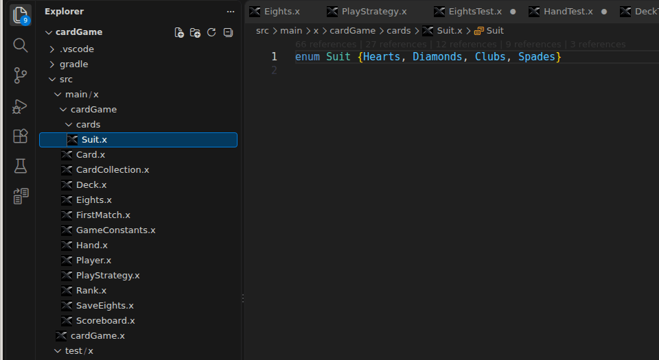
*VS Code: `Suit` moved to the `cards` package in the Explorer; the files that use it are rewritten, as their tabs show.*

### Extract, inline and safe delete

These are code actions: select the code, or put the cursor on it, then press Alt+Enter (IntelliJ) or
Ctrl+. (VS Code); VS Code also lists the refactorings of a selection with Ctrl+Shift+R.

- **Extract expression to local variable** or **to private method**, for a whole returned expression
  or a typed local's initializer. The new local has the type the compiler gives the expression.
- **Extract statements to private method**, for consecutive statements.
- **Inline** a local that a return reads, a private method's call (**Inline private method call**, or
  **Inline and remove private method**), or a constant (**Inline constant property**).
- **Safely delete private member**, for one that nothing uses; a public member that no module of the
  project uses can be deleted too.

<table><tr><td width="50%">

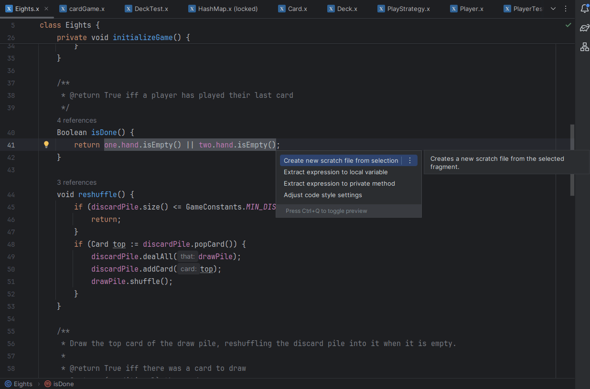
*IntelliJ: Alt+Enter on a selected expression offers to extract it to a local or a private method.*

</td><td width="50%">

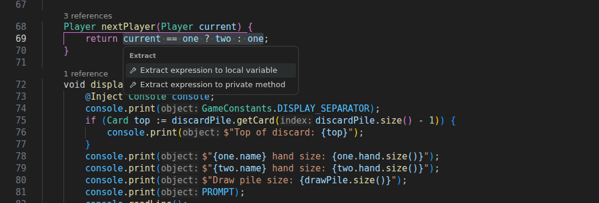
*VS Code: Ctrl+Shift+R on a returned expression offers to extract it to a local or a private method.*

</td></tr></table>

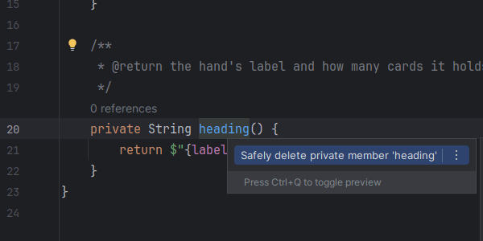
*IntelliJ: Alt+Enter on `heading`, a private method that nothing uses, offers to delete it safely.*

### Quick fixes and imports

On an error, Alt+Enter (IntelliJ) or Ctrl+. (VS Code) offers its fixes:

- **Create private method** or **Create public method** for a call to a method that doesn't exist yet,
  with the parameter types the call implies.
- **Create class** for a `new` of a class that doesn't exist yet, in the same module.
- **Import** for a type of another module that isn't imported.
- **Remove unused import** and **Remove unused local variable**.

<table><tr><td width="50%">

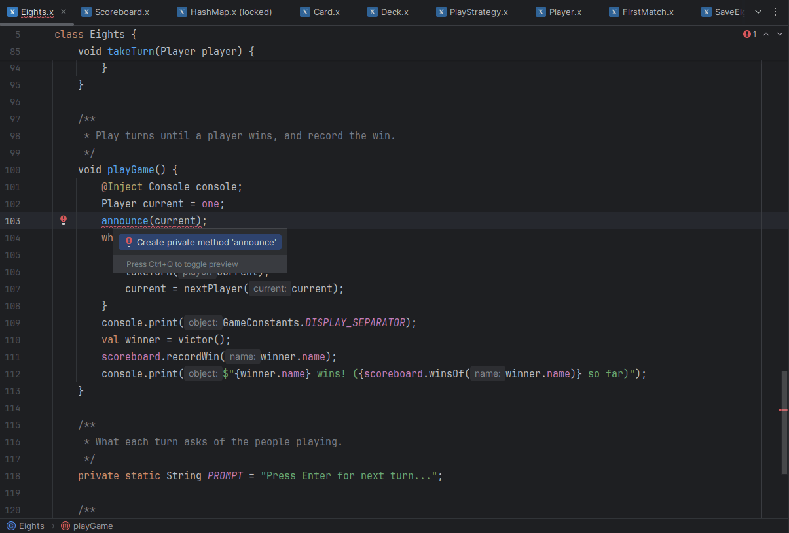
*IntelliJ: Alt+Enter on a call of `announce`, which doesn't exist yet, offers to create it.*

</td><td width="50%">

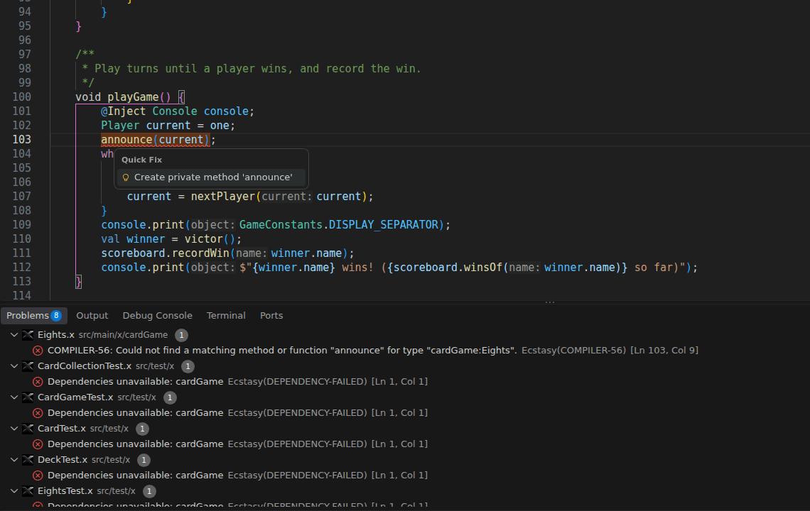
*VS Code: Ctrl+. on the call of `announce`, which doesn't exist yet, offers to create it.*

</td></tr></table>

**Organize imports**, Ctrl+Alt+O (IntelliJ) or Shift+Alt+O (VS Code), removes unused imports and sorts
the rest. **Generate documentation comment**, on a declaration, writes a doc comment with its
parameters and return value.

## 5. Building and running

### Build modes

The build mode decides how Build, Run, Debug and the tests work. Press **Ctrl+Alt+X, then B** to
choose it in either editor, or:

- **IntelliJ:** **Tools | Select Ecstasy Build Mode**, or **Settings | Languages & Frameworks |
  Ecstasy | Build and Run**. It is saved with the project. Where the project's own modules replace
  bundled XDK libraries, as in the XVM repository, the embedded compiler is shown as not available,
  and builds and runs use Gradle.
- **VS Code:** **Ecstasy: Select Build Mode**, or the status bar item that a folder with a Gradle build
  shows. It is the `xtc.build.mode` setting, per folder.

| Mode | What it does |
|------|--------------|
| Embedded compiler (the default) | The language server's compiler builds every module, and its execution worker runs them. Nothing to sync or install, and the fastest round trip. A Gradle build beside it doesn't apply: its settings, such as `runXtc` arguments, JVM options or XDK version, are ignored, and the build output says so. |
| Gradle | The project's Gradle build runs `compileXtc`, `runXtc` and `testXtc`, with all of its settings and its XDK. |
| Automatic | Gradle when the project has a Gradle build, embedded otherwise. |
| `xtc` command line (IntelliJ only, per run configuration) | `xtc run` and `xtc test` from the XDK on your `PATH`. |

The next build or run uses the new mode; nothing restarts.

<table><tr><td width="50%">

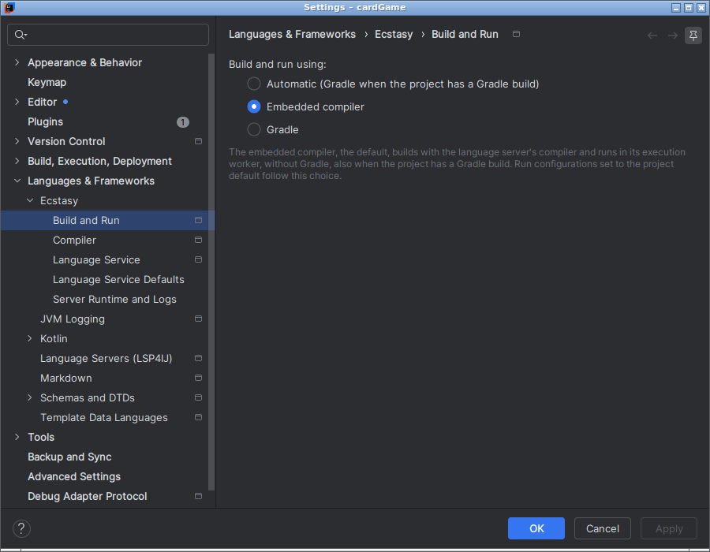
*IntelliJ: **Settings | Languages & Frameworks | Ecstasy | Build and Run**, with **Build and run using** on its default, the embedded compiler.*

</td><td width="50%">

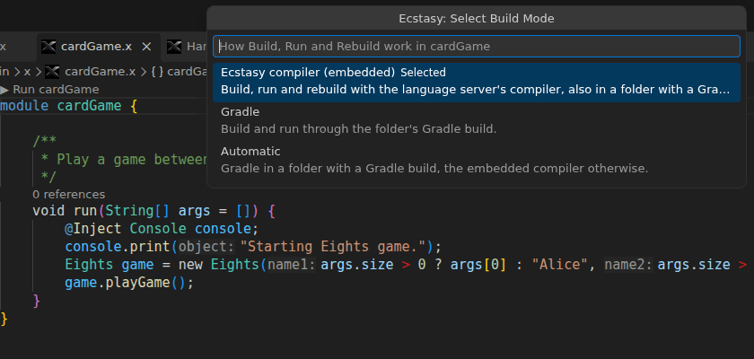
*VS Code: **Ecstasy: Select Build Mode**, which Ctrl+Alt+X, then B, and a click on the status bar's build mode open too.*

</td></tr></table>

### Build

Ctrl+F9 builds (Cmd+F9 on macOS): IntelliJ's **Build | Build Project**, VS Code's **Ecstasy: Build**.
In embedded mode, every module builds in dependency order, from the editors' text, saved or not, into
`build/xtc/embedded`. **Rebuild** compiles everything again. A failed build lists each error with its
file and line, a click away from its code: in IntelliJ's **Build** window, and in VS Code's terminal.

<table><tr><td width="50%">

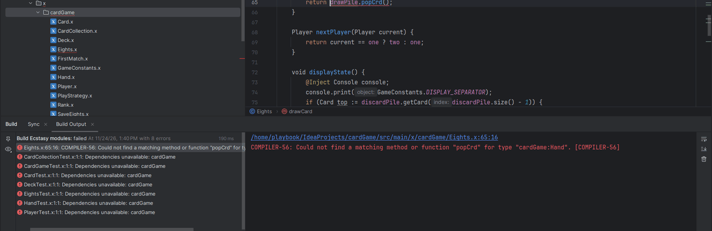
*IntelliJ: a failed build in the Build window: the error in `Eights.x`, and the test modules that need the module that failed.*

</td><td width="50%">

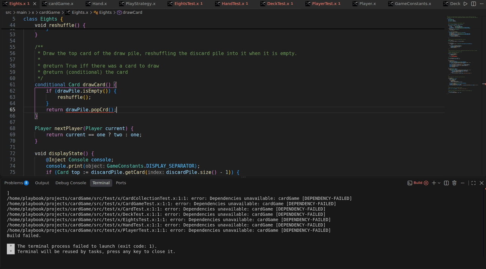
*VS Code: a failed build lists its errors, with their files and lines, in the build's terminal.*

</td></tr></table>

### Run

A module with a `run()` method has a **▶ Run** lens above its `module` declaration, and in IntelliJ a
Run icon in the gutter of that line. Click either to run it. Other ways:

- **IntelliJ:** **Run Context Configuration** (Ctrl+Shift+F10; Ctrl+Shift+R on macOS) in the editor, or
  an **Ecstasy Application** run configuration (**Run | Edit Configurations | + | Ecstasy Application**)
  run with Shift+F10. The configuration names the module, its method and arguments, and what it runs
  with: the project default, embedded, Gradle or `xtc` command line.
- **VS Code:** the editor's Run button, Ctrl+Shift+F10 (Ctrl+Shift+R on macOS), **Ecstasy: Run Module**,
  or an `xtc` task in `.vscode/tasks.json` with arguments (see
  [Tasks](../../vscode-extension/README.md#tasks)).

<table><tr><td width="50%">

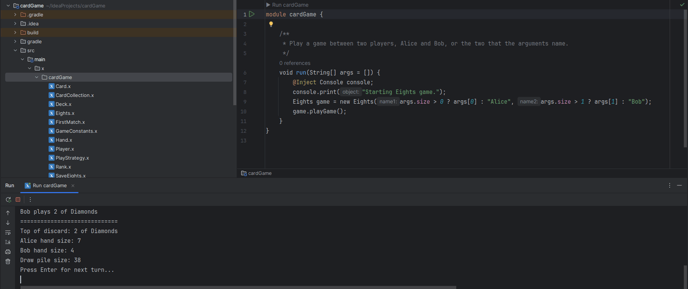
*IntelliJ: the Run lens and the gutter icon run the module; the game reads each Enter from the Run window.*

</td><td width="50%">

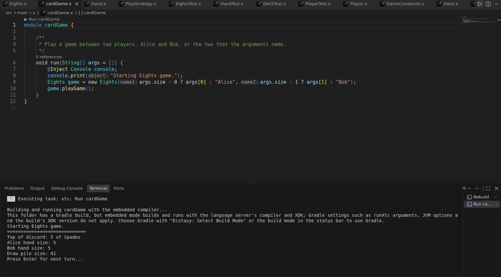
*VS Code: the game runs in a terminal of its own, which also says that the folder's Gradle build doesn't apply in embedded mode.*

</td></tr></table>

The program reads its input from the Run window (IntelliJ) or its terminal (VS Code): type a line and
press Enter. IntelliJ's **Send EOF**, or Ctrl+D on an empty line in VS Code, ends the input. Stop ends
the program; IntelliJ's **Rerun** runs it again.

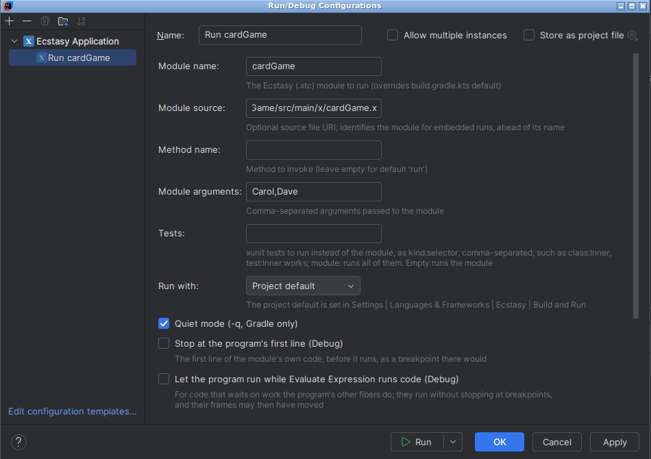
*IntelliJ: an Ecstasy Application configuration, with its arguments and what it runs with.*

In embedded mode, each run gets a fresh program, in an execution worker beside the language server.
Up to four programs run at once. In Gradle mode, the same Run runs the XTC Gradle plugin's `runXtc`
task; IntelliJ's Gradle window also lists the plugin's tasks.


## 6. Testing with xunit

Ecstasy's test framework is [xunit](../../../lib_xunit/README.md). Both editors find a project's tests
as you write them, run and debug them in every build mode, and show their results in their own test
views.

### Write a test

A test is a method or function annotated `@Test`. The annotation is part of Ecstasy's core library,
so a simple test needs no import, and tests can sit in a module, a package or a class. A project
usually keeps them in test modules of their own under `src/test/x`, each importing the module it
tests, as the card game's `DeckTest` does:

```ecstasy
module DeckTest {
    package cardGame import cardGame;

    import cardGame.Deck;
    import cardGame.GameConstants;

    @Test
    void testDeckHas52Cards() {
        Deck deck = new Deck("Standard Deck");
        assert deck.size() == GameConstants.DECK_SIZE as "Deck should have " + GameConstants.DECK_SIZE + " cards";
    }
}
```

`assert … as "message"` fails the test with that message. For more, import xunit
(`package xunit import xunit.xtclang.org;`) and use its annotations: `@BeforeEach`, `@AfterEach`,
`@BeforeAll` and `@AfterAll` around tests, `@Disabled("why")` to skip one, `@DisplayName` for its
name in the results, and `@TestFixture` for a test class's lifecycle. [xunit's
README](../../../lib_xunit/README.md) describes them all.

### Find and run tests

The language server finds the tests of each module as you write them: every `@Test` method, and the
classes, packages and modules that hold them. Each has a test icon in the gutter, and VS Code's
**Testing** view lists them in a tree. A test you write while the project is open shows as soon as
the server has read it, with no restart.

<table><tr><td width="50%">

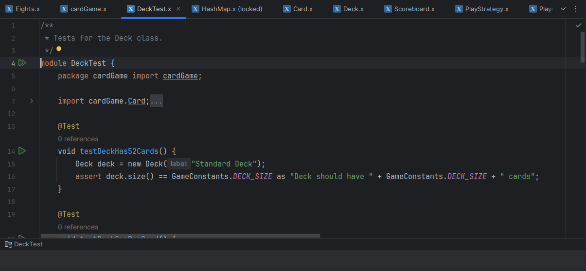
*IntelliJ: a test icon beside every test module and every `@Test` method.*

</td><td width="50%">

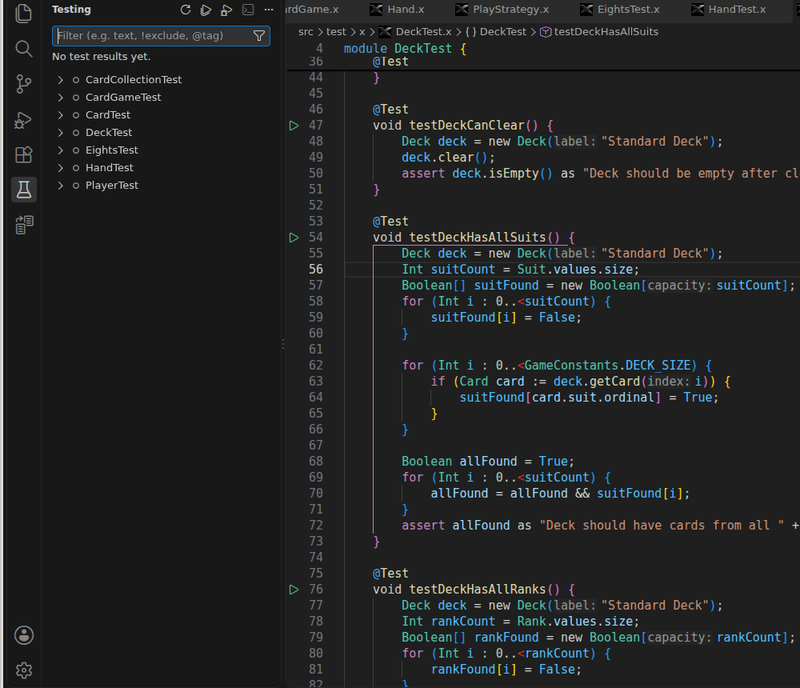
*VS Code: the **Testing** view lists the test modules and their tests; the gutter has a run icon on each.*

</td></tr></table>

- **Run or debug a test, or everything a module, package or class holds.** In IntelliJ, click the
  test icon and choose Run or Debug. In VS Code, click the gutter icon to run (right-click to debug),
  use the Testing view, or **Test: Run Test at Cursor** and **Test: Debug Test at Cursor**.
- **Run every test module's tests**: **Run 'All Ecstasy Tests'** in IntelliJ's Project window, on
  the project folder or its test sources; **Run All Tests** in VS Code's Testing view.

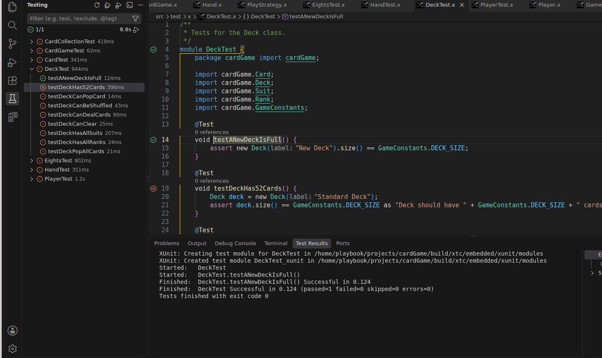
*VS Code: `testANewDeckIsFull`, written while the project is open, is in the Testing view with its gutter icon, and runs.*

### Read the results

Each test passes, fails, errs (it threw something other than a failed assertion) or is skipped, as
a `@Disabled` one is. A failure shows its message at the line that failed, with its stack, and the
tests' output is with the results.

<table><tr><td width="50%">

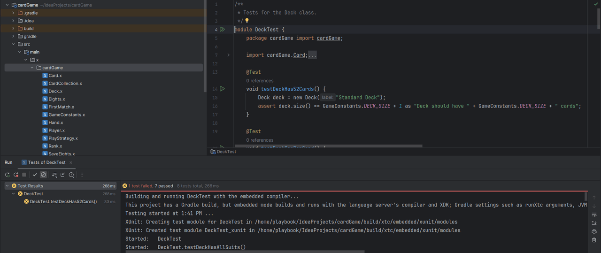
*IntelliJ: the gutter's test icons run DeckTest, embedded, and the test runner shows each test's result and output; one was made to fail.*

</td><td width="50%">

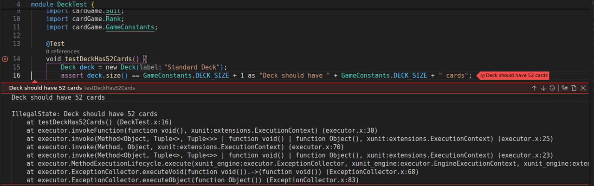
*VS Code: a failing test's message shows at the line that failed, with its stack.*

</td></tr></table>

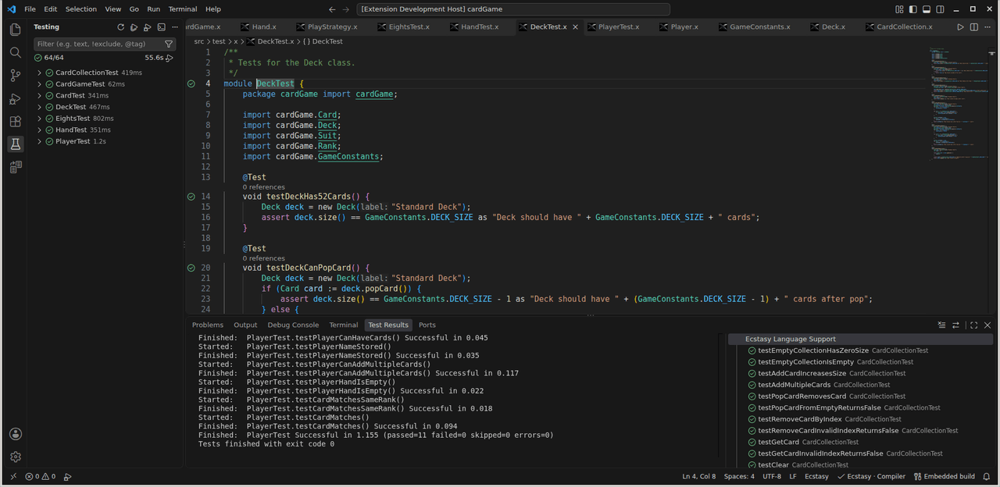
*VS Code: Run All Tests runs every module's tests; the Testing view and the gutter show each result, and Test Results what they printed.*

### Rerun and debug tests

- **Rerun the failed tests**: IntelliJ's **Rerun Failed Tests**, VS Code's **Test: Rerun Failed Tests**.
  After Run 'All Ecstasy Tests', IntelliJ reruns each module's failed tests in that module.
- **Debug a test**: Debug on its icon, or **Test: Debug Test at Cursor**, runs it under the debugger,
  which stops at the test's breakpoints as at a program's; everything in [the debugger](#7-the-debugger)
  works there.

<table><tr><td width="50%">

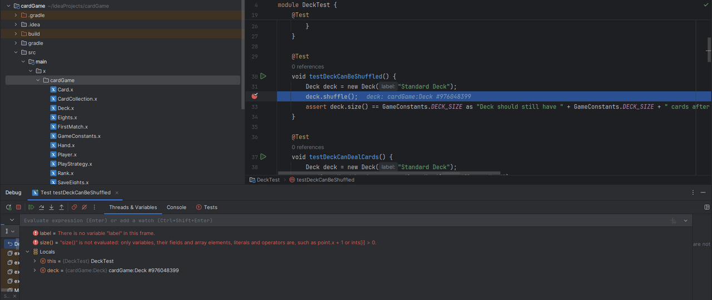
*IntelliJ: Debug on a test's icon stops at its breakpoint, here before the shuffle.*

</td><td width="50%">

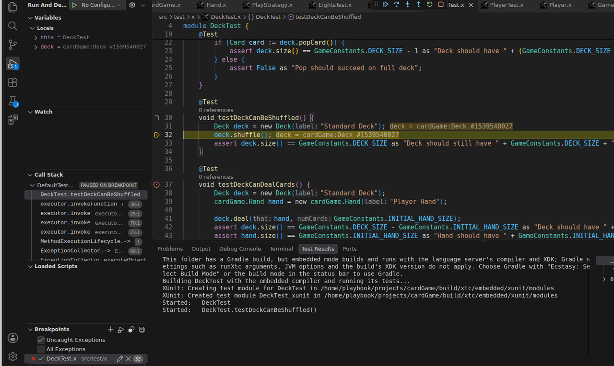
*VS Code: **Test: Debug Test at Cursor** stops at the same kind of breakpoint, with the test's variables and stack.*

</td></tr></table>

### Tests and the build mode

The build mode applies to tests as to runs:

| Build mode | How tests run |
|------------|---------------|
| Embedded | With xunit in a process of the language server's own, against the XDK and xunit that the server comes with, not a version that the project's Gradle build may choose. Its compiled test modules are under `build/xtc/embedded/xunit`. |
| Gradle | The XTC plugin's `testXtc` for the chosen tests, with the build's own XDK and xunit; xunit's results come back to the same views. IntelliJ's Rerun Failed Tests after Run 'All Ecstasy Tests' needs the imported Gradle model, to know each module's project (**Refresh Gradle model**). |
| Command line (IntelliJ) | `xtc test`, for the module's tests. |

<table><tr><td width="50%">

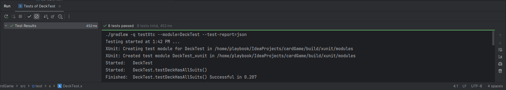
*IntelliJ, Gradle mode: the same icons run `testXtc`, here `--module=DeckTest`, into the same test runner.*

</td><td width="50%">

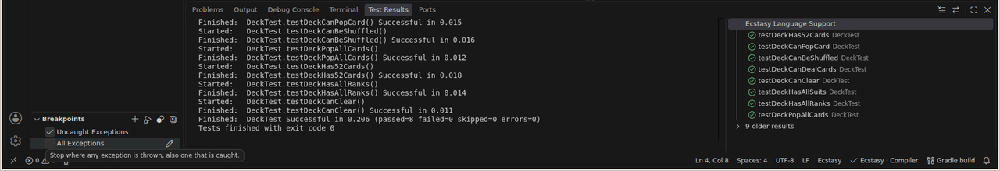
*VS Code, Gradle mode: the Testing view runs `testXtc`, and the results come back to it.*

</td></tr></table>

### When tests don't show or don't run

- **No test icons in a test module**: the module doesn't compile, and its errors are in the Problems
  view; or its tests are where xunit can't run them, in a non-static inner class or a special class
  such as an enum.
- **"Dependencies unavailable" on a test module**: the module it tests has errors; fix those first.
- **The XVM repository's own tests** run with Gradle, as builds and runs do there, since its modules
  replace the bundled libraries.

## 7. The debugger

The debugger works the same in both editors: IntelliJ's debugger through LSP4IJ, and VS Code's own.
A debug session builds and runs the program as Run does, under the debugger.

### Start debugging

- **IntelliJ:** Debug a run configuration with Shift+F9 or the toolbar's Debug button. Running a
  module from its gutter icon makes its configuration, which Shift+F9 then debugs.
- **VS Code:** F5 debugs the module of the active editor, with no configuration needed. To give
  arguments, choose a method or stop at the first line, add a configuration to `.vscode/launch.json`
  (**Add Configuration**, then **Ecstasy: Launch Module**); see
  [Debugging](../../vscode-extension/README.md#debugging) for its fields.

In Gradle mode, Debug runs the module's `runXtc` task with the debugger, and the program connects to
the session; in IntelliJ's command-line mode, it runs `xtc run`. The breakpoints are the same.

To stop before the program does anything, check **Stop at the program's first line** in IntelliJ's
run configuration, or set `"stopOnEntry": true` in VS Code's launch configuration.

### Attach to a program run outside the editor

You can debug a program that you run in a terminal, with the launcher's `--debug` option:

1. Copy the option: VS Code's **Ecstasy: Copy Option to Debug a Program Outside the Editor**, or the
   **Port** comment of a new IntelliJ **Ecstasy Attach** configuration (**Run | Edit Configurations |
   + | Ecstasy Attach**). It is `--debug listen:127.0.0.1:5005,suspend`.
2. Run the program with it, for example:

   ```bash
   xtc run -o build/attach --debug listen:127.0.0.1:5005,suspend src/main/x/cardGame.x
   ```

   It prints `Listening for the debugger at 127.0.0.1:5005` and waits before its first line.
3. Start the attach: Debug the **Ecstasy Attach** configuration (IntelliJ), or a launch configuration
   from the **Ecstasy: Attach to Program** snippet (VS Code), with the same port.

Breakpoints, stepping and evaluation work as in a launched session. Stopping the session detaches,
and the program runs on. The program's XDK must be one with the same tools as your plugin or
extension, and one debugger at a time can attach.

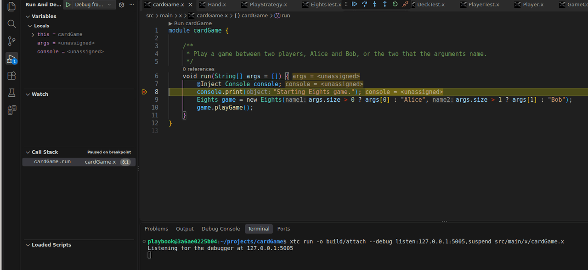
*VS Code: `xtc run` with the copied `--debug` option waits in the terminal; the attach configuration connects, and the program stops at its breakpoint.*

### Breakpoints

Click in the gutter beside a line to set a breakpoint. They work in embedded, Gradle, command-line and
attached sessions alike.

- **Condition**: the breakpoint stops only when an expression is `True`, such as
  `rank == Rank.Queen && suit == Suit.Spades` or `i % 2 == 0`. In IntelliJ, right-click the
  breakpoint; in VS Code, choose **Add Conditional Breakpoint** in the gutter's context menu, or
  **Edit Breakpoint** on one you have. A condition that can't be evaluated stops anyway, and says why.
- **Hit count**: stop at the Nth hit, or `>= N`, `> N` or `% N`. IntelliJ: the breakpoint's **Hit
  condition**, in its right-click popup or the Breakpoints dialog (Ctrl+Shift+F8); VS Code: **Edit
  Breakpoint**, then **Hit Count**.
- **Logpoint**: print a message instead of stopping, with `{expression}` replaced by its value, such as
  `sum={sum}`. IntelliJ: a breakpoint with **Suspend** unchecked and **Evaluate and log**; VS Code:
  **Add Logpoint**.
- **Function breakpoint**: stop in every method of a name, such as `recordWin` or `Point.move`, with a
  condition and hit count like a line's. IntelliJ: in the Breakpoints dialog; VS Code: the
  Breakpoints view's **+**.
- **Data breakpoint**: stop once a field of an object changes, saying from what to what, such as
  `Counter.count changed from 0 to 2`. Right-click the field in the Variables view and choose
  **Break on Value Change**.
- **Exceptions**: an exception that nothing catches stops the program where it is thrown, by default.
  Turn on **All Exceptions** to stop at caught ones too, and give a filter a condition that names
  exception classes, such as `IllegalArgument, OutOfBounds`, to stop only at those. The exception is
  the frame's first variable, and the editor shows its message and stack.

<table><tr><td width="50%">

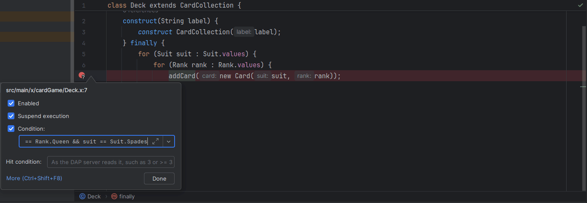
*IntelliJ: right-click a breakpoint for its **Condition** and **Hit condition**; this one stops only when the deck adds the Queen of Spades.*

</td><td width="50%">

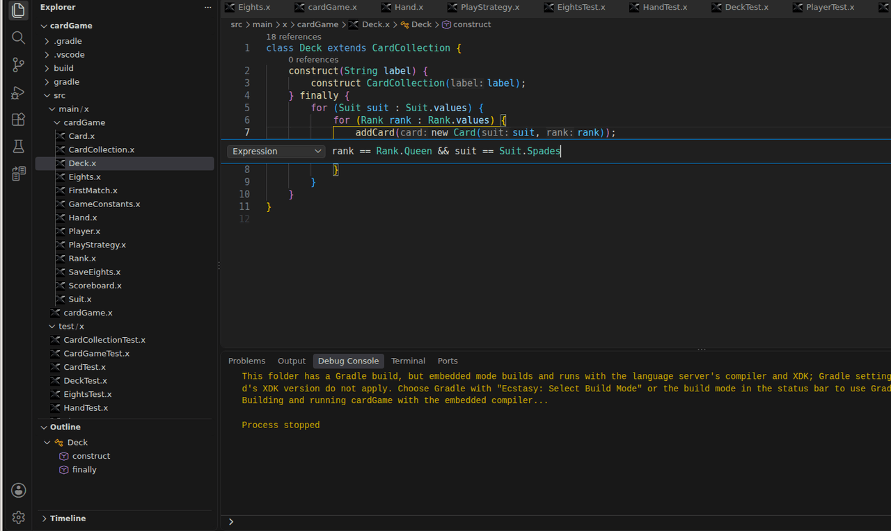
*VS Code: right-click a breakpoint, **Edit Condition**, to give it a condition, or a hit count; this one stops only for the Queen of Spades.*

</td></tr></table>

<table><tr><td width="50%">


*IntelliJ: an uncaught `OutOfBounds` stops the program where it is thrown, with its message and stack.*

</td><td width="50%">


*VS Code: an uncaught `OutOfBounds` stops the program where it is thrown, with its message and stack; it is also the frame's first variable.*

</td></tr></table>


*VS Code: **Break on Value Change** on `two`'s `strategy` stops right after the line that changes it.*

The running program keeps the code it was built from. When you edit a file while debugging, a
breakpoint follows its line to the code that was built, and one on a line you changed is marked
unverified, saying why: debug again to stop there.

### Step through the program

| Action | IntelliJ | VS Code |
|--------|----------|---------|
| Continue | Resume Program, F9 | Continue, F5 |
| Step over | F8 | F10 |
| Step into | F7 | F11 |
| Step out | Shift+F8 | Shift+F11 |
| Step into one of the line's calls | Smart Step Into, Shift+F7 | **Step Into Target**, in the editor's context menu |
| Run to the cursor's line | Run to Cursor, Alt+F9 | **Run to Cursor**, in the editor's context menu |
| Call a frame again from its first line | **Reset Frame**, in the Frames view | **Restart Frame**, in the Call Stack view |
| Stop a running program where it is | Pause Program | Pause, F6 |
| End the program | Stop | Stop |

Stepping into an XDK method opens its source, read-only, and its frames show like your own; in
IntelliJ, use Force Step Into (Alt+Shift+F7) to go into the XDK's code.

<table><tr><td width="50%">


*IntelliJ: Shift+F7 on a line that calls `deal` and `size` asks which call to step into.*

</td><td width="50%">


*VS Code: **Step Into Target**, in the editor's context menu, asks which call on the line to step into: `deal` or `size`.*

</td></tr></table>

### Look at the program's state

When the program stops, the debugger shows:

- **Frames and fibers.** The call stack of the stopped fiber, and every other service and fiber of
  the program, with what each is doing. A service runs on fibers of its own, so the card game's
  `Scoreboard` shows beside the game's own fiber.
- **Variables.** The frame's locals and `this`. Objects expand into their fields, and arrays into their
  elements: VS Code shows a large array in ranges of 100, and IntelliJ its first 100 with a node that
  reads the next. An object's computed properties and its `toString()` come after its fields, as lazy
  values that run the program's code only when you ask for them (VS Code's button, IntelliJ's **Show
  value** link). A mutable object's value ends with an identity code, such as `#1023456`, which tells
  apart two objects with the same fields.
- **Inline values.** The values of the stopped method's parameters and locals, beside their lines.
- **Watches and hovers.** Expressions such as `point.x + 1` or `ints[i] > 0`, evaluated again at every
  stop, without running the program's code. One that would run code, such as a call, says so.


*IntelliJ: stopped while dealing: the frames, the variables with their identity codes, and inline values beside the code.*

<table><tr><td width="50%">


*IntelliJ: a watch, evaluated again at every stop, beside the frame's variables.*

</td><td width="50%">


*VS Code: the Variables, Watch and Call Stack views, inline values beside the code, and the exception filters under Breakpoints.*

</td></tr></table>

Right-click in the Variables or Watch view:

- **Show Values as Hexadecimal** shows integers as `0xFF`, a negative one in its type's two's
  complement; choose it again for decimals.
- **Set Value** gives a local, a field or an array element the value of an expression, such as `5`,
  `n * 2` or `"text"`. A value of another type is refused, with the reason.

### Evaluate expressions and run code

In VS Code's **Debug Console** (Ctrl+Shift+Y), and in IntelliJ's **Evaluate Expression** (Alt+F8) and
the Debug window's console, type an expression to evaluate it in the paused frame. Completion offers
the frame's names, and after a dot the members of the value before it; in Evaluate Expression, press
Ctrl+Space.

What a watch can't evaluate, such as the call `size()`, runs as code on the paused fiber, for at most
two seconds by default, and answers with the result's `toString()`. What it changes stays changed. Meanwhile the rest of the program stays stopped, so code that waits for the program's
other fibers runs out of time; to let them run too, check **Let the program run while Evaluate
Expression runs code** (IntelliJ) or set `"evaluationRunsProgram": true` (VS Code).

While the program runs, a line typed in the Debug Console (VS Code) or the Debug window's console
(IntelliJ) is the program's input.

<table><tr><td width="50%">


*IntelliJ: Alt+F8 evaluates `size()`, a call, in the paused frame: 42 cards are left.*

</td><td width="50%">


*VS Code: the Debug Console evaluates `size() + 1` in the paused frame.*

</td></tr></table>

## 8. Settings, troubleshooting and limitations

### Settings that matter

The [configuration reference](../configuration.md) lists every setting. These are the ones you are
most likely to change. In IntelliJ, every page of the plugin is under **Settings | Languages &
Frameworks | Ecstasy**, which links each of them.

| What | IntelliJ | VS Code |
|------|----------|---------|
| Build mode | **Settings \| Languages & Frameworks \| Ecstasy \| Build and Run**, or Ctrl+Alt+X, then B | `xtc.build.mode`, or Ctrl+Alt+X, then B |
| Language adapter: compiler or Tree-sitter | **Tools \| Switch Ecstasy Language Adapter**, or Ctrl+Alt+X, then A | **Ecstasy: Switch Language Adapter**, Ctrl+Alt+X, then A, or the status bar |
| Inlay hints, reference counts | **Settings \| Languages & Frameworks \| Ecstasy \| Language Service** | `xtc.inlayHints.enabled`, `xtc.codeLens.references` |
| Indentation and line width | **Settings \| Editor \| Code Style \| Ecstasy** | `xtc.formatting.*` |
| The server's memory and logs | **Settings \| Languages & Frameworks \| Ecstasy \| Server Runtime and Logs**: the memory policy, a maximum heap, JVM options, logs | `xtc.server.memoryPolicy`, `xtc.server.maxHeap`, `xtc.java.vmOptions`, `xtc.server.logs`, in user settings |
| The Java that runs the server | IntelliJ's own | `xtc.java.home` |
| Which modules the compiler builds, and libraries | **Settings \| Languages & Frameworks \| Ecstasy \| Compiler** | **Ecstasy: Configure Compiler Paths**, **Ecstasy: Configure Libraries and Sources** |

In VS Code, **Ecstasy: Open Language Service Settings** opens the extension's settings. Without any
of these settings, the compiler finds the project's modules itself, from its folders or its Gradle
build, and uses the XDK it comes with.

The language adapter and the server's runtime settings restart the server, which reopens your
unsaved files; the others apply at once.

<table><tr><td width="50%">


*IntelliJ: **Settings | Languages & Frameworks | Ecstasy | Language Service**: the language adapter, text
synchronization, who formats on save, inlay hints and reference counts, then the running server's effective
configuration.*

</td><td width="50%">


*VS Code: **Ecstasy: Open Language Service Settings** shows the extension's settings, in four groups.*

</td></tr></table>


*IntelliJ: **Settings | Languages & Frameworks | Ecstasy | Server Runtime and Logs**: the server's JVM options, its
memory policy and maximum heap, and how long its logs are kept, with a button that restarts running servers with
the saved settings.*

<table><tr><td width="50%">


*IntelliJ: **Settings | Languages & Frameworks | Ecstasy | Compiler**: what the compiler builds, from the project's
layout or its Gradle build, with buttons that import the Gradle model again.*

</td><td width="50%">


*VS Code: **Ecstasy: Configure Compiler Paths**, from the Command Palette, offers the same choices as IntelliJ's
Compiler page.*

</td></tr></table>


*VS Code: Ctrl+Alt+X, then A, or a click on Ecstasy in the status bar, switches the server's adapter. IntelliJ's
**Tools | Switch Ecstasy Language Adapter**, or the same keys, opens the same choice in a popup.*

### Troubleshooting

When something doesn't work as you expect, look at the language server first.

- **Its state.** VS Code's status bar item, and **Ecstasy: Show Effective Language Service
  Configuration**, which reports the settings the server runs with and what it found. In IntelliJ,
  the **Ecstasy | Language Service** settings page shows the running server's configuration, and
  LSP4IJ's **Language Servers** window its state and traces.
- **Its log.** **Ctrl+Alt+X, then L** shows the server's log, and again hides it: IntelliJ's **Tools |
  Toggle Ecstasy Language Server Log**, VS Code's **Ecstasy: Show Language Server Output**. Each
  server also writes its log to `~/.xtc/logs/lsp/server-<pid>-<start>/server.log`. VS Code marks
  every line of the server's log `[error]`, as the server writes it to its standard error; the level
  after the time, such as `INFO`, is the line's real one.
- **Restart it.** **Ctrl+Alt+X, then R**: IntelliJ's **Tools | Restart Ecstasy Language Server**, VS
  Code's **Ecstasy: Restart Language Server**. Unsaved changes are kept. If the server's process
  dies, IntelliJ starts it again; in VS Code, a click on the status bar item does.
- **Export its logs.** IntelliJ's **Tools | Export Ecstasy Server Logs** and VS Code's **Ecstasy:
  Export Server Logs** save the server's recent logs, timing traces and status as one ZIP file, to
  attach to an issue. It holds no source files, but it may hold local paths and error messages.

<table><tr><td width="50%">


*IntelliJ: LSP4IJ's Language Servers window shows the server's state, its traces and its logs.*

</td><td width="50%">


*VS Code: Ctrl+Alt+X, then L shows the language server's log.*

</td></tr></table>

Some common problems:

| Symptom | What to do |
|---------|------------|
| No errors, completion or navigation | Check the server's state and log. Make sure the adapter is the compiler (Ctrl+Alt+X, then A). |
| VS Code: wrong Java, or none | Set `xtc.java.home` to a Java 25 or later installation. |
| A Gradle build's settings don't apply to a run | The project builds embedded; choose Gradle with Ctrl+Alt+X, then B. |
| Gradle mode can't find `runXtc` or `testXtc` | The project's Gradle build needs the XTC Gradle plugin; IntelliJ also needs the Gradle build linked. |
| A breakpoint is unverified | The line changed since the program was built, or has no code; debug again. |
| **Ecstasy: Create New Project** fails | Install an XDK and put its `xtc` on your `PATH`. |
| The server runs short of memory on a large project | Choose the **Adaptive** memory policy, which grows the heap as the work needs and gives memory back, or a larger maximum heap with the Default policy, in the runtime settings above, and restart it. |

### Known limitations

- VS Code has no `xtc` command-line build mode; use embedded or Gradle.
- IntelliJ's **Run 'All Ecstasy Tests'** has no Debug yet. In Gradle mode its **Rerun Failed Tests** needs
  the project's Gradle model, which names each module's Gradle project: import it with **Refresh Gradle
  model** on IntelliJ's **Ecstasy | Compiler** page.
- In embedded mode, the project's Gradle settings don't apply to builds and runs.
- A program being debugged keeps the code it was built from: edits apply the next time you run it.
- Code run from the Debug Console or Evaluate Expression stops after two seconds, and a lazy value
  after one, by default. To give them longer, set `evaluationTimeLimit` and `lazyValueTimeLimit`, in
  milliseconds, in VS Code's launch configuration, or **Evaluation time limit (ms)** and **Lazy value
  time limit (ms)** in IntelliJ's Ecstasy Application or Ecstasy Attach configuration. IntelliJ can't
  cancel an evaluation sooner, so Evaluate Expression waits out the whole limit for code that never
  ends.
- Rename and safe delete cover the modules the language server knows of. When one changes a public
  declaration, which modules in other folders may use, a notification says that those modules are not
  changed. To include them, add them with **Add consumers from folders** (IntelliJ's **Ecstasy |
  Compiler** page, VS Code's **Ecstasy: Configure Compiler Paths**); a project whose Gradle model is
  imported has all of its build's modules already.
- The formatter doesn't reflow comments or split string literals.
- The Tree-sitter adapter knows only syntax: no type errors, no type-aware completion or checked
  refactorings, and no embedded builds or runs.

The [manual test plan](../manual-test-plan.md#client-compatibility-limits) lists the remaining
differences between the editors in detail.
