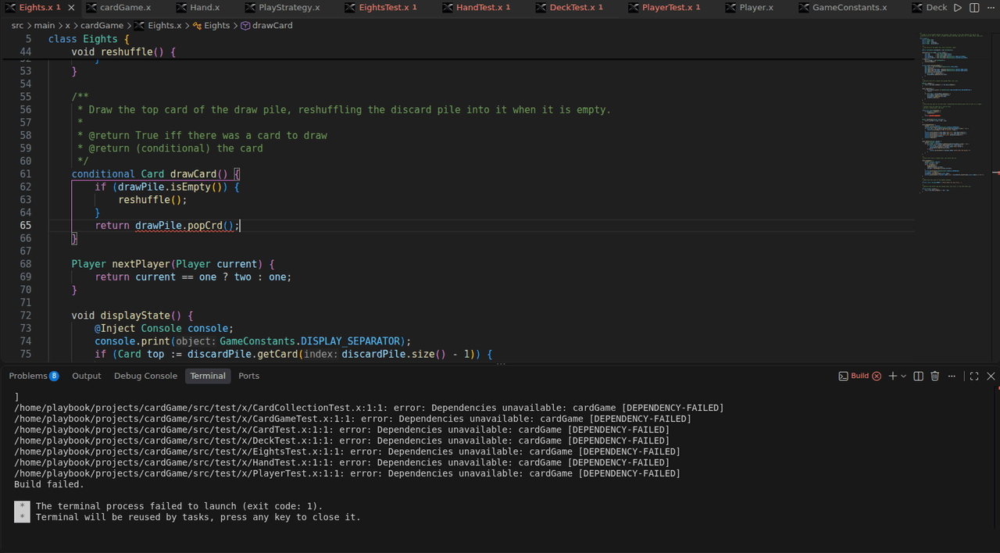
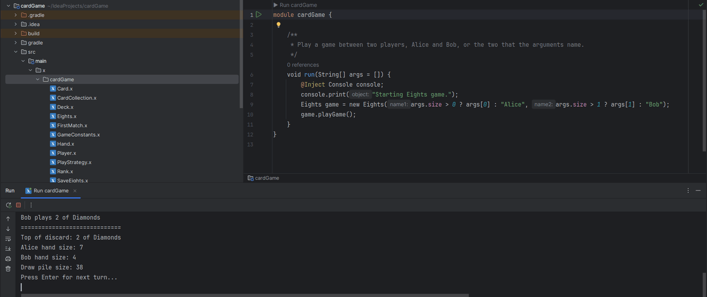
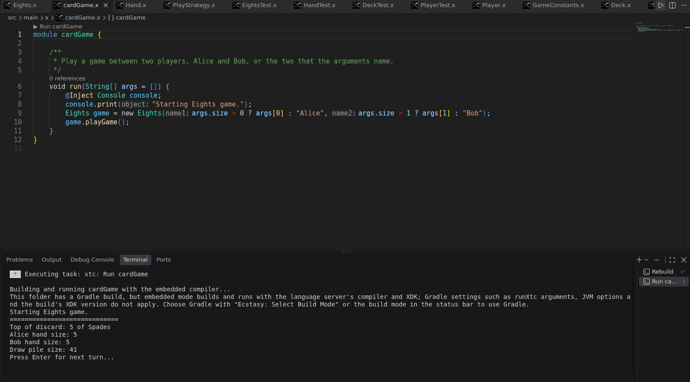

# Building and running

## Build modes

The build mode decides how Build, Run, Debug and the tests work. Press <kbd>Ctrl+Alt+X</kbd>, then <kbd>B</kbd> to
choose it in either editor, or:

- **IntelliJ:** **Tools | Select Ecstasy Build Mode**, or **Settings | Languages & Frameworks |
  Ecstasy | Build and Run**. It is saved with the project.
- **VS Code:** **Ecstasy: Select Build Mode**, or the status bar item that a folder with a Gradle build
  shows. It is the `xtc.build.mode` setting, per folder.

| Mode | What it does |
|------|--------------|
| Embedded compiler (the default) | The language server's compiler builds every module, and its execution worker runs them. Nothing to sync or install, and the fastest round trip. If the project also has a Gradle build, only its run settings apply (see [Gradle settings in embedded runs](#gradle-settings-in-embedded-runs)). |
| Gradle | The project's Gradle build runs `compileXtc`, `runXtc` and `testXtc`, with all of its settings and its XDK. |
| Automatic | Gradle when the project has a Gradle build, embedded otherwise. |
| `xtc` command line (IntelliJ only, per run configuration) | `xtc run` and `xtc test` from the XDK on your `PATH`. |

The next build or run uses the new mode; nothing restarts.

<table><tr><td width="50%">

*IntelliJ: **Settings | Languages & Frameworks | Ecstasy | Build and Run**, with **Build and run using** on its default, the embedded compiler.*

</td><td width="50%">

*VS Code: **Ecstasy: Select Build Mode**, which <kbd>Ctrl+Alt+X</kbd>, then <kbd>B</kbd>, and a click on the status bar's build mode open too.*

</td></tr></table>

### When builds and runs use Gradle whatever the mode

The embedded compiler builds and runs with the XDK that the language server comes with. Where that
XDK cannot stand in for the project's own, Build, Run, Debug and the tests use Gradle whatever the
mode, and the editors say why: a notice the first time, and the embedded compiler shown as not
available, with the reason, on IntelliJ's **Build and Run** page and in **Select Ecstasy Build
Mode**, and in VS Code's picker and the tooltip of its status bar item. That is so in two cases:

- **The project builds with another XDK.** Its Gradle build compiles and runs it with another XDK
  than the bundled one, as its `xdkDistribution` or `xdk` dependency selects it: another version, or
  another build of the same snapshot version. When the Gradle model is imported, the XTC plugin
  reads the XDK's distribution, from a repository or a file dependency, and records the SHA-256 of
  each of its module files and a revision of its `javatools.jar`, which leaves out the commit and
  branch it was built at. The language server compares those with what it bundles, since every
  build of a snapshot has the same version, while two builds of the same sources at other commits
  hold the same modules and compiler. An XDK that a project of the build tree makes, as a composite
  build's included XDK, which the import does not build, counts as another XDK, as does one that the
  import could not resolve or download; the next import tries again, also with Gradle's
  configuration cache on. The reason names both XDKs, as in *builds with XDK 0.5.0, not the bundled
  XDK 0.4.4*, and a folder whose modules only depend on such a module says that it depends on it.
  Refresh the model after the build changes its XDK. Without an imported model, or with one from an
  older XTC plugin, the server does not know the build's XDK, and embedded builds and runs use the
  bundled one.
- **The project's own modules replace bundled XDK libraries**, as in the XVM repository, whose
  `lib_*` modules replace them all. That is the reason given for a folder that has both causes. The
  XVM repository's `manualTests` builds with the repository's own XDK, so the repository builds with
  Gradle also with library replacement turned off.

In VS Code this applies per folder: the window's other folders keep their mode, and a task of a
folder's `tasks.json` takes its folder's. A run that belongs to no folder, as a multi-root
workspace's own launch configuration or **Ecstasy: Run Module** for a module name typed in, uses
Gradle when one of the window's folders does. IntelliJ, with one language server per project, takes the whole project. A choice of the embedded compiler is kept, and
applies again once the cause goes, as after the build moves to the bundled XDK and the model is
refreshed.

## Build

<kbd>Ctrl+F9</kbd> builds (<kbd>Cmd+F9</kbd> on macOS): IntelliJ's **Build | Build Project**, VS Code's **Ecstasy: Build**.
In embedded mode, every module builds in dependency order, from the editors' text, saved or not, into
`build/xtc/embedded`. **Rebuild** compiles everything again. A failed build lists each error with its
file and line, a click away from its code: in IntelliJ's **Build** window, and in VS Code's terminal.

<table><tr><td width="50%">

*IntelliJ: a failed build in the Build window: the error in `Eights.x`, and the test modules that need the module that failed.*

</td><td width="50%">

*VS Code: a failed build lists its errors, with their files and lines, in the build's terminal.*

</td></tr></table>

## Run

A module with a `run()` method has a **▶ Run** lens above its `module` declaration, and in IntelliJ a
Run icon in the gutter of that line. Click either to run it. Other ways:

- **IntelliJ:** **Run Context Configuration** (<kbd>Ctrl+Shift+F10</kbd>; <kbd>Ctrl+Shift+R</kbd> on macOS) in the editor, or
  an **Ecstasy Application** run configuration (**Run | Edit Configurations | + | Ecstasy Application**)
  run with <kbd>Shift+F10</kbd>. The configuration names the module, its method and arguments, and what it runs
  with: the project default, embedded, Gradle or `xtc` command line.
- **VS Code:** the editor's Run button, <kbd>Ctrl+Shift+F10</kbd> (<kbd>Ctrl+Shift+R</kbd> on macOS), **Ecstasy: Run Module**,
  or an `xtc` task in `.vscode/tasks.json` with arguments (see
  [Tasks](../../vscode-extension/README.md#tasks)).

<table><tr><td width="50%">

*IntelliJ: the Run lens and the gutter icon run the module; the game reads each <kbd>Enter</kbd> from the Run window.*

</td><td width="50%">

*VS Code: the game runs in a terminal of its own, which also says that the folder's Gradle build doesn't apply in embedded mode.*

</td></tr></table>

<table><tr><td>

*IntelliJ: an Ecstasy Application configuration, with its arguments and what it runs with.*

</td></tr></table>

### Program input

The program reads its input from the Run window (IntelliJ) or its terminal (VS Code): type a line and
press <kbd>Enter</kbd>. IntelliJ's **Send EOF**, or <kbd>Ctrl+D</kbd> on an empty line in VS Code, ends the input. Stop ends
the program; IntelliJ's **Rerun** runs it again.

### Embedded and Gradle runs

In embedded mode, each run gets a fresh program, in an execution worker beside the language server.
Up to four programs run at once. In Gradle mode, the same Run runs the XTC Gradle plugin's `runXtc`
task; IntelliJ's Gradle window also lists the plugin's tasks.

## Gradle settings in embedded runs

Where the project's Gradle model is imported (IntelliJ's **Refresh Gradle model** on the **Ecstasy |
Compiler** page, VS Code's **Ecstasy: Refresh Gradle Compiler Model**), embedded runs and debug
sessions take the module's run settings from its Gradle project's `xtcRun`: the method and arguments
of its `module { ... }`, where the run configuration leaves them empty, and its `jvmArgs`. Tests take
`xtcTest`'s `jvmArgs`. The run's output says which settings it took, before the program's own output.

Settings made only on a task, as in `tasks.runXtc { ... }`, are not seen, nor are the build's
compile settings and its other run settings, such as `xtcRun`'s module path. A build on another XDK
than the bundled one builds and runs with Gradle instead (see
[When builds and runs use Gradle whatever the mode](#when-builds-and-runs-use-gradle-whatever-the-mode)).
After you change the build, refresh the model for the next run. Which JVM options a run leaves out, and how their
relative paths resolve, is in the [configuration reference](../configuration.md#33-child-processes).

---

[← Refactoring](refactoring.md) · [Contents](README.md) · [Testing with xunit →](testing.md)
