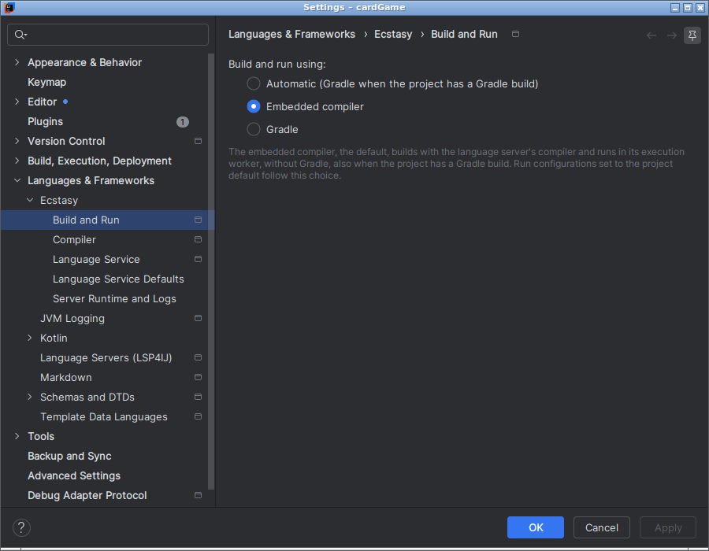
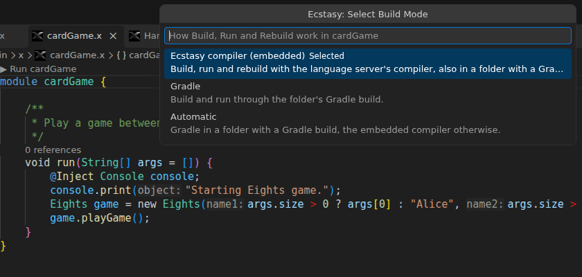
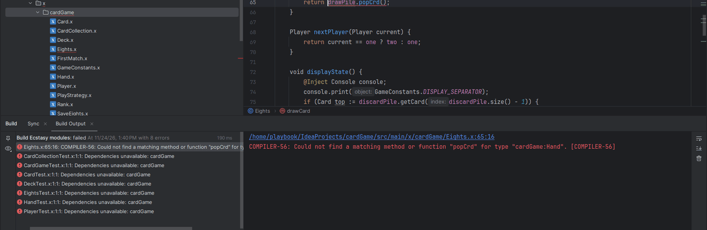
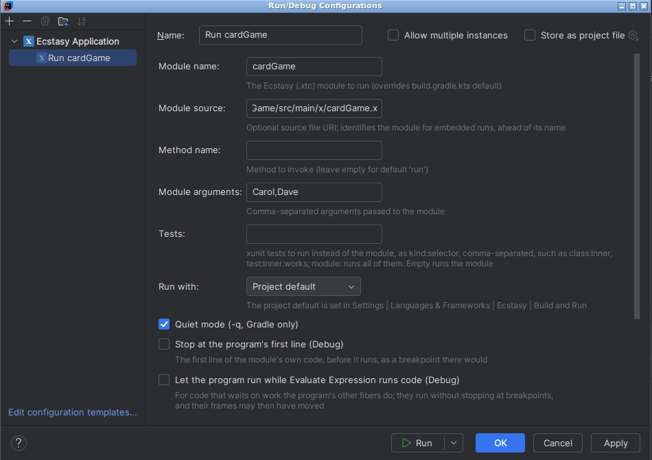

# Building and running

## Build modes

The build mode decides how Build, Run, Debug and the tests work. Press <kbd>Ctrl+Alt+X</kbd>, then <kbd>B</kbd> to
choose it in either editor, or:

- **IntelliJ:** **Tools | Select Ecstasy Build Mode**, or **Settings | Languages & Frameworks |
  Ecstasy | Build and Run**. It is saved with the project. Where the project's own modules replace
  bundled XDK libraries, as in the XVM repository, the embedded compiler is shown as not available,
  and builds and runs use Gradle.
- **VS Code:** **Ecstasy: Select Build Mode**, or the status bar item that a folder with a Gradle build
  shows. It is the `xtc.build.mode` setting, per folder.

| Mode | What it does |
|------|--------------|
| Embedded compiler (the default) | The language server's compiler builds every module, and its execution worker runs them. Nothing to sync or install, and the fastest round trip. If the project also has a Gradle build, only its run settings apply (see [Gradle settings in embedded runs](#gradle-settings-in-embedded-runs)). |
| Gradle | The project's Gradle build runs `compileXtc`, `runXtc` and `testXtc`, with all of its settings and its XDK. |
| Automatic | Gradle when the project has a Gradle build, embedded otherwise. |
| `xtc` command line (IntelliJ only, per run configuration) | `xtc run` and `xtc test` from the XDK on your `PATH`. |

The next build or run uses the new mode; nothing restarts.

<table><tr><td width="50%">

*IntelliJ: **Settings | Languages & Frameworks | Ecstasy | Build and Run**, with **Build and run using** on its default, the embedded compiler.*

</td><td width="50%">

*VS Code: **Ecstasy: Select Build Mode**, which <kbd>Ctrl+Alt+X</kbd>, then <kbd>B</kbd>, and a click on the status bar's build mode open too.*

</td></tr></table>

## Build

<kbd>Ctrl+F9</kbd> builds (<kbd>Cmd+F9</kbd> on macOS): IntelliJ's **Build | Build Project**, VS Code's **Ecstasy: Build**.
In embedded mode, every module builds in dependency order, from the editors' text, saved or not, into
`build/xtc/embedded`. **Rebuild** compiles everything again. A failed build lists each error with its
file and line, a click away from its code: in IntelliJ's **Build** window, and in VS Code's terminal.

<table><tr><td width="50%">

*IntelliJ: a failed build in the Build window: the error in `Eights.x`, and the test modules that need the module that failed.*

</td><td width="50%">

*VS Code: a failed build lists its errors, with their files and lines, in the build's terminal.*

</td></tr></table>

## Run

A module with a `run()` method has a **▶ Run** lens above its `module` declaration, and in IntelliJ a
Run icon in the gutter of that line. Click either to run it. Other ways:

- **IntelliJ:** **Run Context Configuration** (<kbd>Ctrl+Shift+F10</kbd>; <kbd>Ctrl+Shift+R</kbd> on macOS) in the editor, or
  an **Ecstasy Application** run configuration (**Run | Edit Configurations | + | Ecstasy Application**)
  run with <kbd>Shift+F10</kbd>. The configuration names the module, its method and arguments, and what it runs
  with: the project default, embedded, Gradle or `xtc` command line.
- **VS Code:** the editor's Run button, <kbd>Ctrl+Shift+F10</kbd> (<kbd>Ctrl+Shift+R</kbd> on macOS), **Ecstasy: Run Module**,
  or an `xtc` task in `.vscode/tasks.json` with arguments (see
  [Tasks](../../vscode-extension/README.md#tasks)).

<table><tr><td width="50%">

*IntelliJ: the Run lens and the gutter icon run the module; the game reads each <kbd>Enter</kbd> from the Run window.*

</td><td width="50%">

*VS Code: the game runs in a terminal of its own, which also says that the folder's Gradle build doesn't apply in embedded mode.*

</td></tr></table>

<table><tr><td>

*IntelliJ: an Ecstasy Application configuration, with its arguments and what it runs with.*

</td></tr></table>

### Program input

The program reads its input from the Run window (IntelliJ) or its terminal (VS Code): type a line and
press <kbd>Enter</kbd>. IntelliJ's **Send EOF**, or <kbd>Ctrl+D</kbd> on an empty line in VS Code, ends the input. Stop ends
the program; IntelliJ's **Rerun** runs it again.

### Embedded and Gradle runs

In embedded mode, each run gets a fresh program, in an execution worker beside the language server.
Up to four programs run at once. In Gradle mode, the same Run runs the XTC Gradle plugin's `runXtc`
task; IntelliJ's Gradle window also lists the plugin's tasks.

## Gradle settings in embedded runs

Where the project's Gradle model is imported (IntelliJ's **Refresh Gradle model** on the **Ecstasy |
Compiler** page, VS Code's **Ecstasy: Refresh Gradle Compiler Model**), embedded runs and debug
sessions take the module's run settings from its Gradle project's `xtcRun`: the method and arguments
of its `module { ... }`, where the run configuration leaves them empty, and its `jvmArgs`. Tests take
`xtcTest`'s `jvmArgs`. The run's output says which settings it took, before the program's own output.

Settings made only on a task, as in `tasks.runXtc { ... }`, are not seen, nor are the build's XDK
version, its compile settings and its other run settings, such as `xtcRun`'s module path. After you
change the build, refresh the model for the next run. Which JVM options a run leaves out, and how their
relative paths resolve, is in the [configuration reference](../configuration.md#33-child-processes).

---

[← Refactoring](refactoring.md) · [Contents](README.md) · [Testing with xunit →](testing.md)
