# The debugger

The debugger works the same in both editors: IntelliJ connects to it through LSP4IJ, VS Code through
its own debugging support.
A debug session builds and runs the program as Run does, under the debugger.

## Start debugging

- **IntelliJ:** Debug a run configuration with <kbd>Shift+F9</kbd> or the toolbar's Debug button. Running a
  module from its gutter icon makes its configuration, which <kbd>Shift+F9</kbd> then debugs.
- **VS Code:** <kbd>F5</kbd> debugs the module of the active editor, with no configuration needed. To give
  arguments, choose a method or stop at the first line, add a configuration to `.vscode/launch.json`
  (**Add Configuration**, then **Ecstasy: Launch Module**); see
  [Debugging](../../vscode-extension/README.md#debugging) for its fields.

In Gradle mode, Debug runs the module's `runXtc` task with the debugger, and the program connects to
the session; in IntelliJ's command-line mode, it runs `xtc run`. The breakpoints are the same.

To stop before the program does anything, check **Stop at the program's first line** in IntelliJ's
run configuration, or set `"stopOnEntry": true` in VS Code's launch configuration.

## Attach to a program run outside the editor

You can debug a program that you run in a terminal, with the launcher's `--debug` option:

1. Copy the option: VS Code's **Ecstasy: Copy Option to Debug a Program Outside the Editor**, or the
   **Port** comment of a new IntelliJ **Ecstasy Attach** configuration (**Run | Edit Configurations |
   + | Ecstasy Attach**). It is `--debug listen:127.0.0.1:5005,suspend`.
2. Run the program with it, for example:

   ```bash
   xtc run -o build/attach --debug listen:127.0.0.1:5005,suspend src/main/x/cardGame.x
   ```

   It prints `Listening for the debugger at 127.0.0.1:5005` and waits before its first line.
3. Start the attach: Debug the **Ecstasy Attach** configuration (IntelliJ), or a launch configuration
   from the **Ecstasy: Attach to Program** snippet (VS Code), with the same port.

Breakpoints, stepping and evaluation work as in a launched session. Stopping the session detaches,
and the program runs on. The program must run with an XDK of the same version as your plugin or
extension; with another, the attach says so. One debugger at a time can attach.

<table><tr><td>

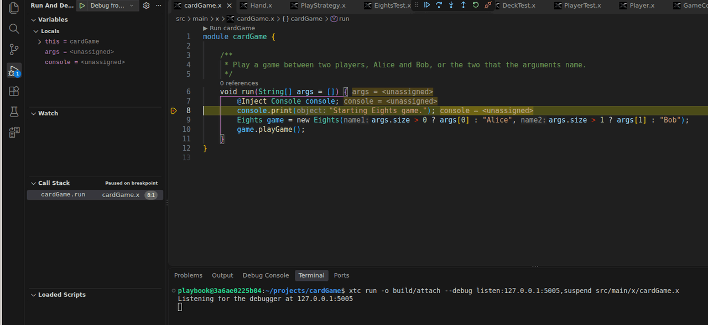

*VS Code: `xtc run` with the copied `--debug` option waits in the terminal; the attach configuration connects, and the program stops at its breakpoint.*

</td></tr></table>

## Breakpoints

Click in the gutter beside a line to set a breakpoint. They work in embedded, Gradle, command-line and
attached sessions alike.

### Conditions, hit counts and logpoints

- **Condition**: the breakpoint stops only when an expression is `True`, such as
  `rank == Rank.Queen && suit == Suit.Spades` or `i % 2 == 0`. In IntelliJ, right-click the
  breakpoint; in VS Code, choose **Add Conditional Breakpoint** in the gutter's context menu, or
  **Edit Breakpoint** on one you have. A condition that can't be evaluated stops anyway, and says why.
- **Hit count**: stop at the Nth hit, or `>= N`, `> N` or `% N`. IntelliJ: the breakpoint's **Hit
  condition**, in its right-click popup or the Breakpoints dialog (<kbd>Ctrl+Shift+F8</kbd>); VS Code: **Edit
  Breakpoint**, then **Hit Count**.
- **Logpoint**: print a message instead of stopping, with `{expression}` replaced by its value, such as
  `sum={sum}`. IntelliJ: a breakpoint with **Suspend** unchecked and **Evaluate and log**; VS Code:
  **Add Logpoint**.
<table><tr><td width="50%">

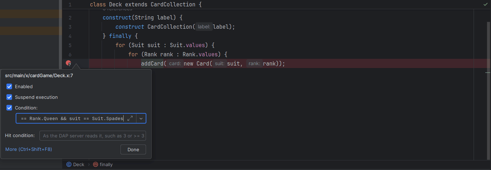
*IntelliJ: right-click a breakpoint for its **Condition** and **Hit condition**; this one stops only when the deck adds the Queen of Spades.*

</td><td width="50%">

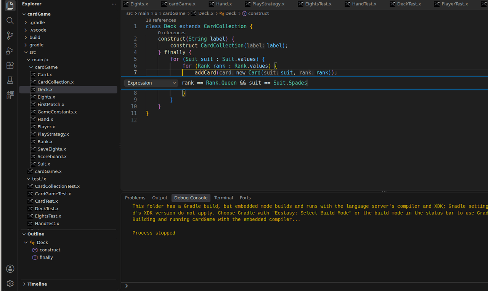
*VS Code: right-click a breakpoint, **Edit Condition**, to give it a condition, or a hit count; this one stops only for the Queen of Spades.*

</td></tr></table>

### Function, data and exception breakpoints

- **Function breakpoint**: stop in every method of a name, such as `recordWin` or `Point.move`, with a
  condition and hit count like a line's. IntelliJ: in the Breakpoints dialog; VS Code: the
  Breakpoints view's **+**.
- **Data breakpoint**: stop once a field of an object changes, saying from what to what, such as
  `Counter.count changed from 0 to 2`. Right-click the field in the Variables view and choose
  **Break on Value Change**.
- **Exceptions**: an exception that nothing catches stops the program where it is thrown, by default.
  Turn on **All Exceptions** to stop at caught ones too, and give a filter a condition that names
  exception classes, such as `IllegalArgument, OutOfBounds`, to stop only at those. The exception is
  the frame's first variable, and the editor shows its message and stack.

<table><tr><td width="50%">

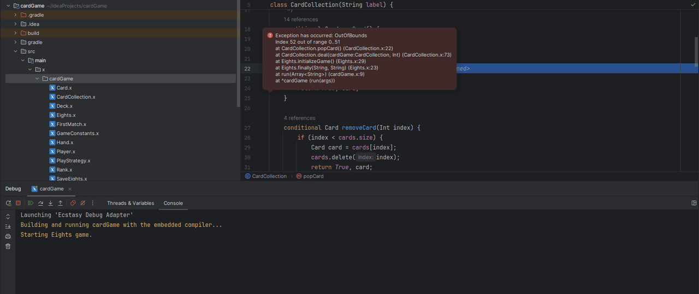
*IntelliJ: stopped at an uncaught `OutOfBounds`.*

</td><td width="50%">

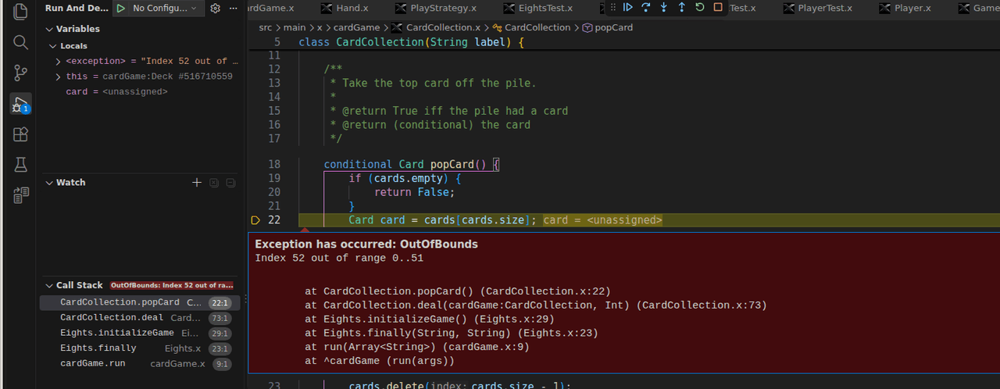
*VS Code: stopped at an uncaught `OutOfBounds`, which is also the frame's first variable.*

</td></tr></table>

<table><tr><td>

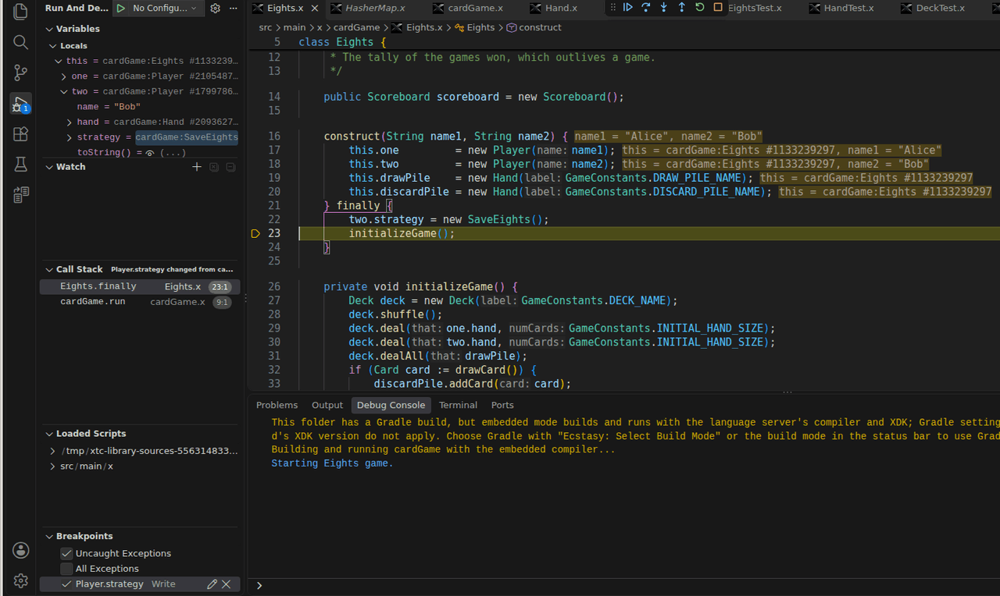

*VS Code: **Break on Value Change** on `two`'s `strategy` stops right after the line that changes it.*

</td></tr></table>

### Breakpoints while you edit

The running program keeps the code it was built from. When you edit a file while debugging, a
breakpoint follows its line to the code that was built, and one on a line you changed is marked
unverified, saying why: debug again to stop there.

## Step through the program

| Action | IntelliJ | VS Code |
|--------|----------|---------|
| Continue | Resume Program, <kbd>F9</kbd> | Continue, <kbd>F5</kbd> |
| Step over | <kbd>F8</kbd> | <kbd>F10</kbd> |
| Step into | <kbd>F7</kbd> | <kbd>F11</kbd> |
| Step out | <kbd>Shift+F8</kbd> | <kbd>Shift+F11</kbd> |
| Step into one of the line's calls | Smart Step Into, <kbd>Shift+F7</kbd> | **Step Into Target**, in the editor's context menu |
| Run to the cursor's line | Run to Cursor, <kbd>Alt+F9</kbd> | **Run to Cursor**, in the editor's context menu |
| Call a frame again from its first line | **Reset Frame**, in the Frames view | **Restart Frame**, in the Call Stack view |
| Stop a running program where it is | Pause Program | Pause, <kbd>F6</kbd> |
| End the program | Stop | Stop |

Stepping into an XDK method opens its source, read-only, and its frames show like your own. In
IntelliJ, that takes Force Step Into (<kbd>Alt+Shift+F7</kbd>); its Step Into stays in your own code.

<table><tr><td width="50%">

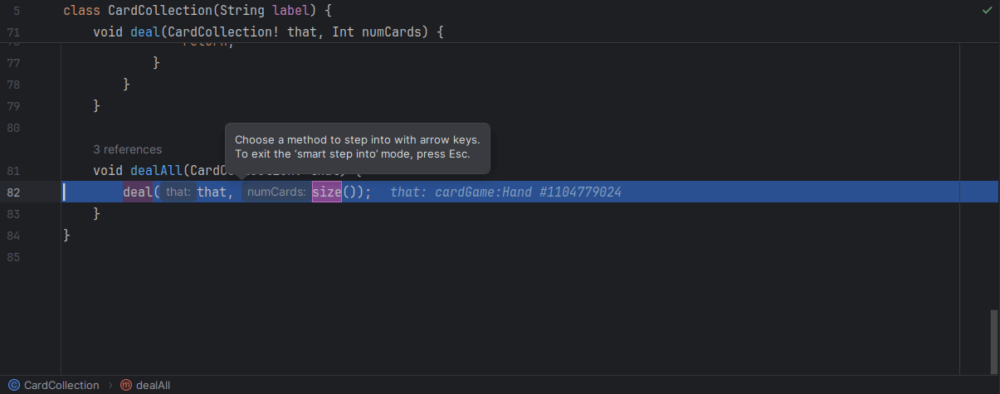
*IntelliJ: <kbd>Shift+F7</kbd> on a line that calls `deal` and `size` asks which call to step into.*

</td><td width="50%">

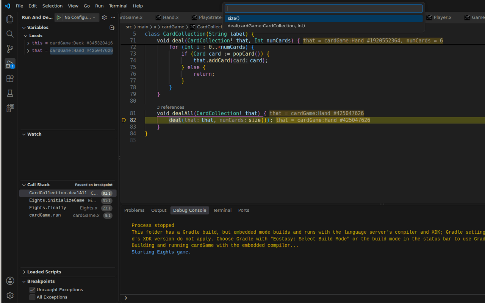
*VS Code: **Step Into Target**, in the editor's context menu, asks which call on the line to step into: `deal` or `size`.*

</td></tr></table>

## Look at the program's state

When the program stops, the debugger shows:

- **Frames and fibers.** The call stack of the stopped fiber, and every other service and fiber of
  the program, with what each is doing. A service runs on fibers of its own, so the card game's
  `Scoreboard` shows beside the game's own fiber.
- **Variables.** The frame's locals and `this`. Objects expand into their fields, and arrays into their
  elements: VS Code shows a large array in ranges of 100, and IntelliJ its first 100 with a node that
  reads the next. An object's computed properties and its `toString()` come after its fields, as lazy
  values that run the program's code only when you ask for them (VS Code's button, IntelliJ's **Show
  value** link). A mutable object's value ends with an identity code, such as `#1023456`, which tells
  apart two objects with the same fields.
- **Inline values.** The values of the stopped method's parameters and locals, beside their lines.
- **Watches and hovers.** Expressions such as `point.x + 1` or `ints[i] > 0`, evaluated again at every
  stop, without running the program's code. One that would run code, such as a call, says so.

<table><tr><td>

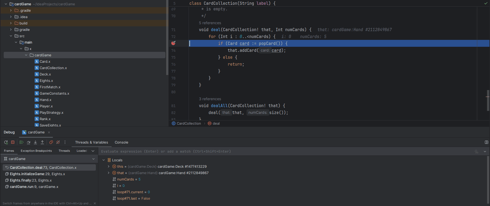

*IntelliJ: stopped while dealing: the frames, the variables with their identity codes, and inline values beside the code.*

</td></tr></table>

<table><tr><td width="50%">

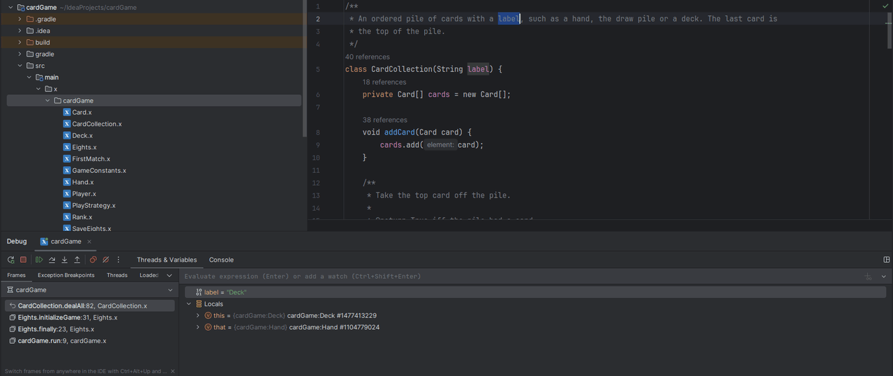
*IntelliJ: a watch, evaluated again at every stop, beside the frame's variables.*

</td><td width="50%">

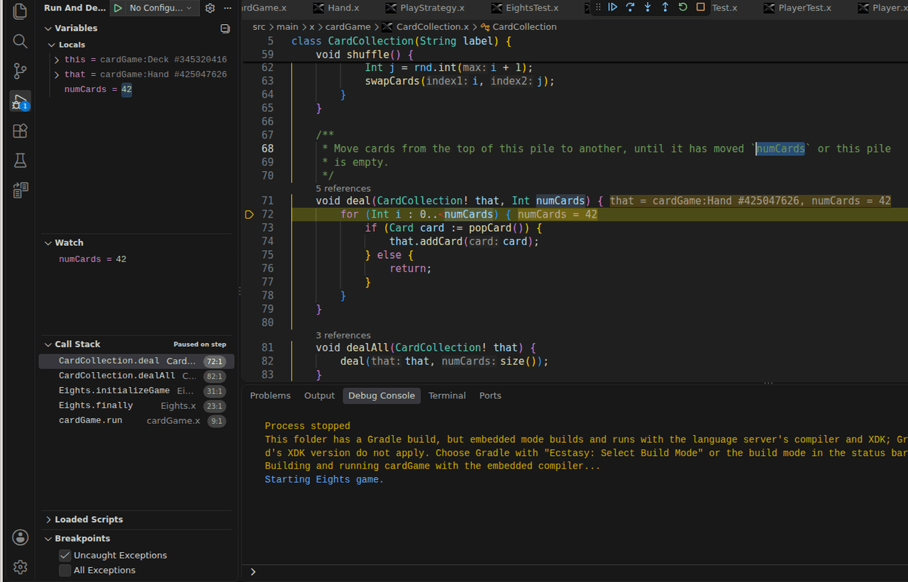
*VS Code: the Variables, Watch and Call Stack views, inline values beside the code, and the exception filters under Breakpoints.*

</td></tr></table>

Right-click in the Variables or Watch view:

- **Show Values as Hexadecimal** shows integers as `0xFF`, a negative one in its type's two's
  complement; choose it again for decimals.
- **Set Value** gives a local, a field or an array element the value of an expression, such as `5`,
  `n * 2` or `"text"`. A value of another type is refused, with the reason.

## Evaluate expressions and run code

In VS Code's **Debug Console** (<kbd>Ctrl+Shift+Y</kbd>), and in IntelliJ's **Evaluate Expression** (<kbd>Alt+F8</kbd>) and
the Debug window's console, type an expression to evaluate it in the paused frame. Completion offers
the frame's names, and after a dot the members of the value before it; in Evaluate Expression, press
<kbd>Ctrl+Space</kbd>.

There, an expression that a watch can't evaluate, such as the call `size()`, runs as code on the
paused fiber, for at most two seconds by default, and answers with the result's `toString()`. What it
changes stays changed. The rest of the program stays stopped meanwhile, so code that waits for its
other fibers runs out of time; to let them run too, check **Let the program run while Evaluate
Expression runs code** (IntelliJ) or set `"evaluationRunsProgram": true` (VS Code).

While the program runs, a line typed in the Debug Console (VS Code) or the Debug window's console
(IntelliJ) is the program's input.

<table><tr><td width="50%">

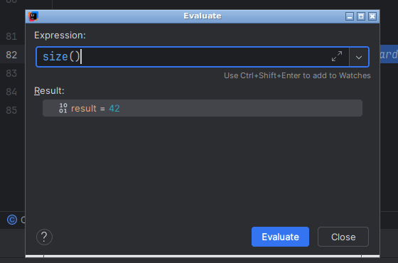
*IntelliJ: <kbd>Alt+F8</kbd> evaluates `size()`, a call, in the paused frame: 42 cards are left.*

</td><td width="50%">

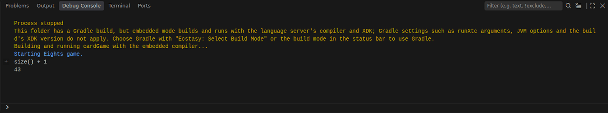
*VS Code: the Debug Console evaluates `size() + 1` in the paused frame.*

</td></tr></table>

---

[← Testing with xunit](testing.md) · [Contents](README.md) · [Settings, troubleshooting and limitations →](settings-and-troubleshooting.md)
