# Editing and navigation

## The language server

The plugin or extension starts the language server when you open an Ecstasy file. Its first analysis
of a project takes some seconds; after that, it rechecks what you change.

- **VS Code** shows the server's state in the status bar: a spinning `Ecstasy` while it starts,
  `✓ Ecstasy · Compiler` when it is ready, and a warning or error icon when it has failed, which you
  can click to restart it.
- **IntelliJ** shows it in LSP4IJ's **Language Servers** window, which also traces what the editor
  and the server say to each other.

The server's default *adapter* analyzes code with the compiler. The other adapter, Tree-sitter,
understands only syntax: it is a fallback for a project that the compiler has trouble with. Switch
with <kbd>Ctrl+Alt+X</kbd>, then <kbd>A</kbd>; see [Settings that matter](settings-and-troubleshooting.md#settings-that-matter).

## Reading code

### Colors, hints and reference counts

The compiler colors names by what they are: fields, parameters, locals, types and static members.
Inlay hints show the parameter names of a call whose arguments don't say what they are, and the
inferred types of locals. A line above each declaration counts its references in the project, tests
included, and a click lists them.

<table><tr><td width="50%">

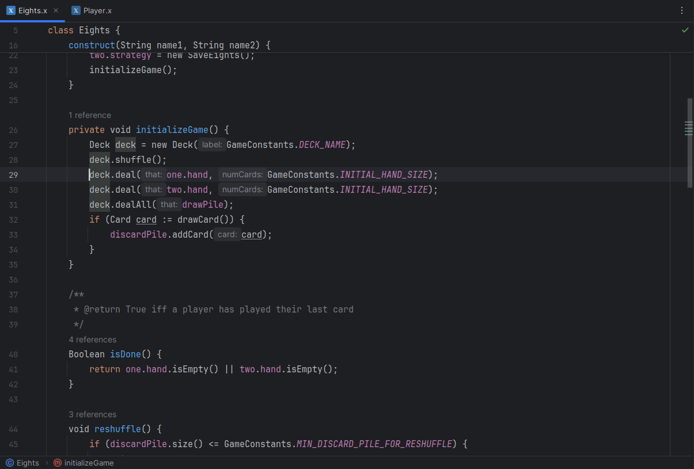
*IntelliJ: inlay hints name a call's parameters, such as `numCards:`, and the line above each declaration counts its references.*

</td><td width="50%">

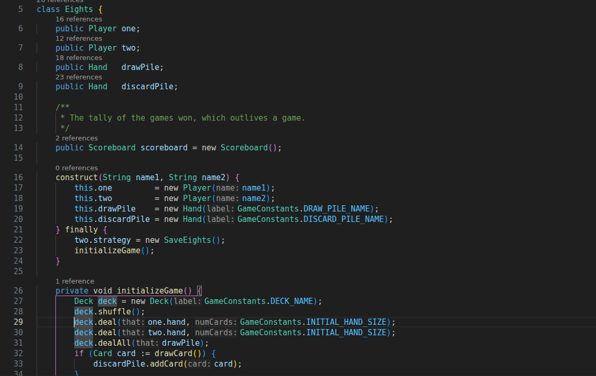
*VS Code: hints name `deal`'s parameters, `that` and `numCards`, and the line above each declaration counts its references.*

</td></tr></table>

### Documentation

Hover a name, or press <kbd>Ctrl+Q</kbd> (IntelliJ) or <kbd>Ctrl+K</kbd> <kbd>Ctrl+I</kbd> (VS Code), for its declaration and doc
comment, as the compiler sees it. This works for the XDK's own types too.

URLs in comments and strings are links, and so is an import's name, to the source it imports: <kbd>Ctrl</kbd>+click
one to open it.

<table><tr><td width="50%">

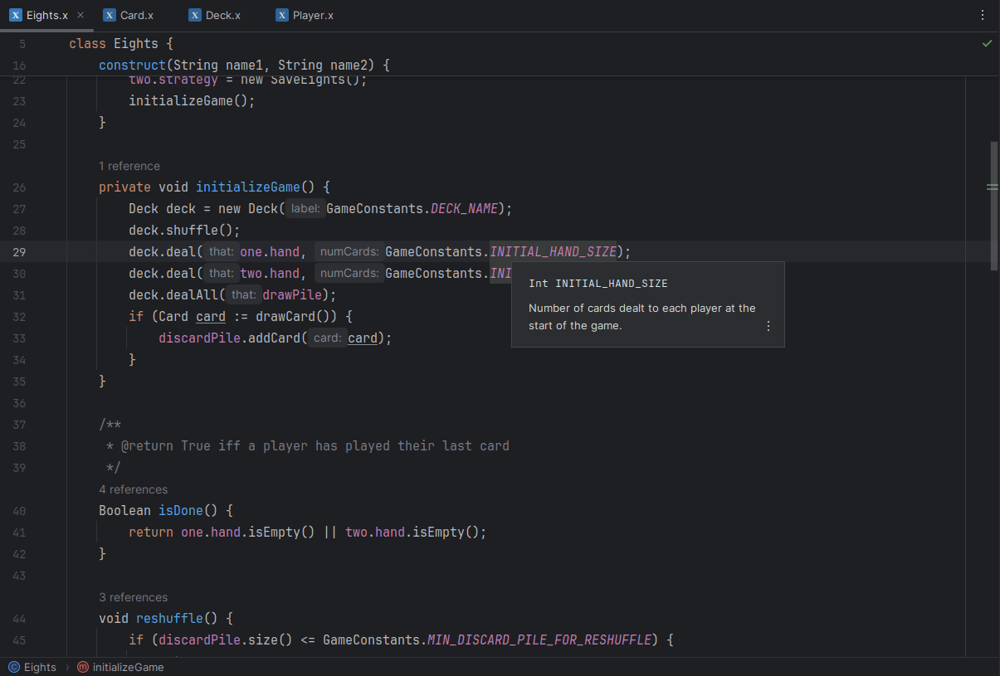
*IntelliJ: quick documentation for `INITIAL_HAND_SIZE`.*

</td><td width="50%">

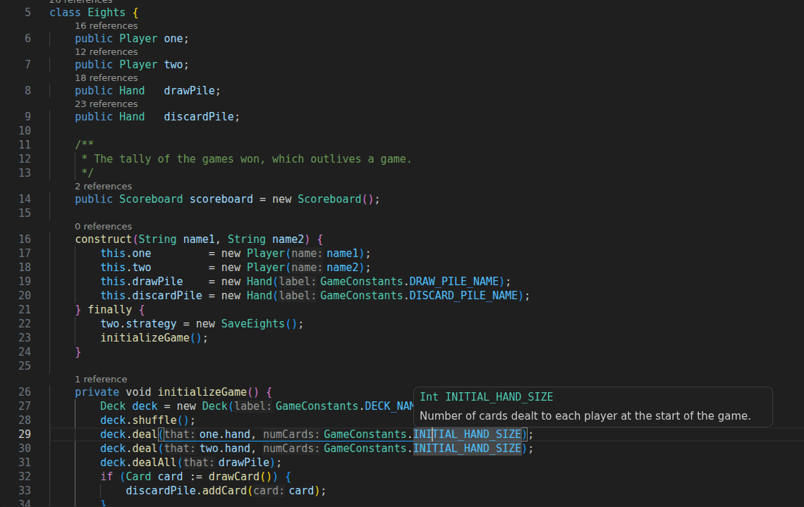
*VS Code: the hover of `INITIAL_HAND_SIZE`.*

</td></tr></table>

### Uses, folding, selection and outline

With the cursor on a name, its uses in the file are highlighted. Methods and doc comments fold.
Extend selection grows the selection by the syntax around it: <kbd>Ctrl+W</kbd> and <kbd>Ctrl+Shift+W</kbd> in IntelliJ,
<kbd>Shift+Alt+Right</kbd> and <kbd>Shift+Alt+Left</kbd> in VS Code.

The file's outline is IntelliJ's **File Structure** popup (<kbd>Ctrl+F12</kbd>) and **Structure** window, and
VS Code's **Outline** view and breadcrumbs.

## Writing code

### Completion

After a dot, completion lists the members of the expression's type as the compiler resolves it,
with their types. As you type a name, it offers the types, variables and keywords in scope. In an
argument list it also offers the values in scope that fit the parameter. Choosing a type from another
module adds its import.

<table><tr><td width="50%">

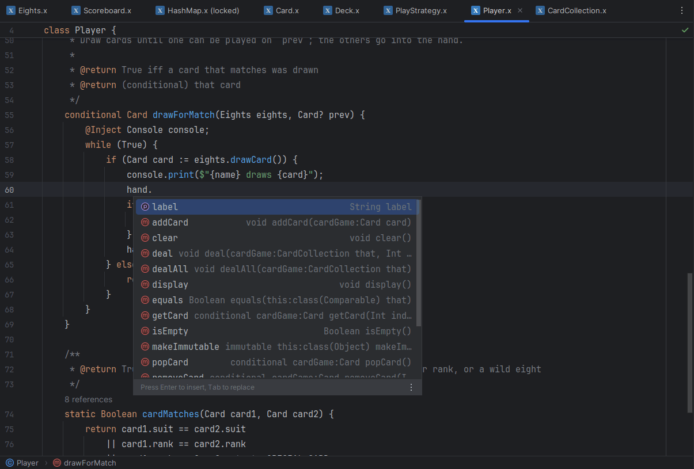
*IntelliJ: completion after `hand.`.*

</td><td width="50%">

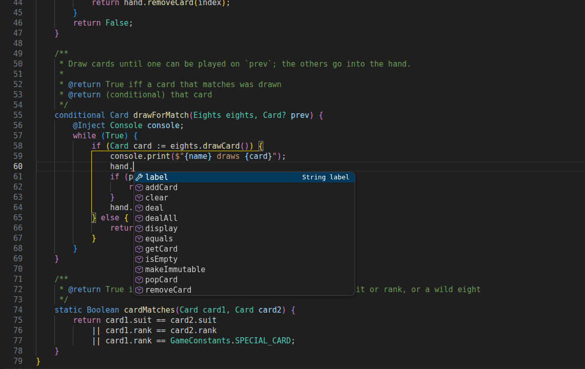
*VS Code: completion after `hand.`.*

</td></tr></table>

### Parameter info

Inside a call, <kbd>Ctrl+P</kbd> (IntelliJ) or <kbd>Ctrl+Shift+Space</kbd> (VS Code) shows the parameters of the method it
calls, with the one at the cursor in bold. It also opens by itself as you type the call's `(`.

<table><tr><td width="50%">

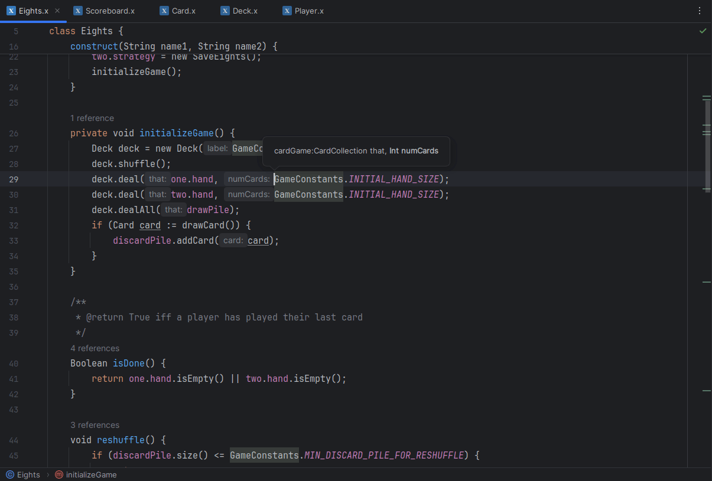
*IntelliJ: parameter info in a call of `deal`.*

</td><td width="50%">

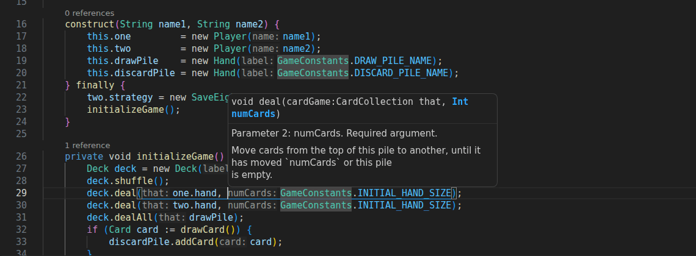
*VS Code: parameter hints in a call of `deal`, with its doc comment.*

</td></tr></table>

### Templates

Templates write common declarations. In IntelliJ, <kbd>Ctrl+J</kbd> lists the live templates, such as `cls`,
`meth`, `fori` and `sout`; in VS Code, the snippets complete with the other suggestions, such as
`meth` for a method. <kbd>Tab</kbd> moves through a template's placeholders.

### Formatting and comments

Formatting goes through the language server's formatter, with your indentation settings
(IntelliJ's **Settings | Editor | Code Style | Ecstasy**, VS Code's `xtc.formatting.*` settings).
Reformat a file or a selection with <kbd>Ctrl+Alt+L</kbd> (IntelliJ) or <kbd>Shift+Alt+F</kbd> (VS Code). <kbd>Enter</kbd> and `}`
indent as you type, and typing `{` and <kbd>Enter</kbd> closes the block. To format on save, use IntelliJ's
**Actions on Save | Reformat code**, or VS Code's `editor.formatOnSave`.

<kbd>Ctrl+/</kbd> comments out the selected lines with `//`; in IntelliJ, <kbd>Ctrl+Shift+/</kbd> wraps a selection in
`/* */`.

## Errors and warnings

### As you type

The compiler checks the editor's text as you type, not the saved file, so an error shows as soon as
you make it. Warnings show too, such as an assertion that can never fail.

<table><tr><td width="50%">

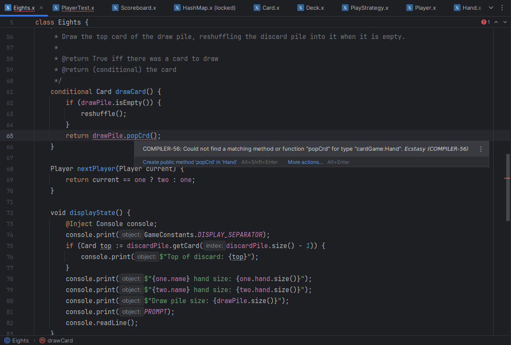
*IntelliJ: a misspelled `popCard` is an error as soon as it is typed; <kbd>Ctrl+F1</kbd> shows the compiler's message, with a fix.*

</td><td width="50%">

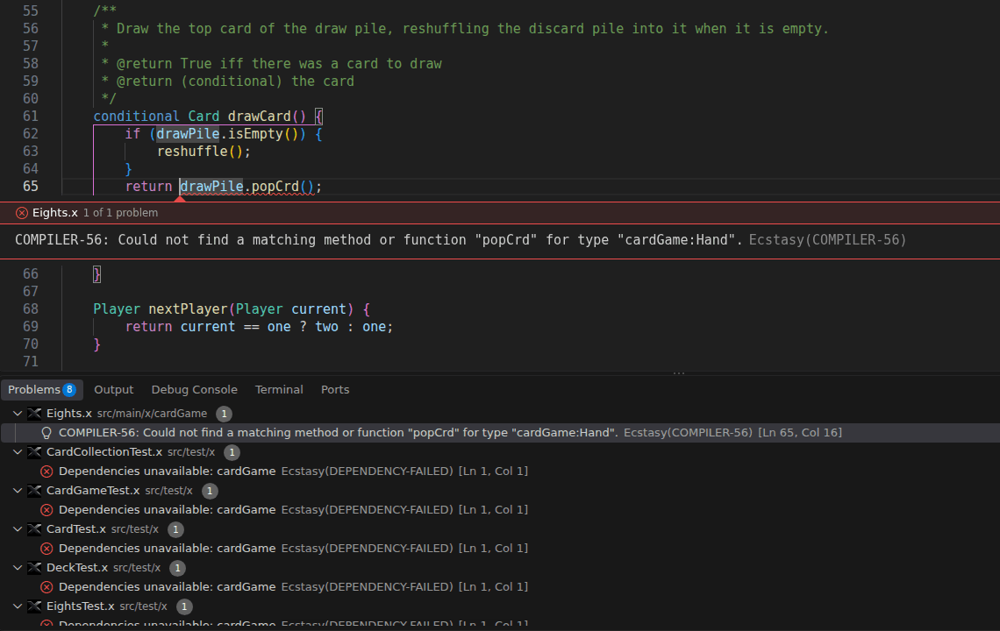
*VS Code: <kbd>F8</kbd> shows the compiler's message, `COMPILER-56`, under the line.*

</td></tr></table>

### In the whole project

Every problem of the project is in IntelliJ's **Problems** window and VS Code's **Problems** view
(<kbd>Ctrl+Shift+M</kbd>), each a click away from its code. That includes files you haven't opened: change a
method's signature, and its callers in other files and in the test modules are listed as errors
until you fix them. IntelliJ also draws such files red in the Project view.

<table><tr><td width="50%">

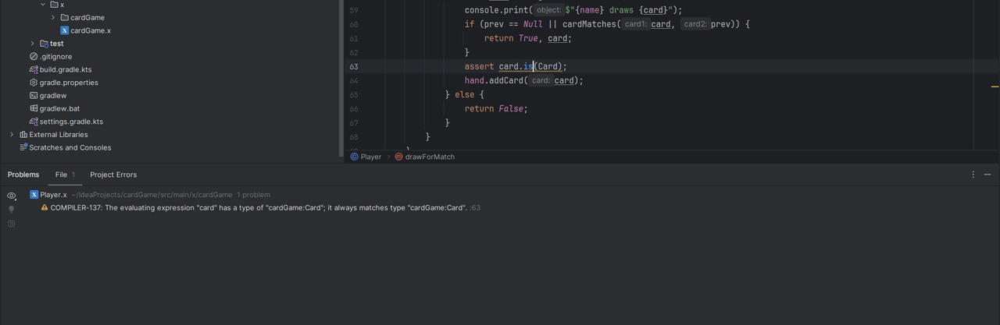
*IntelliJ: the Problems window lists the file's errors and warnings, and Project Errors the rest of the project's.*

</td><td width="50%">

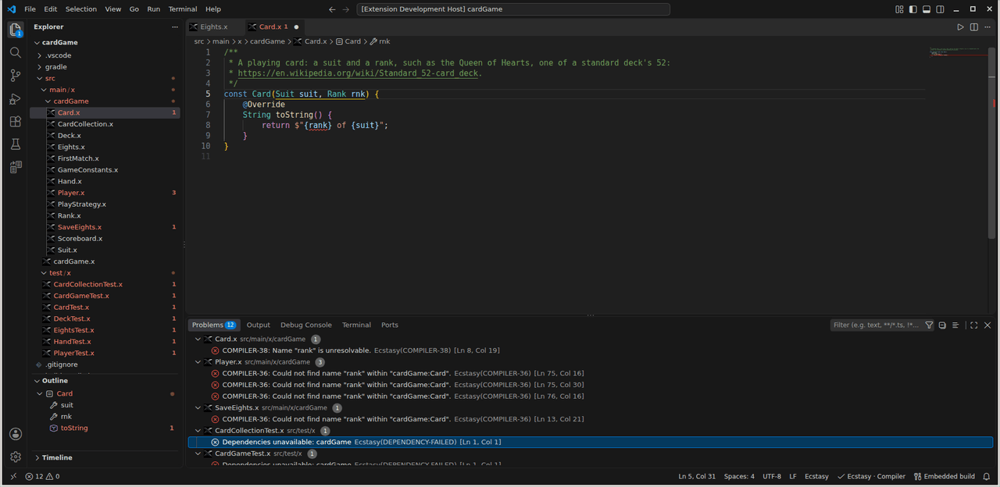
*VS Code: renaming `Card.rank` without saving breaks its uses in files that aren't open, and the test modules that depend on them; the Problems view lists them all.*

</td></tr></table>

## Navigating

| To | IntelliJ | VS Code |
|----|----------|---------|
| Open the declaration of what's under the cursor | <kbd>Ctrl+B</kbd> or <kbd>Ctrl</kbd>+click | <kbd>F12</kbd> or <kbd>Ctrl</kbd>+click |
| Open the declaration of its type | <kbd>Ctrl+Shift+B</kbd> | **Go to Type Definition** |
| List the implementations of an interface method | <kbd>Ctrl+Alt+B</kbd> | <kbd>Ctrl+F12</kbd> |
| Find every use, in all modules | <kbd>Alt+F7</kbd> | <kbd>Shift+Alt+F12</kbd> |
| See who calls a method | <kbd>Ctrl+Alt+H</kbd> | **Show Call Hierarchy** |
| See a class's supertypes and subtypes | <kbd>Ctrl+H</kbd> | **Show Type Hierarchy** |
| Find a class, method or property by name | <kbd>Ctrl+Alt+Shift+N</kbd> | <kbd>Ctrl+T</kbd> |

<table><tr><td width="50%">

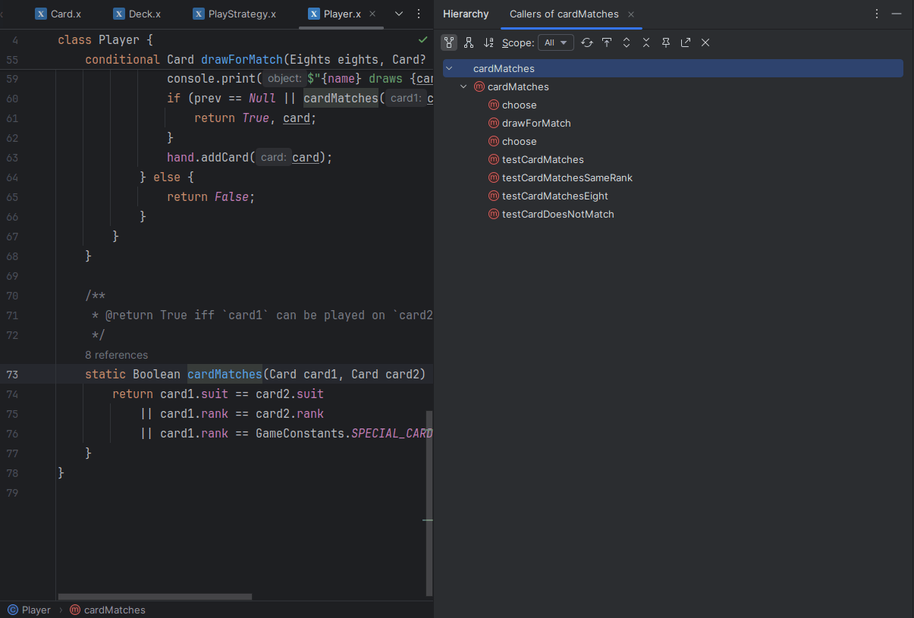
*IntelliJ: <kbd>Ctrl+Alt+H</kbd> on `cardMatches` lists its callers: the player, both strategies' `choose` and the tests.*

</td><td width="50%">

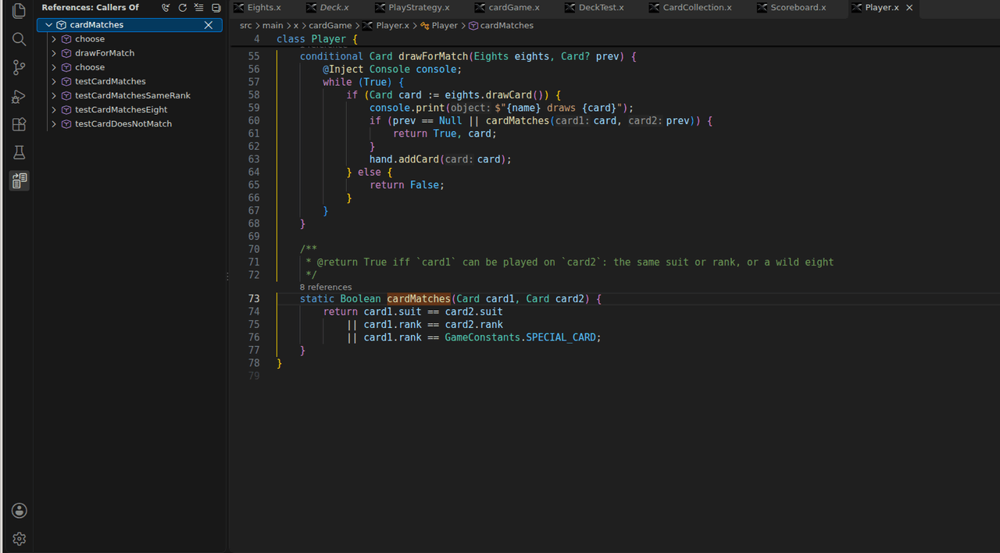
*VS Code: **Show Call Hierarchy** on `cardMatches` lists its callers in the side bar: the player, both strategies and the tests.*

</td></tr></table>

<table><tr><td width="50%">

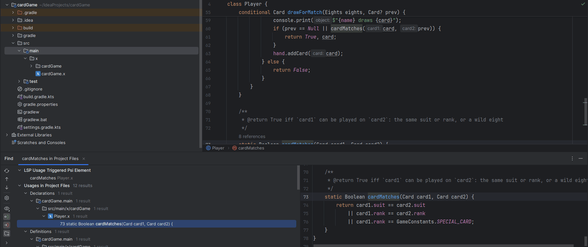
*IntelliJ: <kbd>Alt+F7</kbd> on `cardMatches` finds its uses, including those in the tests, in the Find window.*

</td><td width="50%">

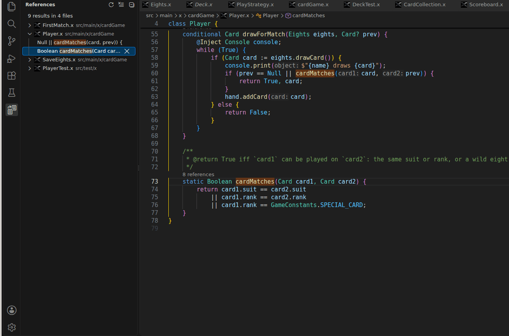
*VS Code: Find All References on `cardMatches` finds 9 uses in 4 files, including the tests.*

</td></tr></table>

### The XDK's sources

Navigation reaches into the XDK as well: going to `HashMap`'s declaration opens the `ecstasy`
module's source, read-only. In VS Code its names are links too, as the language server compiles the library's
sources when the first one opens; IntelliJ doesn't follow them yet, as LSP4IJ 0.30.1 doesn't navigate from a
read-only library source.

<table><tr><td width="50%">

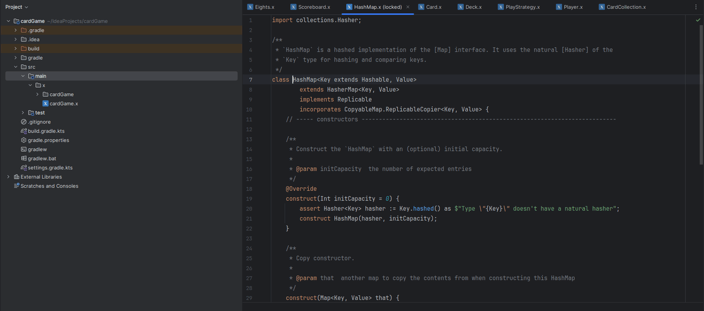
*IntelliJ: Go to Declaration on `HashMap` opens the XDK's source, read-only.*

</td><td width="50%">

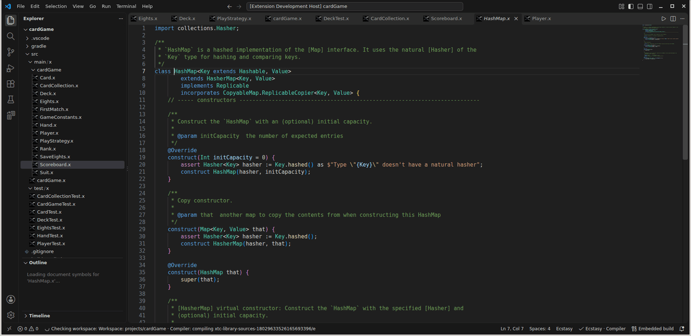
*VS Code: Go to Definition on `HashMap` opens the XDK's source, read-only; the status bar shows the server compiling the library's sources.*

</td></tr></table>

---

[← Getting started](getting-started.md) · [Contents](README.md) · [Refactoring →](refactoring.md)
