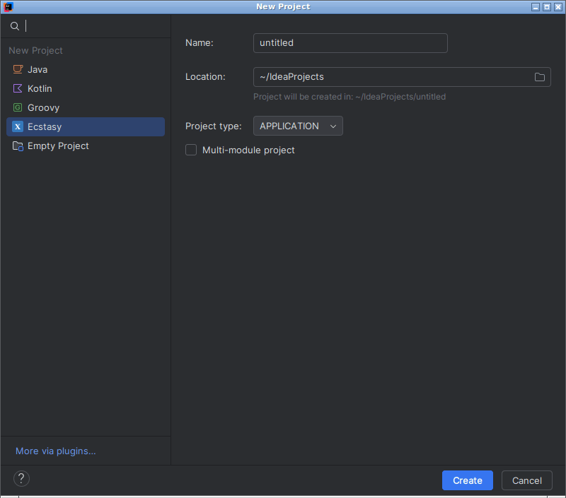
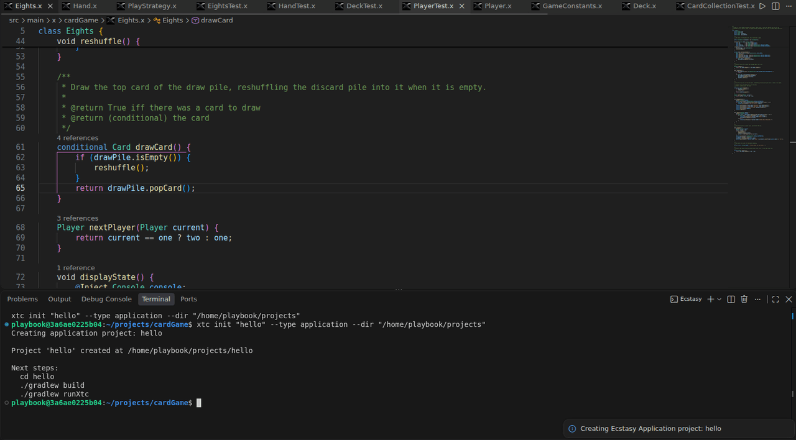
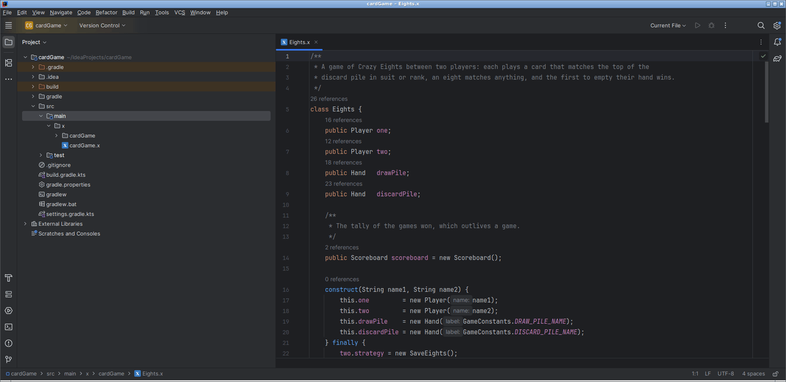
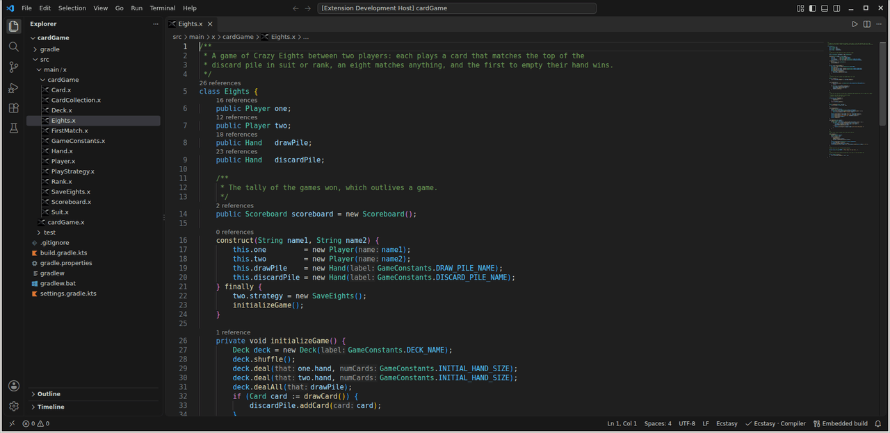

# Getting started

## Requirements

- **IntelliJ IDEA 2026.2 or later**, including the free edition. The plugin needs Red Hat's **LSP4IJ**
  plugin, which provides IntelliJ's language server and debug adapter client, and IntelliJ's bundled
  Gradle and TextMate plugins. The language server runs on IntelliJ's own Java runtime, so you don't
  need to install Java for it.
- **VS Code 1.140 or later.** The language server needs **Java 25 or later**. The extension looks for
  one (the `xtc.java.home` setting, `JAVA_HOME`, `PATH`, SDKMAN and other usual places), and when it
  finds none, it downloads one from Eclipse Adoptium once and keeps it.
- **An XDK, with `xtc` on your `PATH`**, only for some tasks: VS Code's **Ecstasy: Create New
  Project**, `xtc init` and `xtc run` in a terminal, and IntelliJ's command-line build mode. Editing,
  embedded builds, runs, tests and debugging use the XDK that comes with the plugin or extension.
  Snapshot XDKs are on the [XDK snapshot release](https://github.com/xtclang/xvm/releases/tag/xdk-snapshots).
- **For Gradle mode**, a Gradle build with its wrapper and the XTC Gradle plugin. It runs with the XDK
  that the build names.

## Install the IntelliJ plugin

1. Download the plugin ZIP from the
   [IntelliJ plugin snapshot release](https://github.com/xtclang/xvm/releases/tag/intellij-plugin-snapshots),
   or build it from this repository (see [Building from source](../../intellij-plugin/README.md#building-from-source)).
2. In IntelliJ, open **Settings | Plugins**, click the gear icon and choose **Install Plugin from
   Disk...**, then select the ZIP.
3. Restart IntelliJ when it asks. If it reports that LSP4IJ is missing, install **LSP4IJ** from the
   Marketplace first.

The [plugin README](../../intellij-plugin/README.md#installation) also covers the JetBrains Marketplace
and its release channels.

## Install the VS Code extension

1. Download `xtc-language-<version>.vsix` from the
   [VS Code extension snapshot release](https://github.com/xtclang/xvm/releases/tag/vscode-extension-snapshots),
   or build it (see [Building from source](../../vscode-extension/README.md#building-from-source)).
2. In the Extensions view, open the **...** menu and choose **Install from VSIX...**, or run
   `code --install-extension xtc-language-<version>.vsix`.
3. Reload VS Code when it asks.

VS Code's **Welcome** page then has a **Get Started with Ecstasy** walkthrough, which goes through
creating a project, building and running it, the build modes and the server's log.

The snapshots follow the `master` branch. To try changes that aren't there yet, build the plugin or
extension from your checkout.

## Open or create a project

An Ecstasy project is a folder of `.x` files. Open any folder that has them: the language server finds
the modules in it, and the modules they import, without any configuration. A project made by
`xtc init` also has a Gradle build, which Gradle mode uses.

To make a new one:

- **IntelliJ:** **File | New | Project**, then **Ecstasy**. Choose the project type (application,
  library or service) and whether it has several modules. The wizard makes the same project as
  `xtc init`, with the XTC Gradle plugin, and a run configuration for it. It doesn't need an XDK.
- **VS Code:** **Ecstasy: Create New Project** in the Command Palette (<kbd>Ctrl+Shift+P</kbd>) asks for a name,
  a type and a folder, and runs `xtc init` in a terminal.
- **A terminal:** `xtc init myApp --type application --dir ~/projects`.

<table><tr><td width="50%">


*IntelliJ: File | New | Project | Ecstasy makes the same project as `xtc init`.*

</td><td width="50%">


*VS Code: **Ecstasy: Create New Project** asks for a name, a kind and a folder, and runs `xtc init` in the terminal.*

</td></tr></table>

To follow the screenshots, use the card game that the tours use, a two-player game of Crazy Eights
with tests. It is a project that `xtc init` makes, with the card game's sources in place of its own.
You need `xtc` on your `PATH` and a checkout of the [xvm repository](https://github.com/xtclang/xvm);
run this from the checkout's root:

```bash
xtc init cardGame --dir ~/projects
rm -rf ~/projects/cardGame/src
cp -R lang/test-fixtures/tour/cardGame/src ~/projects/cardGame/
```

Open `~/projects/cardGame` in either editor.

<table><tr><td width="50%">


*IntelliJ with the card game open. The plugin starts its language server, with the XDK bundled.*

</td><td width="50%">


*VS Code with the card game open. The status bar shows `✓ Ecstasy · Compiler` once the server is ready, and the build mode, `Embedded build`.*

</td></tr></table>

## Your first five minutes

Open `src/main/x/cardGame/Eights.x`, then try these in order.

1. **See an error as you type.** Misspell a method name in a call. The compiler marks it at once,
   before you save; hover it, or press <kbd>Ctrl+F1</kbd> in IntelliJ, to read the message. Undo the change.
2. **Complete a name.** Type a variable's name and a dot, such as `deck.`: completion lists the
   members of its type, with their types. <kbd>Ctrl+Space</kbd> opens the list anywhere.
3. **Read documentation.** Hover over a method name, or press <kbd>Ctrl+Q</kbd> (IntelliJ) or <kbd>Ctrl+K</kbd> <kbd>Ctrl+I</kbd>
   (VS Code), for its signature and doc comment.
4. **Go to a definition.** <kbd>Ctrl</kbd>+click a call, or press <kbd>Ctrl+B</kbd> (IntelliJ) or <kbd>F12</kbd> (VS Code), to open
   the method it calls. It works for the XDK's types too, whose sources open read-only.
5. **Run the program.** Open `src/main/x/cardGame.x` and click the Run icon in the gutter (IntelliJ)
   or the **▶ Run** lens above `module cardGame` (VS Code). The game runs in the Run window or a
   terminal; press <kbd>Enter</kbd> to play each turn.
6. **Debug it.** Click in the gutter beside a line of `Deck.x` to set a breakpoint, then press
   <kbd>Shift+F9</kbd> (IntelliJ) or <kbd>F5</kbd> (VS Code). The program stops at the breakpoint, and the debugger shows
   its frames and variables. Step with <kbd>F8</kbd> and <kbd>F7</kbd> (IntelliJ) or <kbd>F10</kbd> and <kbd>F11</kbd> (VS Code), and continue
   with <kbd>F9</kbd> (IntelliJ) or <kbd>F5</kbd> (VS Code).
7. **Run a test.** Open `src/test/x/DeckTest.x`. Click the test icon in the gutter beside
   `module DeckTest` and choose Run (IntelliJ), or click its run icon (VS Code). Each test's result
   shows in the test runner or the Testing view.

---

[Contents](README.md) · [Editing and navigation →](editing-and-navigation.md)
