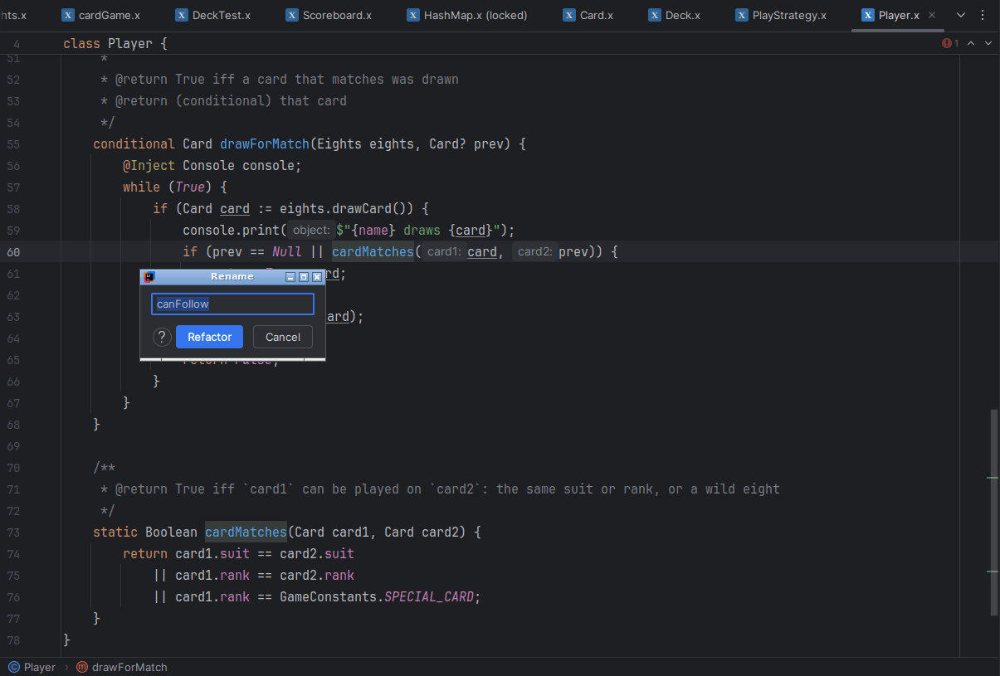
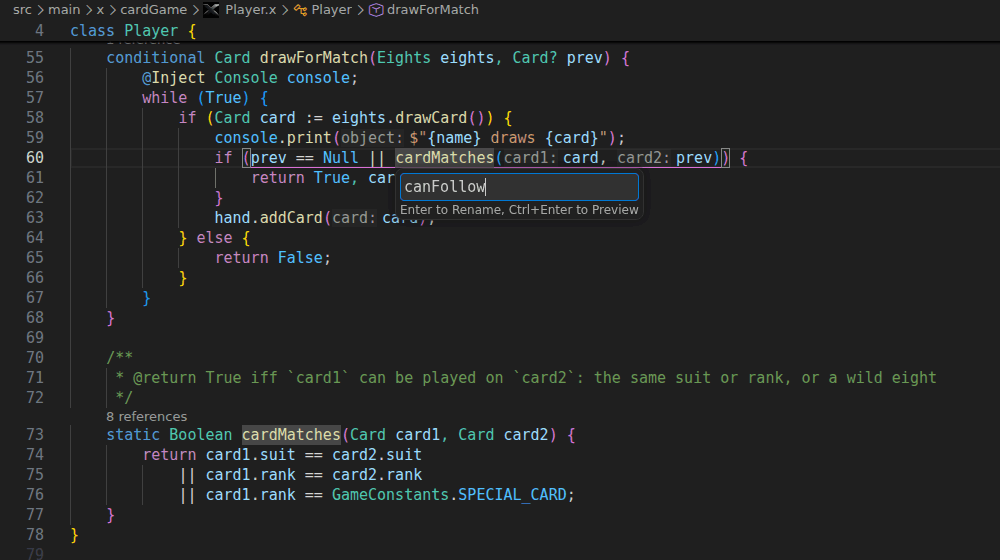
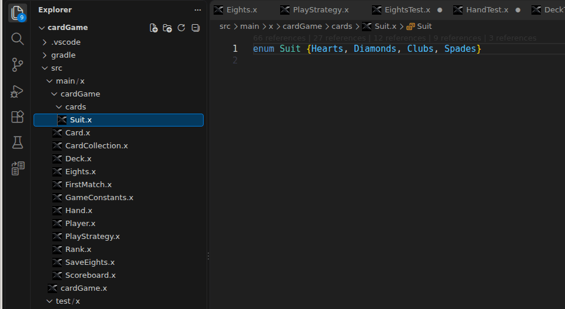
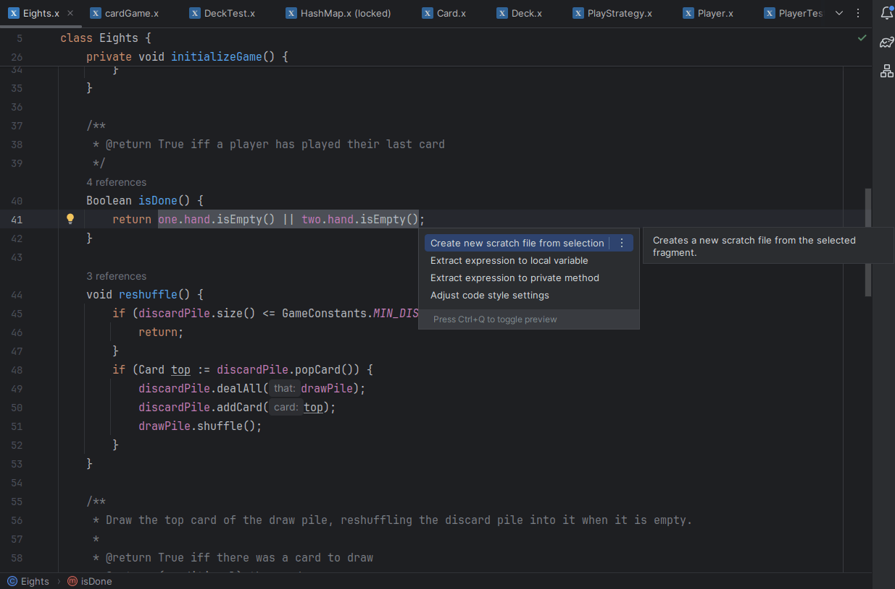
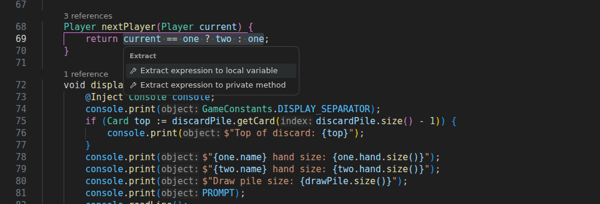
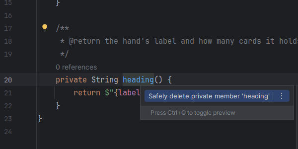
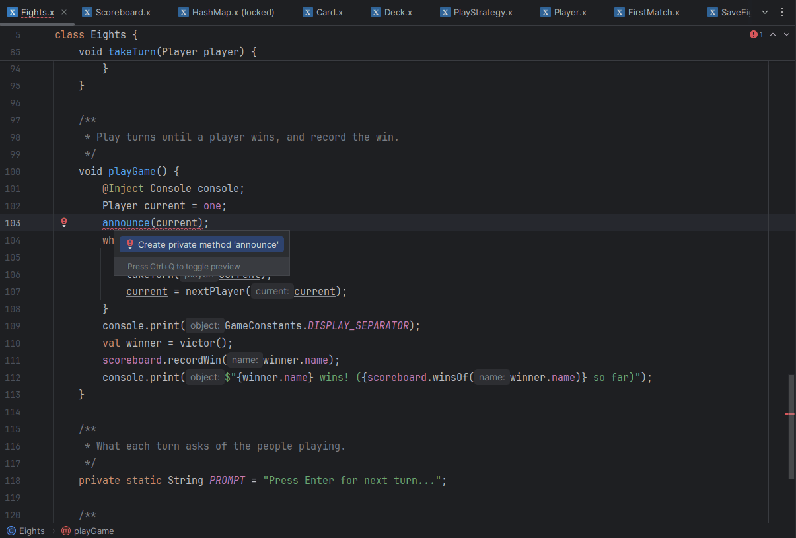
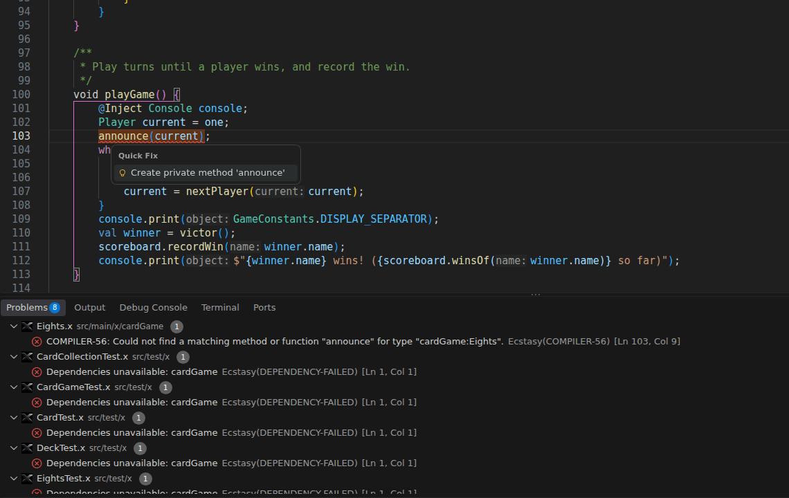

# Refactoring

Every refactoring is checked before anything changes: the language server recompiles everything the
change touches and compares what each name refers to before and after. When it can't prove that the
program still means the same, it doesn't offer the change, or refuses it with the reason, rather than
leave your code broken.

## Rename

Press <kbd>Shift+F6</kbd> (IntelliJ) or <kbd>F2</kbd> (VS Code) on a method, property, local, parameter or type, and type the
new name. The rename changes the declaration and every use, in every module of the project, tests
included.

<table><tr><td width="50%">

*IntelliJ: <kbd>Shift+F6</kbd> on `cardMatches` renames it, here to `canFollow`.*

</td><td width="50%">

*VS Code: <kbd>F2</kbd> on `cardMatches` renames it, here to `canFollow`; the server checks the new name before anything changes.*

</td></tr></table>

Renaming a class renames its file, since Ecstasy keeps one type per file, and renaming a file in the
Project view or Explorer renames its type. Undo takes a rename back in one step: IntelliJ first asks,
as it does for any change of several files; VS Code takes it back in all files at once and leaves
them unsaved.

## Move

Moving a file to another package's folder moves its type, and every use follows: the server rewrites
qualified names and imports, also in files that aren't open. In IntelliJ, use **Refactor | Move** (<kbd>F6</kbd>) or
drag the file in the Project view; in VS Code, cut and paste or drag it in the Explorer.

*VS Code: `Suit` moved to the `cards` package in the Explorer; the files that use it are rewritten, as their tabs show.*

## Extract, inline and safe delete

These are code actions: select the code, or put the cursor on it, then press <kbd>Alt+Enter</kbd> (IntelliJ) or
<kbd>Ctrl+.</kbd> (VS Code); VS Code also lists the refactorings of a selection with <kbd>Ctrl+Shift+R</kbd>.

- **Extract expression to local variable** or **to private method**, for a whole returned expression
  or a typed local's initializer. The new local has the type the compiler gives the expression.
- **Extract statements to private method**, for consecutive statements.
- **Inline** a local that is used once, in the statement after it, or whose value the compiler proves
  constant; a private method's call (**Inline private method call**, or **Inline and remove private
  method**); or a constant (**Inline constant property**).
- **Safely delete private member**, for one that nothing uses; a public member that no module of the
  project uses can be deleted too.

<table><tr><td width="50%">

*IntelliJ: <kbd>Alt+Enter</kbd> on a selected expression offers to extract it to a local or a private method.*

</td><td width="50%">

*VS Code: <kbd>Ctrl+Shift+R</kbd> on a returned expression offers to extract it to a local or a private method.*

</td></tr></table>

*IntelliJ: <kbd>Alt+Enter</kbd> on `heading`, a private method that nothing uses, offers to delete it safely.*

## Quick fixes and imports

On an error, <kbd>Alt+Enter</kbd> (IntelliJ) or <kbd>Ctrl+.</kbd> (VS Code) offers its fixes:

- **Create private method** or **Create public method** for a call to a method that doesn't exist yet,
  with the parameter types the call implies.
- **Create class** for a `new` of a class that doesn't exist yet, in the same module.
- **Import** for a type of another module that isn't imported.
- **Remove unused import** and **Remove unused local variable**.

<table><tr><td width="50%">

*IntelliJ: <kbd>Alt+Enter</kbd> on a call of `announce`, which doesn't exist yet, offers to create it.*

</td><td width="50%">

*VS Code: <kbd>Ctrl+.</kbd> on the call of `announce`, which doesn't exist yet, offers to create it.*

</td></tr></table>

**Organize imports**, <kbd>Ctrl+Alt+O</kbd> (IntelliJ) or <kbd>Shift+Alt+O</kbd> (VS Code), removes unused imports and sorts
the rest. **Generate documentation comment**, on a declaration, writes a doc comment with its
parameters and return value.

---

[← Editing and navigation](editing-and-navigation.md) · [Contents](README.md) · [Building and running →](building-and-running.md)
