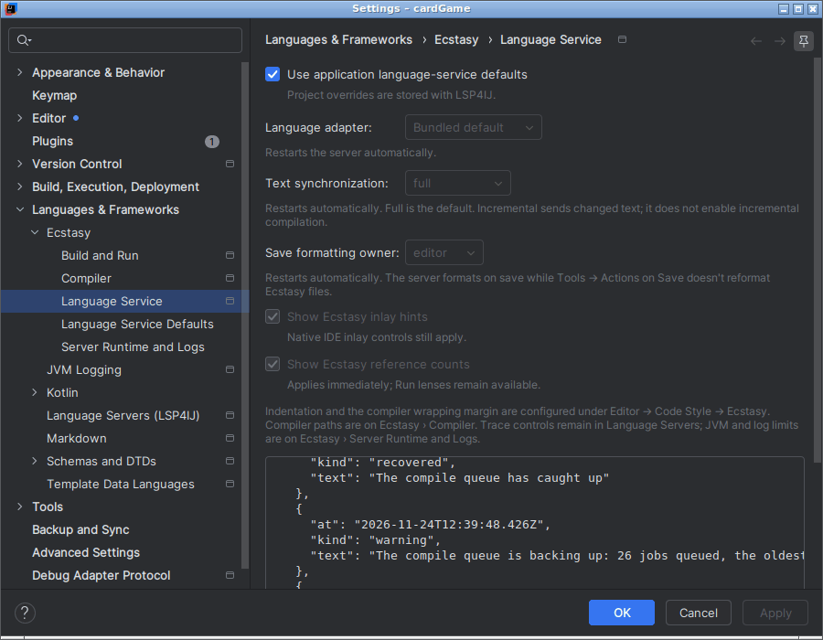
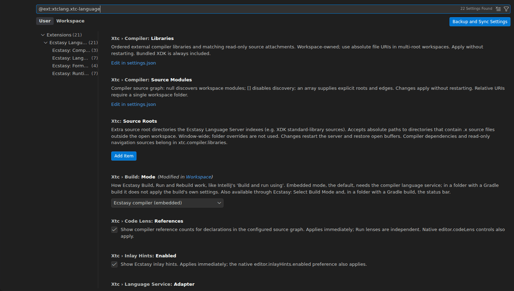
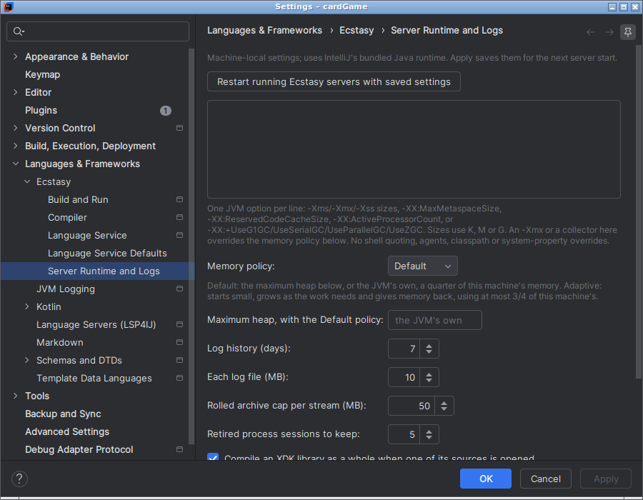
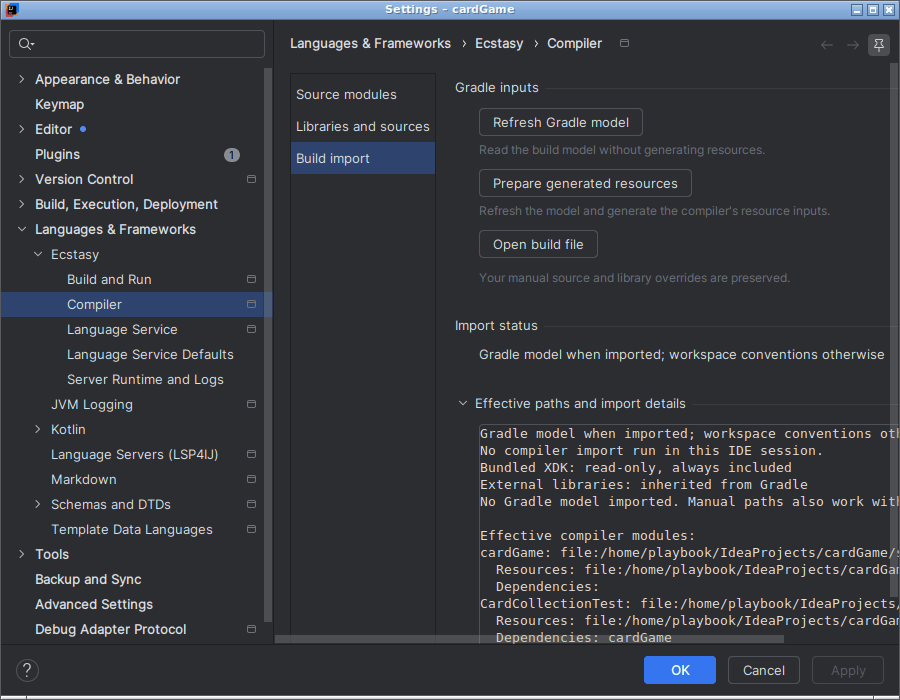
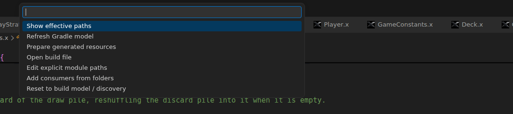
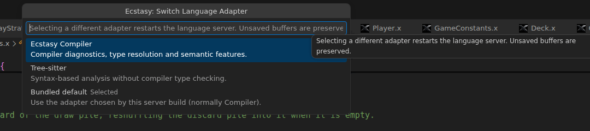
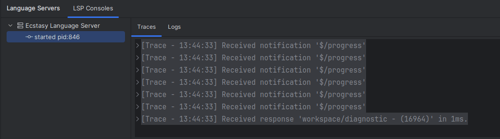
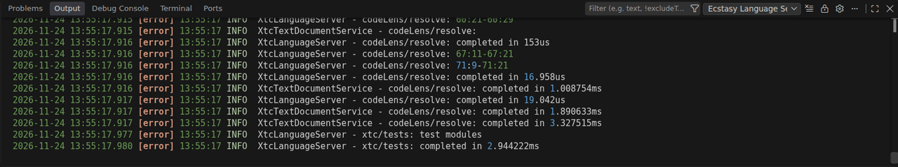

# Settings, troubleshooting and limitations

## Settings that matter

The [configuration reference](../configuration.md) lists every setting. These are the ones you are
most likely to change. In IntelliJ, every page of the plugin is under **Settings | Languages &
Frameworks | Ecstasy**, which links each of them.

| What | IntelliJ | VS Code |
|------|----------|---------|
| Build mode | **Settings \| Languages & Frameworks \| Ecstasy \| Build and Run**, or <kbd>Ctrl+Alt+X</kbd>, then <kbd>B</kbd> | `xtc.build.mode`, or <kbd>Ctrl+Alt+X</kbd>, then <kbd>B</kbd> |
| Language adapter: compiler or Tree-sitter | **Tools \| Switch Ecstasy Language Adapter**, or <kbd>Ctrl+Alt+X</kbd>, then <kbd>A</kbd> | **Ecstasy: Switch Language Adapter**, <kbd>Ctrl+Alt+X</kbd>, then <kbd>A</kbd>, or the status bar |
| Inlay hints, reference counts | **Settings \| Languages & Frameworks \| Ecstasy \| Language Service** | `xtc.inlayHints.enabled`, `xtc.codeLens.references` |
| Indentation, line width and comment wrapping | **Settings \| Editor \| Code Style \| Ecstasy** | `xtc.formatting.*` |
| The server's memory and logs | **Settings \| Languages & Frameworks \| Ecstasy \| Server Runtime and Logs**: the memory policy, a maximum heap, JVM options, logs | `xtc.server.memoryPolicy`, `xtc.server.maxHeap`, `xtc.java.vmOptions`, `xtc.server.logs`, in user settings |
| The Java that runs the server | IntelliJ's own | `xtc.java.home` |
| Which modules the compiler builds, and libraries | **Settings \| Languages & Frameworks \| Ecstasy \| Compiler** | **Ecstasy: Configure Compiler Paths**, **Ecstasy: Configure Libraries and Sources** |

In VS Code, **Ecstasy: Open Language Service Settings** opens the extension's settings. Without any
of these settings, the compiler finds the project's modules itself, from its folders or its Gradle
build, and uses the XDK it comes with.

The language adapter and the server's runtime settings restart the server, which reopens your
unsaved files; the others apply at once.

<table><tr><td width="50%">

*IntelliJ: **Settings | Languages & Frameworks | Ecstasy | Language Service**: the language adapter, text
synchronization, who formats on save, inlay hints and reference counts, then the running server's effective
configuration.*

</td><td width="50%">

*VS Code: **Ecstasy: Open Language Service Settings** shows the extension's settings, in four groups.*

</td></tr></table>

<table><tr><td>

*IntelliJ: **Settings | Languages & Frameworks | Ecstasy | Server Runtime and Logs**: the server's JVM options, its
memory policy and maximum heap, and how long its logs are kept, with a button that restarts running servers with
the saved settings.*

</td></tr></table>

<table><tr><td width="50%">

*IntelliJ: **Settings | Languages & Frameworks | Ecstasy | Compiler**: what the compiler builds, from the project's
layout or its Gradle build, with buttons that import the Gradle model again.*

</td><td width="50%">

*VS Code: **Ecstasy: Configure Compiler Paths**, from the Command Palette, offers the same choices as IntelliJ's
Compiler page.*

</td></tr></table>

<table><tr><td>

*VS Code: <kbd>Ctrl+Alt+X</kbd>, then <kbd>A</kbd>, or a click on Ecstasy in the status bar, switches the server's adapter. IntelliJ's
**Tools | Switch Ecstasy Language Adapter**, or the same keys, opens the same choice in a popup.*

</td></tr></table>

## Troubleshooting

When something doesn't work as you expect, look at the language server first.

### The language server

- **Its state.** VS Code's status bar item, and **Ecstasy: Show Effective Language Service
  Configuration**, which reports the settings the server runs with and what it found. In IntelliJ,
  the **Ecstasy | Language Service** settings page shows the running server's configuration, and
  LSP4IJ's **Language Servers** window its state and traces.
- **Its log.** <kbd>Ctrl+Alt+X</kbd>, then <kbd>L</kbd> shows the server's log, and again hides it: IntelliJ's **Tools |
  Toggle Ecstasy Language Server Log**, VS Code's **Ecstasy: Show Language Server Output**. Each
  server also writes its log to `~/.xtc/logs/lsp/server-<pid>-<start>/server.log`. VS Code marks
  every line of the server's log `[error]`, as the server writes it to its standard error; the level
  after the time, such as `INFO`, is the line's real one.
- **Restart it.** <kbd>Ctrl+Alt+X</kbd>, then <kbd>R</kbd>: IntelliJ's **Tools | Restart Ecstasy Language Server**, VS
  Code's **Ecstasy: Restart Language Server**. Unsaved changes are kept. If the server's process
  dies, both editors start it again; should VS Code give up after it fails again and again, a click on the status
  bar item starts it.
- **Export its logs.** IntelliJ's **Tools | Export Ecstasy Server Logs** and VS Code's **Ecstasy:
  Export Server Logs** save the server's recent logs, timing traces and status as one ZIP file, to
  attach to an [issue](https://github.com/xtclang/xvm/issues). It holds no source files, but it may
  hold local paths and error messages.

<table><tr><td width="50%">

*IntelliJ: LSP4IJ's Language Servers window shows the server's state, its traces and its logs.*

</td><td width="50%">

*VS Code: <kbd>Ctrl+Alt+X</kbd>, then <kbd>L</kbd> shows the language server's log.*

</td></tr></table>

### Common problems

| Symptom | What to do |
|---------|------------|
| No errors, completion or navigation | Check the server's state and log. Make sure the adapter is the compiler (<kbd>Ctrl+Alt+X</kbd>, then <kbd>A</kbd>). |
| VS Code: wrong Java, or none | Set `xtc.java.home` to a Java 25 or later installation. |
| A Gradle build's settings don't apply to a run | The project builds embedded, which takes only some run settings from Gradle; see [Gradle settings in embedded runs](building-and-running.md#gradle-settings-in-embedded-runs). Refresh the model, move task-only settings to `xtcRun`, or choose Gradle with <kbd>Ctrl+Alt+X</kbd>, then <kbd>B</kbd>. |
| Gradle mode can't find `runXtc` or `testXtc` | The project's Gradle build needs the XTC Gradle plugin; IntelliJ also needs the Gradle build linked. |
| A breakpoint is unverified | The line changed since the program was built, or has no code; debug again. |
| **Ecstasy: Create New Project** fails | Install an XDK and put its `xtc` on your `PATH`. |
| The server runs short of memory on a large project | Choose the **Adaptive** memory policy, which grows the heap as the work needs and gives memory back, or a larger maximum heap with the Default policy, in the runtime settings above, and restart it. |

## Known limitations

### Editing

- The formatter doesn't split string literals. It refills only comments with `/**` or `/*` and `*/` on lines of
  their own, and only with comment wrapping on; `//` comments keep their lines.
- The Tree-sitter adapter knows only syntax: no type errors, no type-aware completion or checked
  refactorings, and no embedded builds or runs.

### Refactoring

- Rename, move and safe delete cover the modules the language server knows of. When one of them
  changes a public declaration, which modules in other folders may use (a move changes its type's
  qualified name), a notification says that those modules are not changed. To include them, add them with
  **Add consumers from folders** (IntelliJ's **Ecstasy | Compiler** page, VS Code's **Ecstasy:
  Configure Compiler Paths**); a project whose Gradle model is imported has all of its build's modules
  already.
- A rename checks that every name in the compiled code still means the same declaration. It doesn't
  change, or check, what no name in the code carries: a name in a string or a comment, or one built
  at run time to look a member up by reflection; an `is` check against an interface, which matches a
  class by its members' names; and the keys a renamed property's value gets in JSON or other data
  that the program writes and reads back.

### Building, running and testing

- VS Code has no `xtc` command-line build mode; use embedded or Gradle.
- IntelliJ's **Run 'All Ecstasy Tests'** has no Debug yet.
- In embedded mode, a Gradle build applies only through its run settings; see
  [Gradle settings in embedded runs](building-and-running.md#gradle-settings-in-embedded-runs).

### Debugging

- A program being debugged keeps the code it was built from: edits apply the next time you run it.
- Code run from the Debug Console or Evaluate Expression stops after two seconds, and a lazy value
  after one, by default. To give them longer, set `evaluationTimeLimit` and `lazyValueTimeLimit`, in
  milliseconds, in VS Code's launch configuration, or **Evaluation time limit (ms)** and **Lazy value
  time limit (ms)** in IntelliJ's Ecstasy Application or Ecstasy Attach configuration. IntelliJ can't
  cancel an evaluation sooner, so Evaluate Expression waits out the whole limit for code that never
  ends.

The [manual test plan](../manual-test-plan.md#client-compatibility-limits) lists the remaining
differences between the editors in detail.

---

[← The debugger](debugging.md) · [Contents](README.md)
