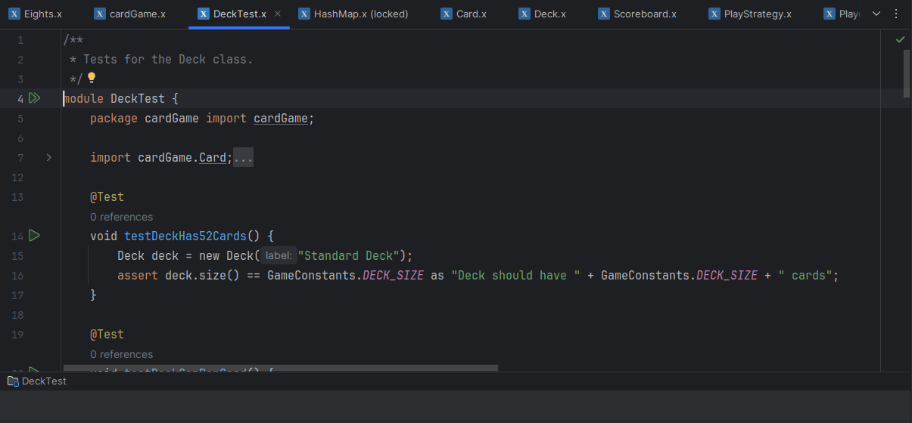
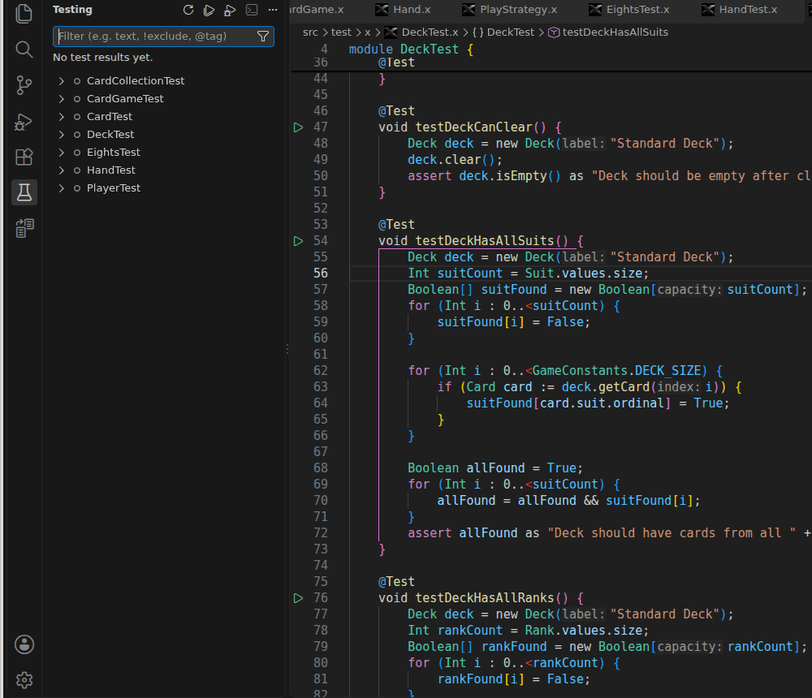
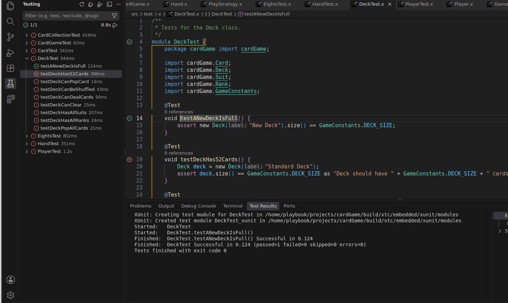
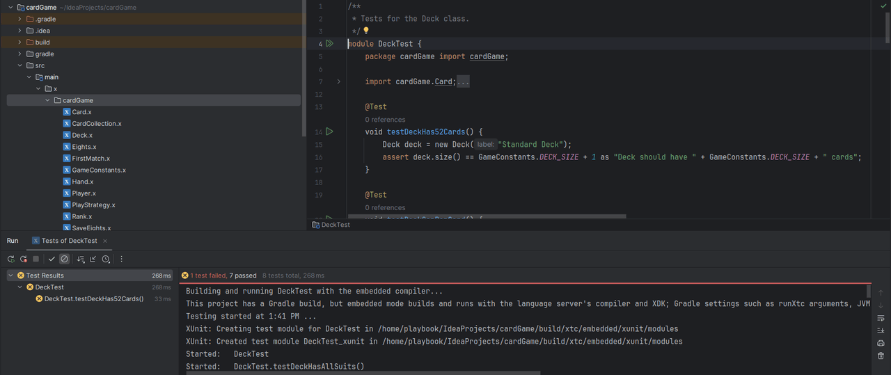
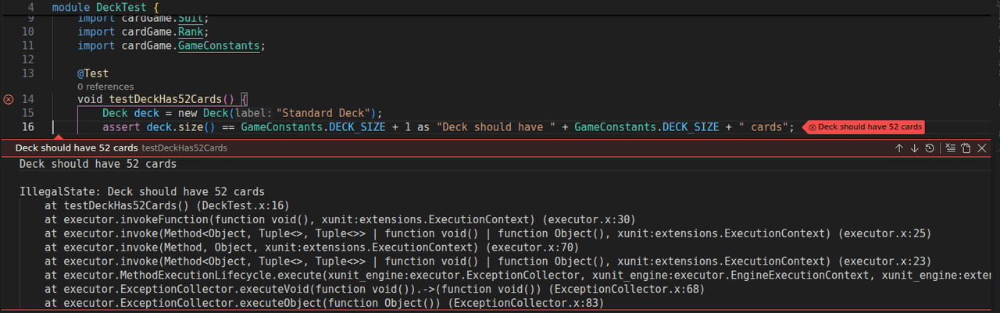
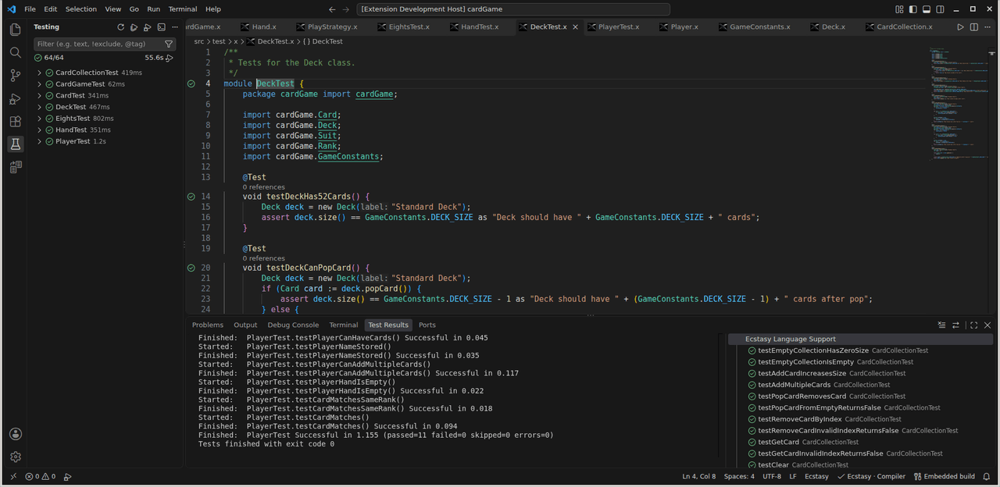
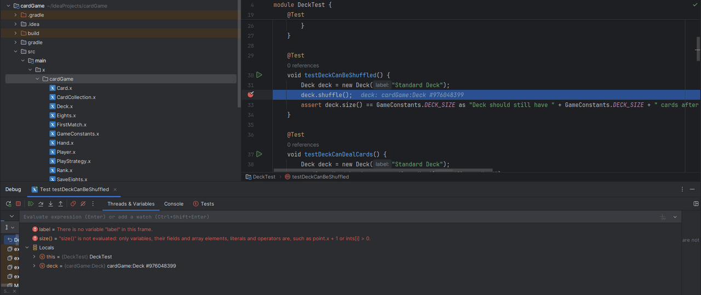
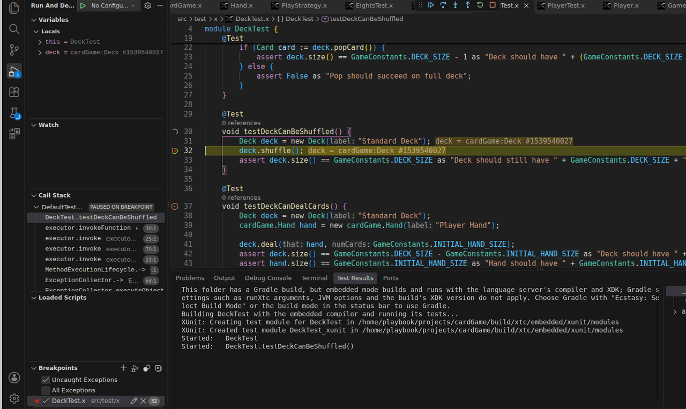
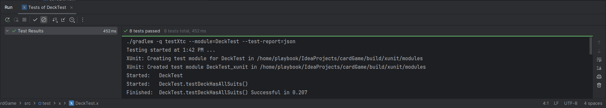
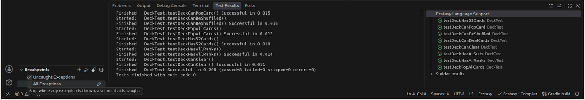

# Testing with xunit

Ecstasy's test framework is [xunit](../../../lib_xunit/README.md). Both editors find a project's tests
as you write them, run and debug them in every build mode, and show their results in their own test
views.

## Write a test

A test is a method or function annotated `@Test`. The annotation is part of Ecstasy's core library,
so a simple test needs no import, and tests can sit in a module, a package or a class. A project
usually keeps them in test modules of their own under `src/test/x`, each importing the module it
tests, as the card game's `DeckTest` does:

```ecstasy
module DeckTest {
    package cardGame import cardGame;

    import cardGame.Deck;
    import cardGame.GameConstants;

    @Test
    void testDeckHas52Cards() {
        Deck deck = new Deck("Standard Deck");
        assert deck.size() == GameConstants.DECK_SIZE as "Deck should have " + GameConstants.DECK_SIZE + " cards";
    }
}
```

`assert … as "message"` fails the test with that message. For more, import xunit
(`package xunit import xunit.xtclang.org;`) and use its annotations: `@BeforeEach`, `@AfterEach`,
`@BeforeAll` and `@AfterAll` around tests, `@Disabled("why")` to skip one, `@DisplayName` for its
name in the results, and `@TestFixture` for a test class's lifecycle. [xunit's
README](../../../lib_xunit/README.md) describes them all.

## Find and run tests

The language server finds the tests of each module as you write them: every `@Test` method, and the
classes, packages and modules that hold them. Each has a test icon in the gutter, and VS Code's
**Testing** view lists them in a tree. A test you write while the project is open shows as soon as
the server has read it, with no restart.

<table><tr><td width="50%">


*IntelliJ: a test icon beside every test module and every `@Test` method.*

</td><td width="50%">


*VS Code: the **Testing** view lists the test modules and their tests; the gutter has a run icon on each.*

</td></tr></table>

- **Run or debug a test, or everything a module, package or class holds.** In IntelliJ, click the
  test icon and choose Run or Debug. In VS Code, click the gutter icon to run (right-click to debug),
  use the Testing view, or **Test: Run Test at Cursor** and **Test: Debug Test at Cursor**.
- **Run every test module's tests**: **Run 'All Ecstasy Tests'** in IntelliJ's Project window, on
  the project folder or its test sources; **Run All Tests** in VS Code's Testing view.

<table><tr><td>



*VS Code: `testANewDeckIsFull`, written while the project is open, is in the Testing view with its gutter icon, and runs.*

</td></tr></table>

## Read the results

Each test passes, fails, errs (it threw something other than a failed assertion) or is skipped, as
a `@Disabled` one is. A failure shows its message at the line that failed, with its stack, and the
tests' output is with the results.

<table><tr><td width="50%">


*IntelliJ: the gutter's test icons run `DeckTest`, embedded, and the test runner shows each test's result and output; one was made to fail.*

</td><td width="50%">


*VS Code: a failing test's message shows at the line that failed, with its stack.*

</td></tr></table>

<table><tr><td>



*VS Code: Run All Tests runs every module's tests; the Testing view and the gutter show each result, and Test Results what they printed.*

</td></tr></table>

## Rerun and debug tests

- **Rerun the failed tests**: IntelliJ's **Rerun Failed Tests**, VS Code's **Test: Rerun Failed Tests**.
  After Run 'All Ecstasy Tests', IntelliJ reruns each module's failed tests in that module; in Gradle
  mode, that needs the imported Gradle model, which names each module's project (**Refresh Gradle
  model** on the **Ecstasy | Compiler** page).
- **Debug a test**: Debug on its icon, or **Test: Debug Test at Cursor**, runs it under the debugger,
  which stops at the test's breakpoints as at a program's; everything in [the debugger](debugging.md)
  works there.

<table><tr><td width="50%">


*IntelliJ: Debug on a test's icon stops at its breakpoint, here before the shuffle.*

</td><td width="50%">


*VS Code: **Test: Debug Test at Cursor** stops at the same kind of breakpoint, with the test's variables and stack.*

</td></tr></table>

## Tests and the build mode

The build mode applies to tests as to runs:

| Build mode | How tests run |
|------------|---------------|
| Embedded | With xunit in a process of the language server's own, against the XDK and xunit that the server comes with, not a version that the project's Gradle build may choose. Its compiled test modules are under `build/xtc/embedded/xunit`. |
| Gradle | The XTC plugin's `testXtc` for the chosen tests, with the build's own XDK and xunit; xunit's results come back to the same views. |
| Command line (IntelliJ) | `xtc test`, for the module's tests. |

<table><tr><td width="50%">


*IntelliJ, Gradle mode: the same icons run `testXtc`, here `--module=DeckTest`, into the same test runner.*

</td><td width="50%">


*VS Code, Gradle mode: the Testing view runs `testXtc`, and the results come back to it.*

</td></tr></table>

## When tests don't show or don't run

- **No test icons in a test module**: the module doesn't parse, and its syntax errors are in the
  Problems view (a type error alone still lists its tests); or its tests are where xunit can't run
  them, in a non-static inner class or a special class such as an enum.
- **`Dependencies unavailable` on a test module**: the module it tests has errors; fix those first.
- **The XVM repository's own tests** run with Gradle, as builds and runs do there, since its modules
  replace the bundled libraries.

---

[← Building and running](building-and-running.md) · [Contents](README.md) · [The debugger →](debugging.md)
